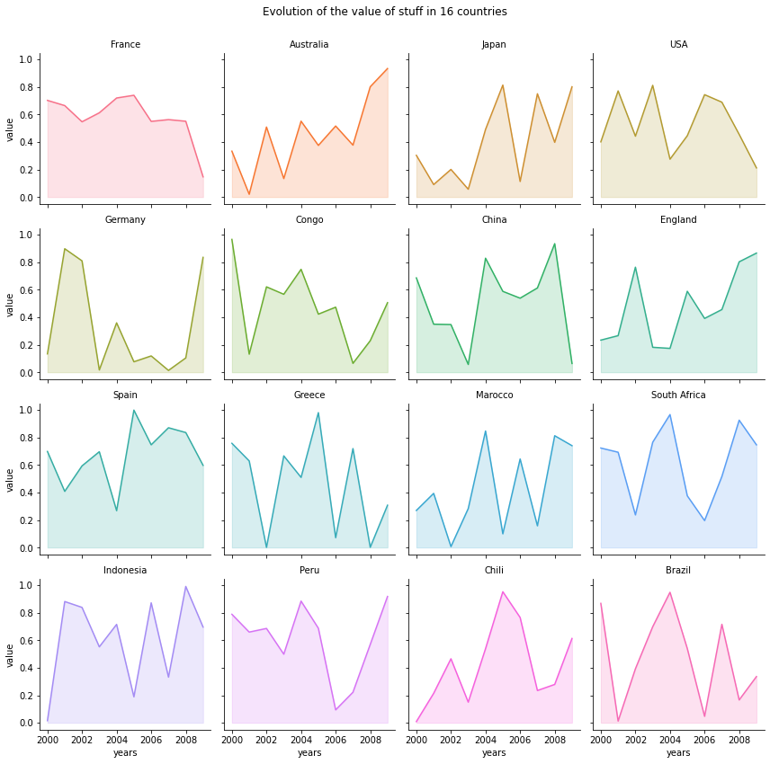

I believe that [area charts](http://python-graph-gallery.com/area-plot/) are especially useful when used through **faceting**. It allows to quickly find out the different patterns existing in the data. This example relies on a pandas data frame. We have **2 numerical** variables (year and value of something), and a **categorical** variable (the country). The area charts are created using the `fill_between()` function of matplotlib. The faceting is made using the awesome `FacetGrid()` utility of seaborn. The parameter given to the `FacetGrid()` are:
* `data` : Tidy (“long-form”) dataframe
* `col` : Variables that define subsets of the data, which will be drawn on separate facets in the grid
* `hue` : Variables that define subsets of the data, which will be drawn on separate facets in the grid
* `col_wrap` : “Wrap” the column variable at this width, so that the column facets span multiple rows

```python
# libraries
import numpy as np
import seaborn as sns
import pandas as pd
import matplotlib.pyplot as plt
 
# Create a dataset
my_count=["France","Australia","Japan","USA","Germany","Congo","China","England","Spain","Greece","Marocco","South Africa","Indonesia","Peru","Chili","Brazil"]
df = pd.DataFrame({
"country":np.repeat(my_count, 10),
"years":list(range(2000, 2010)) * 16,
"value":np.random.rand(160)
})
 
# Create a grid : initialize it
g = sns.FacetGrid(df, col='country', hue='country', col_wrap=4, )

# Add the line over the area with the plot function
g = g.map(plt.plot, 'years', 'value')
 
# Fill the area with fill_between
g = g.map(plt.fill_between, 'years', 'value', alpha=0.2).set_titles("{col_name} country")
 
# Control the title of each facet
g = g.set_titles("{col_name}")
 
# Add a title for the whole plot
plt.subplots_adjust(top=0.92)
g = g.fig.suptitle('Evolution of the value of stuff in 16 countries')

# Show the graph
plt.show()
```

:::output

:::
