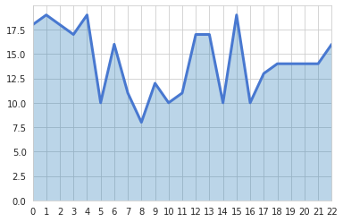

You can change the figure style of a matplotlib graph using seaborn library. The example below uses 'white grid' style. This chart has been found on [stack overflow](https://stackoverflow.com/questions/24547047/how-to-make-matplotlib-graphs-look-professionally-done-like-this), proposed by [mwaskom](https://stackoverflow.com/users/1533576/mwaskom).

```python
# libraries
import numpy as np
import seaborn as sns
import matplotlib.pyplot as plt

# set the seaborn style
sns.set_style("whitegrid")
 
# Color palette
blue, = sns.color_palette("muted", 1)
 
# Create data
x = np.arange(23)
y = np.random.randint(8, 20, 23)
 
# Make the plot
fig, ax = plt.subplots()
ax.plot(x, y, color=blue, lw=3)
ax.fill_between(x, 0, y, alpha=.3)
ax.set(xlim=(0, len(x) - 1), ylim=(0, None), xticks=x)

# Show the graph
plt.show()
```

:::output

:::
