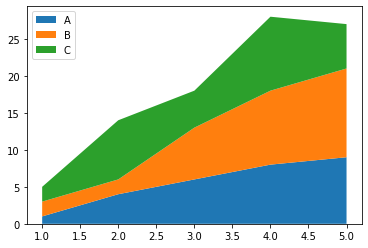

A basic stacked area chart can be plotted by the `stackplot()` function of matplotlib. The parameters passed to the function are:
* `x` : x axis positions
* `y` : y axis positions
* `labels` : labels to assign to each data series

Note that for `y` input, as you can give a sequence of arrays, you can also give multiple arrays. The example below shows both ways.

```python
# libraries
import numpy as np
import matplotlib.pyplot as plt
 
# --- FORMAT 1
 
# Your x and y axis
x=range(1,6)
y=[ [1,4,6,8,9], [2,2,7,10,12], [2,8,5,10,6] ]
 
# Basic stacked area chart.
plt.stackplot(x,y, labels=['A','B','C'])
plt.legend(loc='upper left')
plt.show()
 
# --- FORMAT 2
x=range(1,6)
y1=[1,4,6,8,9]
y2=[2,2,7,10,12]
y3=[2,8,5,10,6]
 
# Basic stacked area chart.
plt.stackplot(x,y1, y2, y3, labels=['A','B','C'])
plt.legend(loc='upper left')
plt.show()
```

:::output



:::
