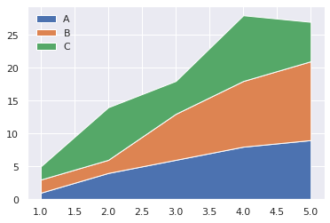

You can benefit the seaborn style in your graphs by calling the `set_theme()` function of seaborn library at the beginning of your code:

```python
# libraries
import numpy as np
import matplotlib.pyplot as plt
import seaborn as sns

# set seaborn style
sns.set_theme()
 
# Data
x=range(1,6)
y=[ [1,4,6,8,9], [2,2,7,10,12], [2,8,5,10,6] ]
 
# Plot
plt.stackplot(x,y, labels=['A','B','C'])
plt.legend(loc='upper left')
plt.show()
```

:::output

:::
