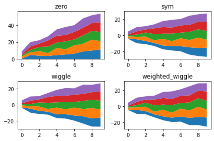

The `stackplot()` function of [matplotlib](http://python-graph-gallery.com/matplotlib/) allows to make [stacked area chart](http://python-graph-gallery.com/stacked-area-plot/). It provides a **baseline** argument that allows to custom the position of the areas around the baseline. Four possibilities are exist, and they are represented here. This chart is strongly inspired from the [Hooked](http://thoppe.github.io/) answer on this [stack overflow question](https://stackoverflow.com/questions/2225995/how-can-i-create-stacked-line-graph-with-matplotlib), thanks to him!

```python
# libraries
import numpy as np
import matplotlib.pyplot as plt
import seaborn as sns
 
# Create data
X = np.arange(0, 10, 1)
Y = X + 5 * np.random.random((5, X.size))
 
# There are 4 types of baseline we can use:
baseline = ["zero", "sym", "wiggle", "weighted_wiggle"]
 
# Let's make 4 plots, 1 for each baseline
for n, v in enumerate(baseline):
    if n<3 :
        plt.tick_params(labelbottom='off')
    plt.subplot(2 ,2, n + 1)
    plt.stackplot(X, *Y, baseline=v)
    plt.title(v)
    plt.tight_layout()
```

:::output

:::
