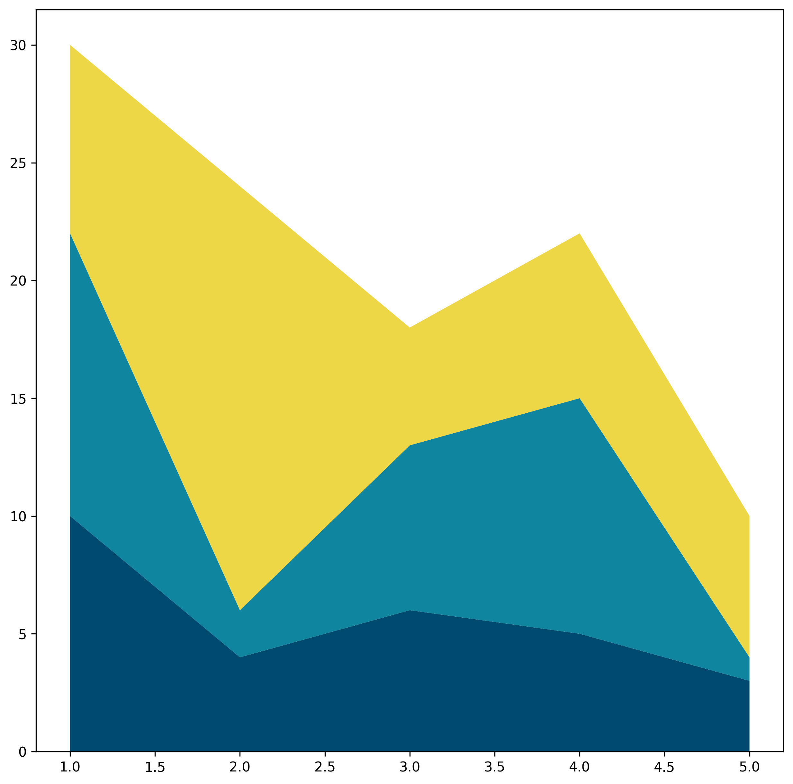
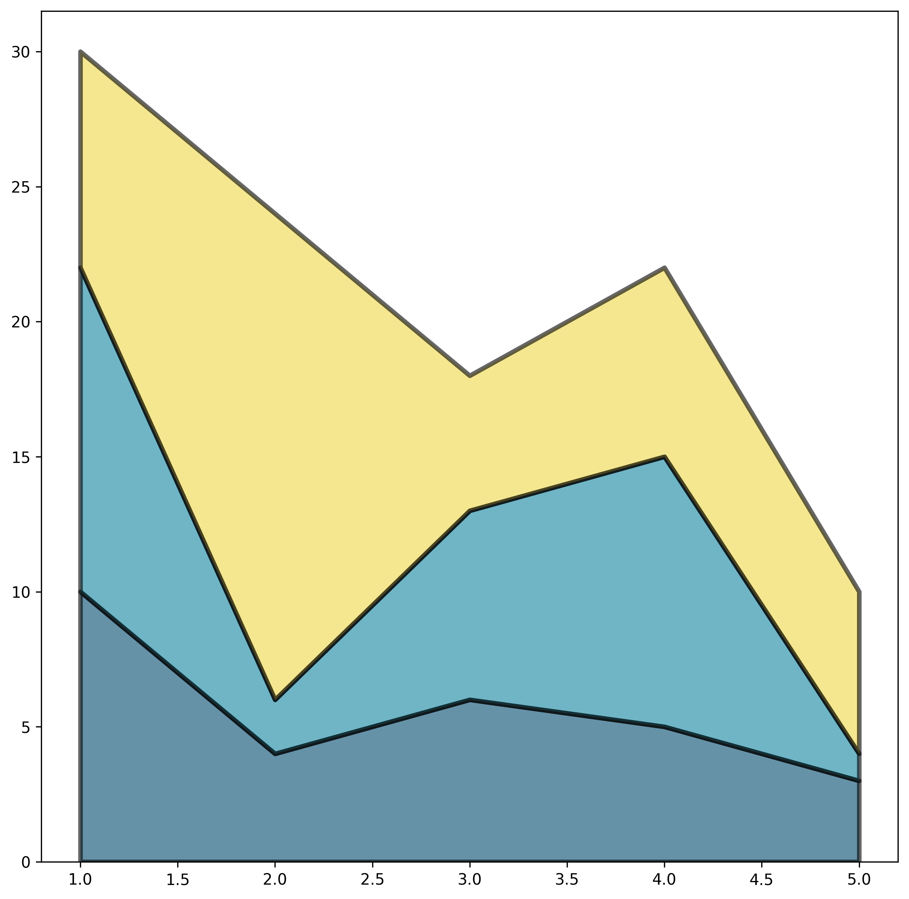
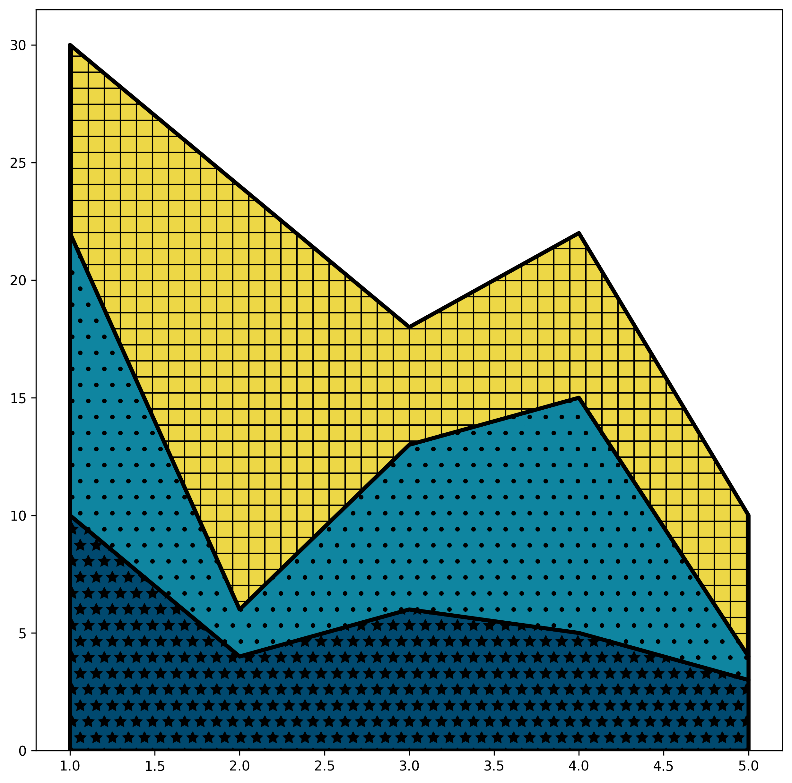
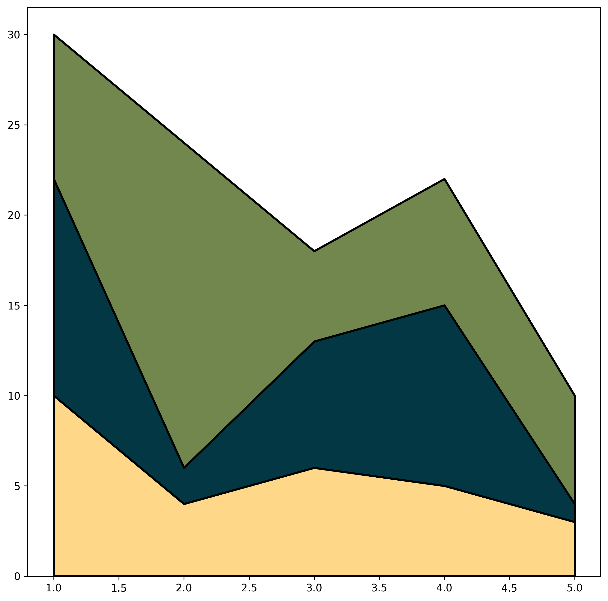

## Libraries & Data

Let's start by loading a few libraries and create a simple dataset:

```python
import pandas as pd
import matplotlib.pyplot as plt

df = pd.DataFrame(
    {
        "x": range(1, 6),
        "y1": [10, 4, 6, 5, 3],
        "y2": [12, 2, 7, 10, 1],
        "y3": [8, 18, 5, 7, 6],
    }
)
df.head()
```

:::output
::output-html{src="./output-1.html"}
:::

## Basic color customization

The easiest way to customize the colors of your chart is to pass to the `colors` argument a **list of colors**:

```python
fig, ax = plt.subplots(figsize=(10, 10), dpi=300)

ax.stackplot(
    df["x"],
    df["y1"],
    df["y2"],
    df["y3"],
    colors=["#00496FFF", "#0F85A0FF", "#EDD746FF"],
)

plt.show()
```

:::output

:::

## Linewidth style

The `edgecolor` argument sets the color of the area borders, while `linewidth` determines how thick those borders are.

```python
fig, ax = plt.subplots(figsize=(10, 10), dpi=300)

ax.stackplot(
    df["x"],
    df["y1"],
    df["y2"],
    df["y3"],
    edgecolor="black",
    linewidth=3,
    colors=["#00496FFF", "#0F85A0FF", "#EDD746FF"],
)

plt.show()
```

:::output

:::

## Opacity

We can easily change the opacity of the chart thanks to the `alpha` argument. Possible values range from `0` (completely transparent) to `1` (completely opaque), and the default one is `1`:

```python
fig, ax = plt.subplots(figsize=(10, 10), dpi=300)

ax.stackplot(
    df["x"],
    df["y1"],
    df["y2"],
    df["y3"],
    edgecolor="black",
    linewidth=3,
    alpha=0.6,
    colors=["#00496FFF", "#0F85A0FF", "#EDD746FF"],
)

plt.show()
```

:::output

:::

## Pattern inside the areas

```python
fig, ax = plt.subplots(figsize=(10, 10), dpi=300)

ax.stackplot(
    df["x"],
    df["y1"],
    df["y2"],
    df["y3"],
    edgecolor="black",
    linewidth=3,
    colors=["#00496FFF", "#0F85A0FF", "#EDD746FF"],
    hatch=["*", ".", "+"],
)

plt.show()
```

:::output

:::

## More colors with PyPalettes

Thanks to the [pypalettes library](/color-palette-finder), it's super easy to use a large number of palette in your seaborn/matplotlib charts. You can find your dream palette in the [color palette finder](/color-palette-finder), and use the `load_cmap()` function with the name of the palette you want and then access the `colors` attribute. Here is an example with the `Acadia` palette:

```python
from pypalettes import load_palette

colors = load_palette("Acadia")

fig, ax = plt.subplots(figsize=(10, 10), dpi=300)

ax.stackplot(
    df["x"], df["y1"], df["y2"], df["y3"], edgecolor="black", linewidth=2, colors=colors
)

plt.show()
```

:::output

:::

## Going further

You might be interested in:

- what are the [other options when building a staked area chart?](/stacked-area-plot#stackplotWidget)
- how to smooth a [stacked area chart](/570-custom-streamchart)
- how to create a [small multiple area chart](/242-area-chart-and-faceting)
