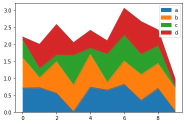

Using pandas library, the [stacked area charts](http://python-graph-gallery.com/stacked-area-plot/) are plotted with the `plot.area()` function. Each column of your data frame will be plotted as an area on the chart.

```python
# libraries
import pandas as pd
import numpy as np
import matplotlib.pyplot as plt
 
# Dataset
df = pd.DataFrame(np.random.rand(10, 4), columns=['a', 'b', 'c', 'd'])
 
# plot
df.plot.area()

# show the graph
plt.show()
```

:::output

:::
