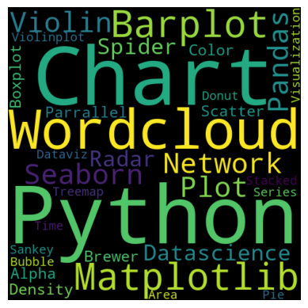

## Wordcloud

A basic wordcloud can be generated from text using the `WordCloud()` object of the wordcloud library with the `generate(text)` method. The parameters used in this example are:

- `width` : width of the canvas
- `height` : height of the canvas

```python
# Libraries
from wordcloud import WordCloud
import matplotlib.pyplot as plt
 
# Create a list of word
text=("""Python Python Python Matplotlib Matplotlib Seaborn
      Network Plot Violin Chart Pandas Datascience Wordcloud
      Spider Radar Parrallel Alpha Color Brewer Density Scatter
      Barplot Barplot Boxplot Violinplot Treemap Stacked Area
      Chart Chart Visualization Dataviz Donut Pie Time-Series
      Wordcloud Wordcloud Sankey Bubble""")
 
# Create the wordcloud object
wordcloud = WordCloud(width=480, height=480).generate(text)
 
# Display the generated image:
plt.imshow(wordcloud, interpolation='bilinear')
plt.axis("off")
plt.margins(x=0, y=0)
plt.show()
```

:::output

:::

## Going further

Discover how to **customize** your wordcloud by [changing size, color and more](/261-custom-python-wordcloud) and [using a shape mask](/262-wordcloud-with-specific-shape).
