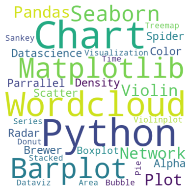
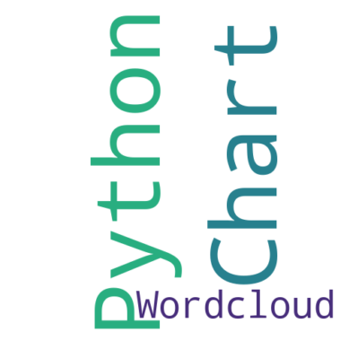
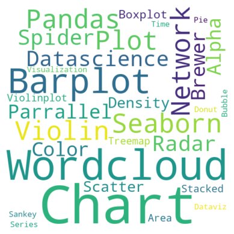
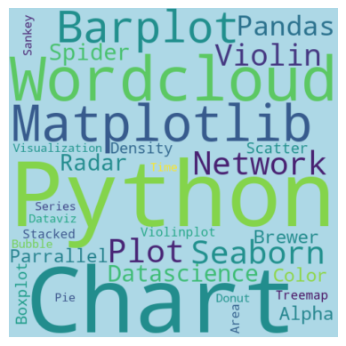
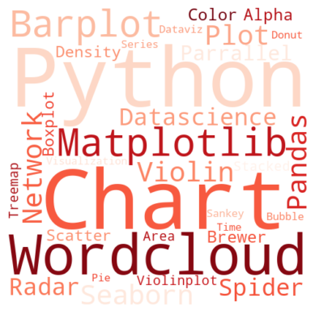

## Maximum and minimum font size

You can control minimum and maximum font size of your wordcloud using the `min_font_size` and `max_font_size` parameters in WordCloud object.

```python
# Libraries
from wordcloud import WordCloud
import matplotlib.pyplot as plt

# Create a list of word
text=("""Python Python Python Matplotlib Matplotlib Seaborn
      Network Plot Violin Chart Pandas Datascience Wordcloud
      Spider Radar Parrallel Alpha Color Brewer Density Scatter
      Barplot Barplot Boxplot Violinplot Treemap Stacked Area
      Chart Chart Visualization Dataviz Donut Pie Time-Series
      Wordcloud Wordcloud Sankey Bubble""")

# Create the wordcloud object
wordcloud = WordCloud(
    width=480, height=480,
    max_font_size=100, min_font_size=10,
    background_color='white'
).generate(text)

# Display the generated image:
plt.imshow(wordcloud, interpolation="bilinear")
plt.axis("off")
plt.margins(x=0, y=0)
plt.show()
```

:::output

:::

## Number of words

It is possible to set a maximum number of words to display on the tagcloud with the `max_words` parameter. The following example shows 3 most frequent words in the figure.

```python
# Libraries
from wordcloud import WordCloud
import matplotlib.pyplot as plt

# Create a list of word
text=("""Python Python Python Matplotlib Matplotlib Seaborn
      Network Plot Violin Chart Pandas Datascience Wordcloud
      Spider Radar Parrallel Alpha Color Brewer Density Scatter
      Barplot Barplot Boxplot Violinplot Treemap Stacked Area
      Chart Chart Visualization Dataviz Donut Pie Time-Series
      Wordcloud Wordcloud Sankey Bubble""")

# Create the wordcloud object
wordcloud = WordCloud(
    width=480, height=480,
    max_words=3,
    background_color='white'
).generate(text)

# Display the generated image:
plt.imshow(wordcloud, interpolation="bilinear")
plt.axis("off")
plt.margins(x=0, y=0)
plt.show()
```

:::output

:::

## Remove some words

You can remove the words you don't want to see in the figure by listing them in the `stopwords` parameter.

```python
# Libraries
from wordcloud import WordCloud
import matplotlib.pyplot as plt

# Create a list of word
text=("""Python Python Python Matplotlib Matplotlib Seaborn
      Network Plot Violin Chart Pandas Datascience Wordcloud
      Spider Radar Parrallel Alpha Color Brewer Density Scatter
      Barplot Barplot Boxplot Violinplot Treemap Stacked Area
      Chart Chart Visualization Dataviz Donut Pie Time-Series
      Wordcloud Wordcloud Sankey Bubble""")

# Create the wordcloud object
stopwords = ["Python", "Matplotlib"]
wordcloud = WordCloud(
    width=480, height=480,
    stopwords=stopwords,
    background_color='white'
).generate(text)

# Display the generated image:
plt.imshow(wordcloud, interpolation="bilinear")
plt.axis("off")
plt.margins(x=0, y=0)
plt.show()
```

:::output

:::

## Change background

You can change the color of the background of your python wordcloud with the `background_color` parameter.

```python
# Libraries
from wordcloud import WordCloud
import matplotlib.pyplot as plt

# Create a list of word
text=("""Python Python Python Matplotlib Matplotlib Seaborn
      Network Plot Violin Chart Pandas Datascience Wordcloud
      Spider Radar Parrallel Alpha Color Brewer Density Scatter
      Barplot Barplot Boxplot Violinplot Treemap Stacked Area
      Chart Chart Visualization Dataviz Donut Pie Time-Series
      Wordcloud Wordcloud Sankey Bubble""")

# Create the wordcloud object
wordcloud = WordCloud(
    width=480, height=480,
    background_color="lightblue"
).generate(text)

# Display the generated image:
plt.imshow(wordcloud, interpolation="bilinear")
plt.axis("off")
plt.margins(x=0, y=0)
plt.show()
```

:::output

:::

## Change color of words

And finally you can change the color pallette of words with `colormap` parameter.

```python
# Libraries
from wordcloud import WordCloud
import matplotlib.pyplot as plt

# Create a list of word
text=("""Python Python Python Matplotlib Matplotlib Seaborn
      Network Plot Violin Chart Pandas Datascience Wordcloud
      Spider Radar Parrallel Alpha Color Brewer Density Scatter
      Barplot Barplot Boxplot Violinplot Treemap Stacked Area
      Chart Chart Visualization Dataviz Donut Pie Time-Series
      Wordcloud Wordcloud Sankey Bubble""")

# Create the wordcloud object
wordcloud = WordCloud(
    width=480, height=480,
    colormap="Reds",
    background_color='white'
).generate(text)

# Display the generated image:
plt.imshow(wordcloud, interpolation="bilinear")
plt.axis("off")
plt.margins(x=0, y=0)
plt.show()
```

:::output

:::

## Going further

This post explains how to customize a [wordcloud](/wordcloud) in python.

You might be interested in how to [customize the shape](/262-wordcloud-with-specific-shape) of the wordcloud.
