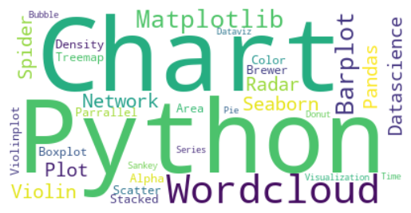
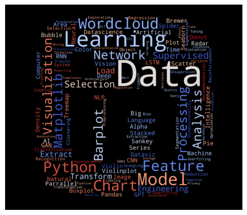
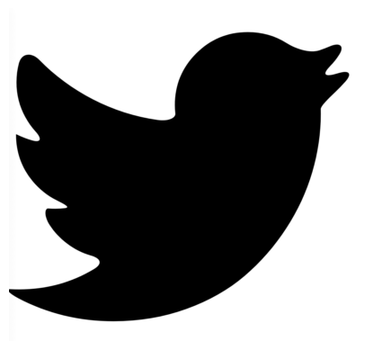
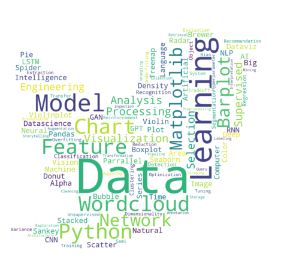

## Mask and images

For this type of chart, images are used as masks to define the **shape of the chart**. The mask is applied to the chart, and the chart is clipped to the shape of the mask. The mask can be any image, but it is usually a **silhouette** of a person, **animal**, or **object**.

Also, the more you have words in the text, the better the shape of the chart will be.

_Warning: Make sure you have the image **locally stored** on your computer._

## Default wordcloud

Let's see what a basic [wordcloud](https://python-graph-gallery.com/wordcloud/) looks like. We will use the `wordcloud` library to generate the wordcloud:

```python
# Libraries
from wordcloud import WordCloud
import matplotlib.pyplot as plt
 
text=("""Python Python Python Matplotlib Matplotlib Seaborn Network Plot Violin Chart Pandas Datascience Wordcloud Spider Radar Parrallel Alpha Color Brewer Density Scatter Barplot Barplot Boxplot Violinplot Treemap Stacked Area Chart Chart Visualization Dataviz Donut Pie Time-Series Wordcloud Wordcloud Sankey Bubble""")
 
# Create the wordcloud object
wordcloud = WordCloud(
    mask=None,
    background_color='white'
).generate(text)

# Display the generated image:
plt.imshow(wordcloud, interpolation="bilinear")
plt.axis("off")
plt.show()
```

:::output

:::

## Mask of linkedin logo

First let's load an image and display it:

```python
import numpy as np
from PIL import Image

# load image
linkedin_mask = np.array(Image.open("linkedin-logo.png"))

# display image
plt.imshow(linkedin_mask, cmap=plt.cm.gray, interpolation='bilinear')
plt.axis('off')
plt.show()
```

:::output

:::

Then we can use it for the wordcloud:

```python
# Libraries
from wordcloud import WordCloud
import matplotlib.pyplot as plt

text=("""Python Python Python Matplotlib Matplotlib Seaborn Network Plot Violin Chart Pandas Datascience Wordcloud Spider Radar Parrallel Alpha Color Brewer Density Scatter Barplot Barplot Boxplot Violinplot Treemap Stacked Area Chart Chart Visualization Dataviz Donut Pie Time-Series Wordcloud Wordcloud Sankey Bubble Analysis Data Big Data Machine Learning Deep Learning AI Artificial Intelligence Neural Network CNN RNN LSTM GAN GPT-3 NLP Natural Language Processing Computer Vision Image Recognition Object Detection Segmentation Classification Regression Clustering Dimensionality Reduction Recommendation System Reinforcement Learning Supervised Learning Unsupervised Learning Semi-Supervised Learning Transfer Learning Model Training Model Evaluation Model Selection Model Optimization Hyperparameter Tuning Overfitting Underfitting Bias Variance Tradeoff Feature Engineering Feature Selection Feature Extraction Data Preprocessing Data Cleaning Data Transformation Data Augmentation Data Wrangling Data Exploration Data Visualization Data Analysis Data Interpretation Data Reporting Data Storytelling Data Presentation Data Engineering Data Architecture Data Pipeline Data Ingestion Data Storage Data Processing Data Query Data Retrieval Data Mining Data Scraping Data Collection Data Labeling Data Annotation ETL Extract Transform Load ELT Extract Load Transform Data Warehouse Data Mart Data Lake Data Lakehouse Data Governance Data Quality Data Security Data Privacy Data Ethics Data Regulation Data Compliance Data Protection""")

# Create the wordcloud object
wordcloud = WordCloud(
    mask=linkedin_mask,
    background_color='black',
    colormap='coolwarm'
).generate(text)

# Display the generated image:
fig, ax = plt.subplots(1, 1, figsize=(6, 8))
ax.imshow(wordcloud, interpolation="bilinear")
ax.axis("off")
plt.show()
```

:::output

:::

## Mask of the twitter logo

Let's load the image:

```python
import numpy as np
from PIL import Image

# load image
twitter_mask = np.array(Image.open("twitter-logo.png"))

# display image
plt.imshow(twitter_mask, cmap=plt.cm.gray, interpolation='bilinear')
plt.axis('off')
plt.show()
```

:::output

:::

Then we can use it for the wordcloud:

```python
# Libraries
from wordcloud import WordCloud
import matplotlib.pyplot as plt

text=("""Python Python Python Matplotlib Matplotlib Seaborn Network Plot Violin Chart Pandas Datascience Wordcloud Spider Radar Parrallel Alpha Color Brewer Density Scatter Barplot Barplot Boxplot Violinplot Treemap Stacked Area Chart Chart Visualization Dataviz Donut Pie Time-Series Wordcloud Wordcloud Sankey Bubble Analysis Data Big Data Machine Learning Deep Learning AI Artificial Intelligence Neural Network CNN RNN LSTM GAN GPT-3 NLP Natural Language Processing Computer Vision Image Recognition Object Detection Segmentation Classification Regression Clustering Dimensionality Reduction Recommendation System Reinforcement Learning Supervised Learning Unsupervised Learning Semi-Supervised Learning Transfer Learning Model Training Model Evaluation Model Selection Model Optimization Hyperparameter Tuning Overfitting Underfitting Bias Variance Tradeoff Feature Engineering Feature Selection Feature Extraction Data Preprocessing Data Cleaning Data Transformation Data Augmentation Data Wrangling Data Exploration Data Visualization Data Analysis Data Interpretation Data Reporting Data Storytelling Data Presentation Data Engineering Data Architecture Data Pipeline Data Ingestion Data Storage Data Processing Data Query Data Retrieval Data Mining Data Scraping Data Collection Data Labeling Data Annotation""")

# Create the wordcloud object
wordcloud = WordCloud(
    mask=twitter_mask,
    background_color='white'
).generate(text)

# Display the generated image:
fig, ax = plt.subplots(1, 1, figsize=(6, 8))
ax.imshow(wordcloud, interpolation="bilinear")
ax.axis("off")
plt.show()
```

:::output

:::

## Going further

This post explains how use a mask to create a wordcloud **with a shape**.

You might be interested in how to [customize a wordcloud style](/261-custom-python-wordcloud)
