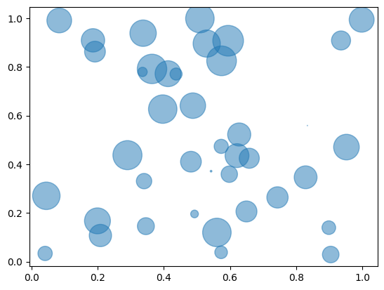

## Libraries & Dataset

We will start by importing the necessary libraries and loading the dataset.

Since [bubble plots](/bubble-plot) requires **numerical values**, we need to have quantitative data in our dataset.

```python
# libraries
import matplotlib.pyplot as plt
import numpy as np
import pandas as pd

# create data
df = pd.DataFrame({
      'x': np.random.rand(40),
      'y': np.random.rand(40),
      'z': np.random.rand(40),
   })
df.head()
```

:::output
::output-html{src="./output-1.html"}
:::

## Bubble plot

A bubble plot is very similar to a [scatterplot](/scatter-plot). Using [matplotlib](/matplotlib) library, a bubble plot can be constructed using the `scatter()` function. In the example, the following parameters are used:

- `x` : The data position on the x axis
- `y` : The data position on the y axis
- `s` : The marker size
- `alpha` : Transparancy ratio

```python
plt.scatter(df['x'], df['y'], s=df['z']*1000, alpha=0.5)
plt.show()
```

:::output

:::

## Going further

You might be interested in:

- how to change [colors, shape and size](/271-custom-your-bubble-plot) of the bubbles
- how to [map bubble colors](/272-map-a-color-to-bubble-plot) with a 4th variable
