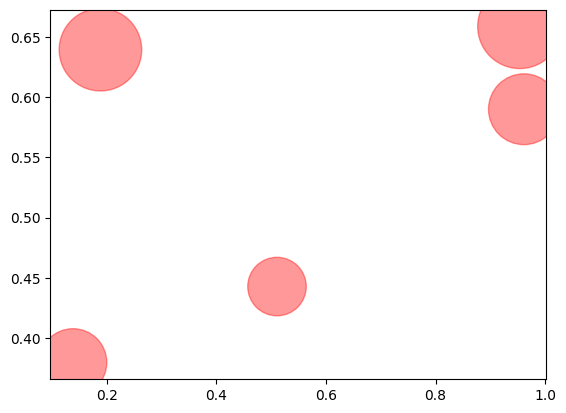
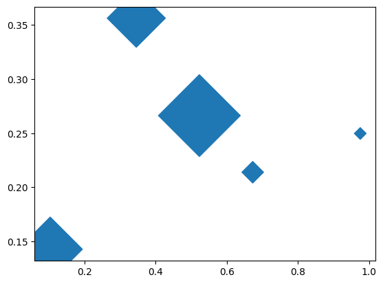
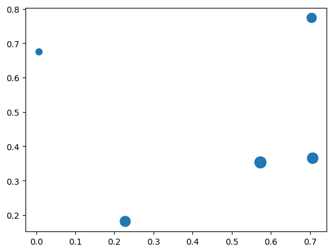
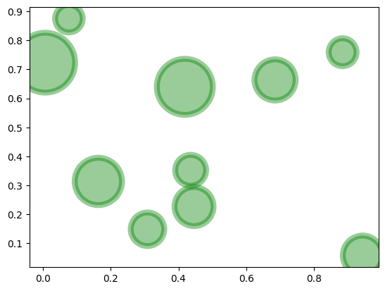
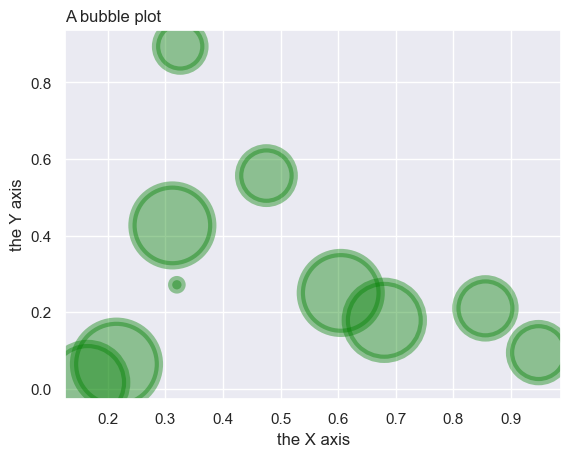

## Color

After plotting a [basic bubble plot](https://python-graph-gallery.com/270-basic-bubble-plot/) with the `scatter()` function of [matplotlib](https://python-graph-gallery.com/matplotlib/), you can customize it by changing the color of the markers. You can use the color parameter `c` for this purpose.

```python
# libraries
import matplotlib.pyplot as plt
import numpy as np
import pandas as pd
 
# create data
df = pd.DataFrame({
   'x': np.random.rand(10),
   'y': np.random.rand(10),
   'z': np.random.rand(10),
})
df = pd.DataFrame({
   'x': np.random.rand(5),
   'y': np.random.rand(5),
   'z': np.random.rand(5),
})
 
# Change color with c and alpha
plt.scatter(df['x'], df['y'], s=df['z']*4000, c="red", alpha=0.4)

# show the graph
plt.show()
```

:::output

:::

## Shape

As you can change the color of the markers, it is also possible to change the shapes by giving `marker` parameter to the `scatter()` function.

```python
# libraries
import matplotlib.pyplot as plt
import numpy as np
import pandas as pd
 
# create data
df = pd.DataFrame({
   'x': np.random.rand(10),
   'y': np.random.rand(10),
   'z': np.random.rand(10),
})
df = pd.DataFrame({
   'x': np.random.rand(5),
   'y': np.random.rand(5),
   'z': np.random.rand(5),
})
 
# plot
plt.scatter(df['x'], df['y'], s=df['z']*4000, marker="D")

# show the graph
plt.show()
```

:::output

:::

## Global Size

In order to change the size of each marker, `s` size parameter can be used. In the example below, `s` parameter is set as a multiplier of z data points, so the sizes of the markers depends on the z values.

```python
# libraries
import matplotlib.pyplot as plt
import numpy as np
import pandas as pd
 
# create data
df = pd.DataFrame({
   'x': np.random.rand(10),
   'y': np.random.rand(10),
   'z': np.random.rand(10),
})
df = pd.DataFrame({
   'x': np.random.rand(5),
   'y': np.random.rand(5),
   'z': np.random.rand(5),
})
 
# plot
plt.scatter(df['x'], df['y'], s=df['z']*200)

# show the graph
plt.show()
```

:::output

:::

## Edges

`linewidth` parameter is useful to set the edge thickness of the markers in a basic bubble plot built with matplotlib.

```python
# libraries
import matplotlib.pyplot as plt
import numpy as np
import pandas as pd
 
# create data
df = pd.DataFrame({
   'x': np.random.rand(10),
   'y': np.random.rand(10),
   'z': np.random.rand(10),
})
 
# plot
plt.scatter(df['x'], df['y'], s=df['z']*4000, c="green", alpha=0.4, linewidth=6)

# show the graph
plt.show()
```

:::output

:::

## Seaborn Style

It is possible to benefit from [seaborn](https://python-graph-gallery.com/seaborn/) library style when plotting charts in matplotlib. You just need to load the seaborn library and use seaborn `set_theme()` function!

```python
# libraries
import matplotlib.pyplot as plt
import numpy as np
import pandas as pd
 
# create data
df = pd.DataFrame({
   'x': np.random.rand(10),
   'y': np.random.rand(10),
   'z': np.random.rand(10),
})
 
# pimp your plot with the seaborn style
import seaborn as sns
sns.set_theme()

# plot
plt.scatter(df['x'], df['y'], s=df['z']*4000, c="green", alpha=0.4, linewidth=6)
 
# Add titles (main and on axis)
plt.xlabel("the X axis")
plt.ylabel("the Y axis")
plt.title("A bubble plot", loc="left")

# show the graph
plt.show()
```

:::output

:::

## Going further

You might be interested in:

- how to [map bubble colors](/272-map-a-color-to-bubble-plot) with a 4th variable
- how to create a [beautiful bubble plot](/web-bubble-plot-with-annotations-and-custom-features) in python
