## Most basic

Building a map with the `basemap` library always follow the same process. Once the library is loaded, a map is initialized with the `Basemap()` function. Then, some part of the maps a drawn. For instance, coastlines can be added with the `drawcoastlines()` function:

```python
# libraries
from mpl_toolkits.basemap import Basemap
import numpy as np
import matplotlib.pyplot as plt

# Set the plot size for this notebook:
plt.rcParams["figure.figsize"]=13,13

# Always start witht the basemap function to initialize a map
m=Basemap()
 
# Show the coast lines
m.drawcoastlines()
 
plt.show();
```

:::output
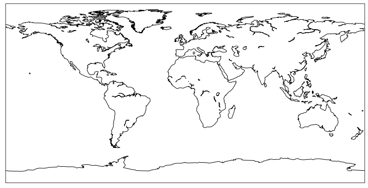
:::

## Bounding

You can select a specific area of the world when you initialize the map with the `Basemap()` function. Let's say you want to draw south america:

```python
m=Basemap(llcrnrlon=-100, llcrnrlat=-58,urcrnrlon=-30,urcrnrlat=15)

# Show the coast lines
m.drawcoastlines()
 
plt.show()
```

:::output
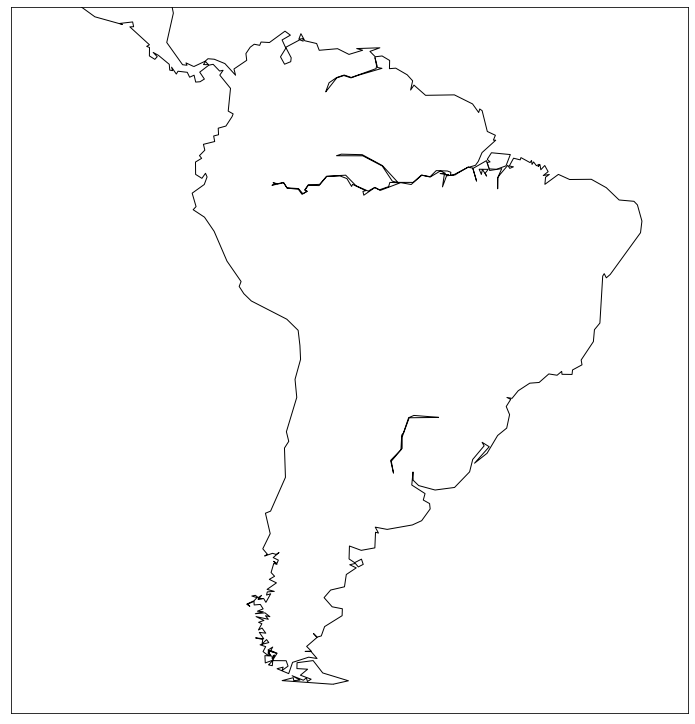
:::

## Colors

You probably want to have something better than this black and white map. For each function adding boundaries, you can specify some parameter for color, width and so on:

```python
# Initialize
m=Basemap(llcrnrlon=-100, llcrnrlat=-58,urcrnrlon=-30,urcrnrlat=15)

# Background color:
m.drawmapboundary(fill_color='#A6CAE0')

# Continent in green
m.fillcontinents(color='#69b2a2',lake_color='#A6CAE0')

# Show the coast lines in black
m.drawcoastlines(color='black', linewidth=2)
 
plt.show()
```

:::output
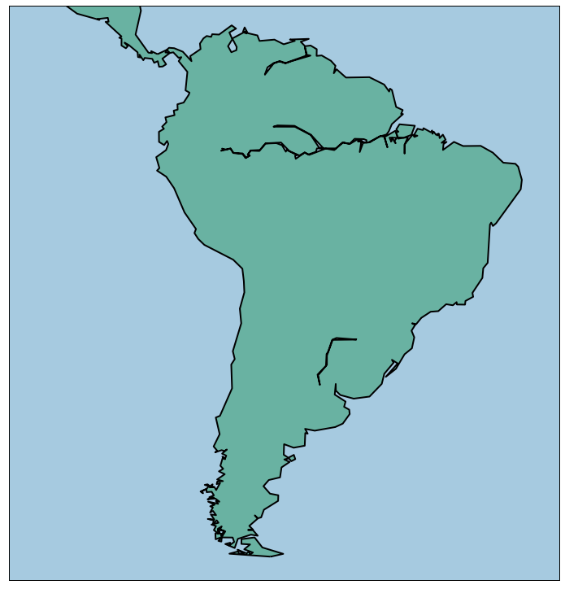
:::

## List of available boundaries

Several types of boundaries are available in functions similar to `drawcoastlines()`. Country boundaries are available with `drawmapboundary()`, continents with `fillcontinents()`, rivers with `drawrivers()`, US counties with `drawcounties()` and US states with `drawstates()`

Let's make the best of it with a map of the US

```python
# initialise
map = Basemap(llcrnrlon=-130, llcrnrlat=25, urcrnrlon=-65.,urcrnrlat=52., lat_0 = 40., lon_0 = -80)
 
# background color
map.drawmapboundary(fill_color='#A6CAE0', color="black")

# country color
map.fillcontinents(color='#e6b800',lake_color='#A6CAE0')
map.drawcountries(color='grey', linewidth=1)

# Show states
map.drawstates(color='lightgrey', linewidth=1)

plt.show()
```

:::output
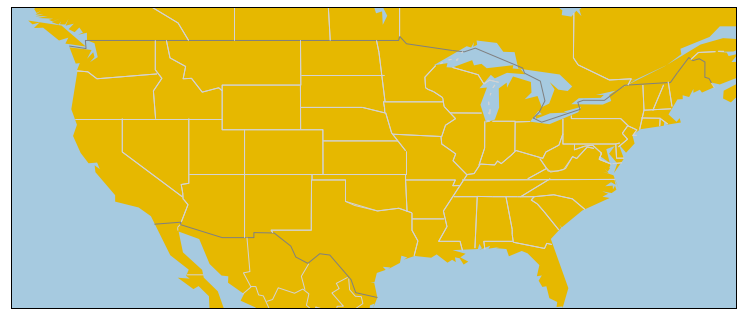
:::

## Projection

Several projections are offered by the basemap library. You just have to specify it in the `projection` parameter of the `Basemap()` function. Let's have a look to the possibilities:

`ortho`

```python
# ortho
plt.rcParams["figure.figsize"]=8,8
m=Basemap(lat_0=0, lon_0=0, projection='ortho' )
m.drawmapboundary(fill_color='#A6CAE0')
m.fillcontinents(color='grey', alpha=0.3)
plt.show();
```

:::output
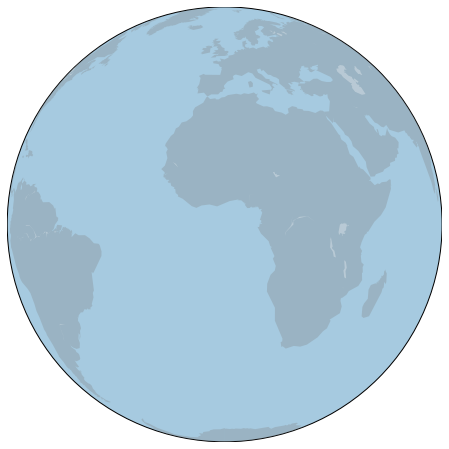
:::

`merc`

```python
# merc
m=Basemap(llcrnrlon=-180, llcrnrlat=-60,urcrnrlon=180,urcrnrlat=80, projection='merc')
m.drawmapboundary(fill_color='#A6CAE0')
m.fillcontinents(color='grey', alpha=0.3)
plt.show()
```

:::output
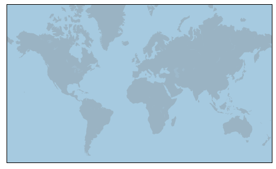
:::

`robin`

```python
# robin
m=Basemap(lat_0=0, lon_0=0, projection='robin' )
m.drawmapboundary(fill_color='#A6CAE0')
m.fillcontinents(color='grey', alpha=0.3)
plt.show()
```

:::output
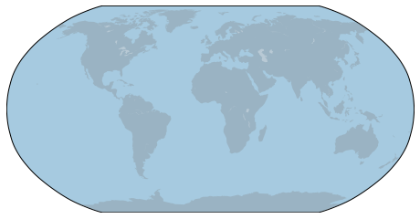
:::

`aeqd`

```python
#aeqd --> you HAVE to provide lon_0 and lat_0
m=Basemap(lat_0=30, lon_0=30, projection='aeqd' )
m.drawmapboundary(fill_color='#A6CAE0')
m.fillcontinents(color='grey', alpha=0.3)
plt.show()
```

:::output
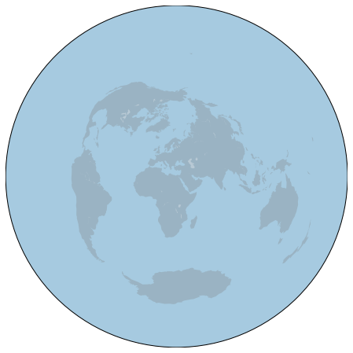
:::

`nsper`

```python
#nsper
m=Basemap(lat_0=0, lon_0=0, projection='nsper' )
m.drawmapboundary(fill_color='#A6CAE0')
m.fillcontinents(color='grey', alpha=0.3)
plt.show()
```

:::output
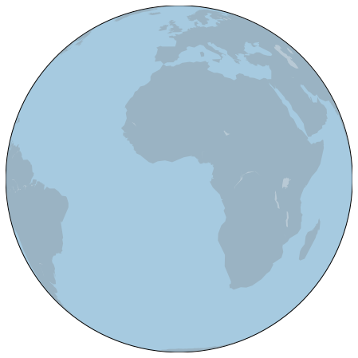
:::

`cyl`

```python
#cyl
m=Basemap(llcrnrlon=-180, llcrnrlat=-60,urcrnrlon=180,urcrnrlat=80, projection='cyl' )
m.drawmapboundary(fill_color='#A6CAE0')
m.fillcontinents(color='grey', alpha=0.3)
plt.show()
```

:::output
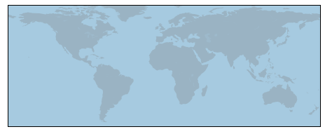
:::

## Background Layer

Last but not least, you can load a background layer for the map. Instead of showing some boundaries and uniform colors only, it will show some nice backgrounds. Several options are available:

`bluemarble`

```python
m = Basemap(llcrnrlon=-10.5,llcrnrlat=33,urcrnrlon=10.,urcrnrlat=46., resolution='i', projection='cass', lat_0 = 39.5, lon_0 = 0.)
m.bluemarble()
plt.show
```

:::output
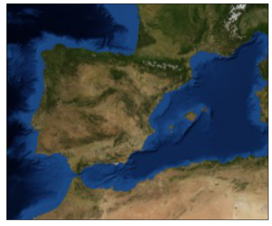
:::

`shadedrelief`

```python
m = Basemap(llcrnrlon=-10.5,llcrnrlat=33,urcrnrlon=10.,urcrnrlat=46., resolution='i', projection='cass', lat_0 = 39.5, lon_0 = 0.)
m.shadedrelief()
plt.show()
```

:::output
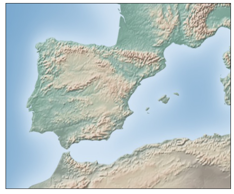
:::

`ArcGis`

I looks like `arcGis` background requires some sort of authentification now 🤔. The code below looks outdated

```python
# World Shaded Relief
# m = Basemap(projection='mill',llcrnrlon=-123. ,llcrnrlat=37,urcrnrlon=-121 ,urcrnrlat=39, resolution = 'l', epsg = 4326)
# m.arcgisimage(service='World_Shaded_Relief', xpixels = 1500, verbose= True)
 
# Ocean Basemap
# m = Basemap(projection='mill',llcrnrlon=-123. ,llcrnrlat=37,urcrnrlon=-121 ,urcrnrlat=39, resolution = 'l', epsg = 4326)
# m.arcgisimage(service='Ocean_Basemap', xpixels = 1500, verbose= True)
```
