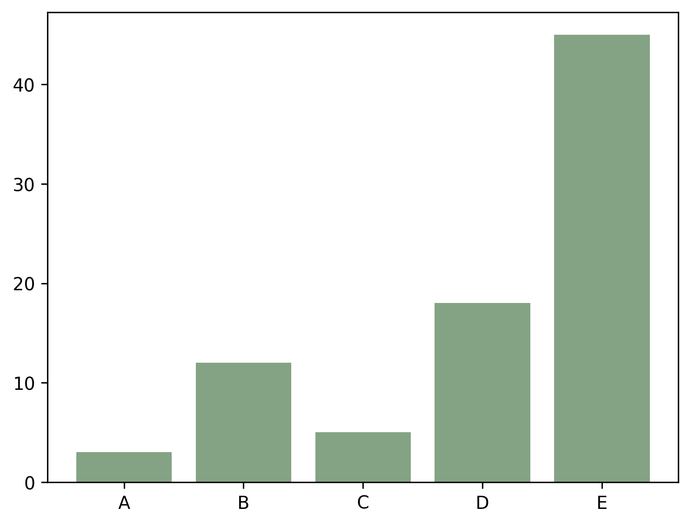
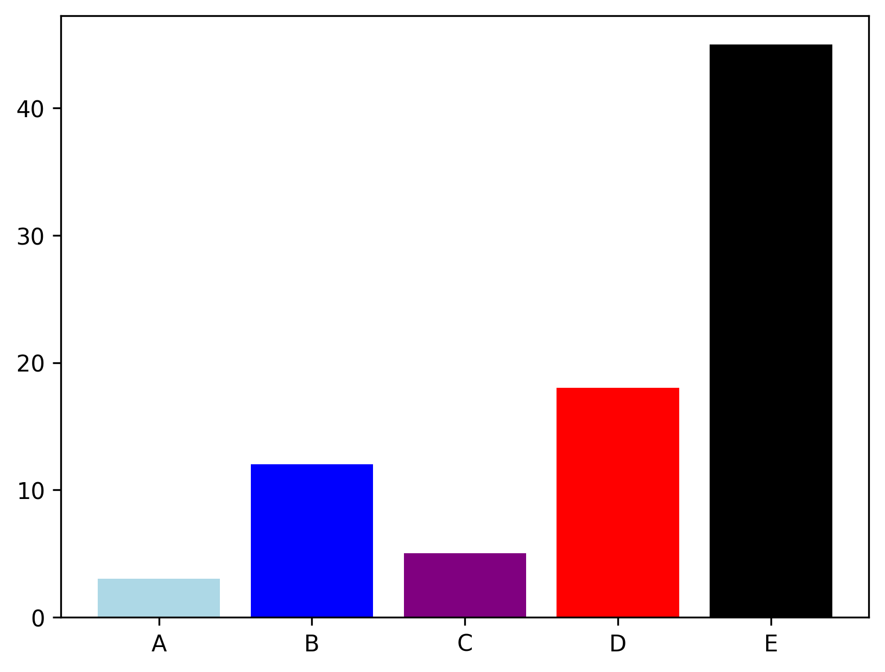
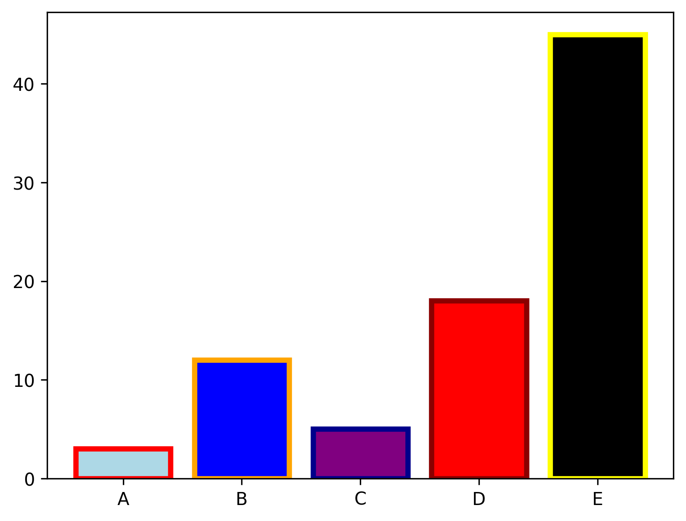

## Libraries

First, you need to import the following libraries:

- [matplotlib](https://python-graph-gallery.com/matplotlib/) for creating the chart and customize it
- [pandas](https://python-graph-gallery.com/pandas/) for storing the data used

```python
import matplotlib.pyplot as plt
import pandas as pd
```

## Dataset

In this post, we'll use a very simple dataset, that you can create as follow

```python
height = [3, 12, 5, 18, 45]
bars = ('A', 'B', 'C', 'D', 'E')

df = pd.DataFrame({'height': height,
                   'bars': bars})
```

## Uniform color using RGB

You can change the color of bars in a barplot using the `color` argument.  
**RGB** is a way of making colors. You have to to provide an amount of red, green, blue, and the transparency value to the color argument and it returns a color.

```python
color = (0.2, # redness
         0.4, # greenness
         0.2, # blueness
         0.6 # transparency
         ) 

# Create bars
fig, ax = plt.subplots()
ax.bar(df['bars'], df['height'],
       color=color)

# Show graph
plt.show()
```

:::output

:::

## Different color for each bar

If you want to give **different color to each bar**, just provide a list of color names to the `color` argument.

You can find the available colors at [this address](https://matplotlib.org/stable/gallery/color/named_colors.html)

```python
color = ['lightblue', 'blue', 'purple', 'red', 'black']

# Create bars
fig, ax = plt.subplots()
ax.bar(df['bars'], df['height'],
       color=color)

# Show graph
plt.show()
```

:::output

:::

## Control color of border

The `edgecolor` argument allows you to color the borders of barplots. You can either put a color name like 'blue' or put a **list of colors**.

We also specify `linewidth=3` in order to make the edges more visible (the default value is 1 and can be too thin).

```python
color = ['lightblue', 'blue', 'purple', 'red', 'black']
edgecolor = ['red', 'orange', 'darkblue', 'darkred', 'yellow']

# Create bars
fig, ax = plt.subplots()
ax.bar(df['bars'], df['height'],
       color=color,
       edgecolor=edgecolor,
       linewidth=3)

# Show graph
plt.show()
```

:::output

:::

## Going further

This post explains how to **modify the colors** of a [barplot](https://python-graph-gallery.com/barplot/) with matplotlib.

You might want to check [how to custom width of bars](https://python-graph-gallery.com/5-control-width-and-space-in-barplots/) and [how to flip a barplot](https://python-graph-gallery.com/2-horizontal-barplot/).
