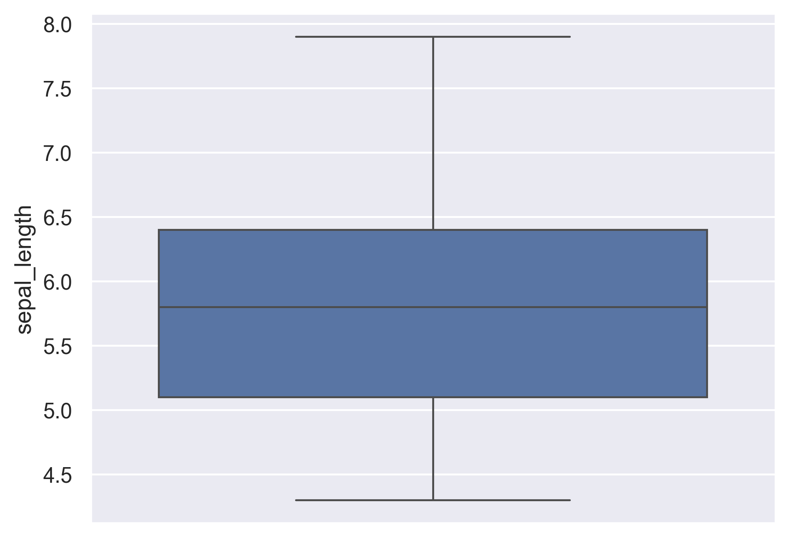
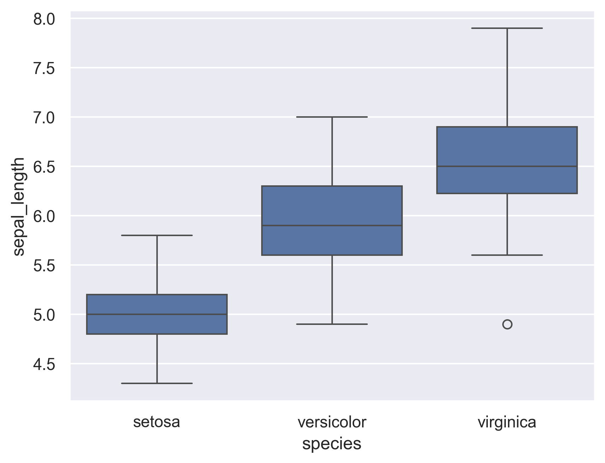

## Libraries

First, we need to load a few libraries:

- [matplotlib](https://python-graph-gallery.com/matplotlib/): for displaying the chart
- [seaborn](https://python-graph-gallery.com/seaborn/): for creating the chart

```python
import seaborn as sns
import matplotlib.pyplot as plt
```

## Dataset

Since [boxplot](https://python-graph-gallery.com/boxplot/) is used to display the **distribution of a numerical variable**, we need a dataset that contains at least one numerical variable.

In this example, we will use the `iris` dataset that we can easily **load**:

```python
df = sns.load_dataset('iris')
```

## One single numerical variable

The simplest form of boxplot: analysis of the **overall distribution** of a single numerical variable with the `boxplot()` function.

```python
sns.set_theme(style="darkgrid")
sns.boxplot(y=df["sepal_length"])
plt.show()
```

:::output

:::

## One numerical variable and several groups

Depending on your data, you may want to have a better understanding of the distribution of a given variable between **two or more groups**.

You can do so by specifying the `x` parameter in the `boxplot()` function.

```python
sns.set_theme(style="darkgrid")
sns.boxplot(x=df["species"], y=df["sepal_length"])
plt.show()
```

:::output

:::

## Going further

This post explains how to create and customize a [boxplot](https://python-graph-gallery.com/boxplot/) with the [seaborn](https://python-graph-gallery.com/seaborn/) library.

You might be interested in how adding [individual data points in boxplot](https://python-graph-gallery.com/36-add-jitter-over-boxplot-seaborn/) and how to create a [raincloud plot](https://python-graph-gallery.com/raincloud-plot-with-matplotlib-and-ptitprince/) with the `ptitprince` library.
