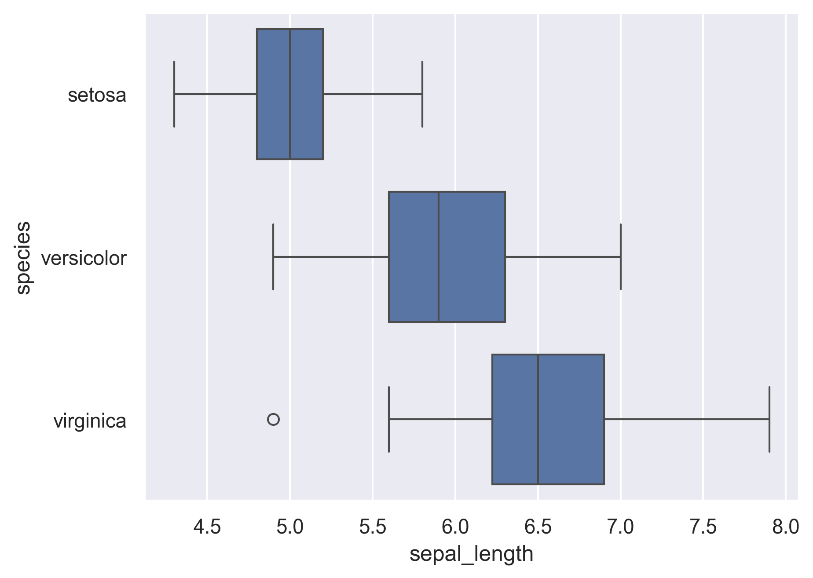

## Libraries

First, we need to load a few libraries:

- [matplotlib](https://python-graph-gallery.com/matplotlib/): for displaying the chart
- [seaborn](https://python-graph-gallery.com/seaborn/): for creating the chart

```python
import seaborn as sns
import matplotlib.pyplot as plt
```

## Dataset

Since [boxplot](https://python-graph-gallery.com/boxplot/) is used to display the **distribution of numerical variables**, we need a dataset that contains at least one numerical variable.

In this example, we will use the `iris` dataset that we can easily **load**:

```python
df = sns.load_dataset('iris')
```

## Switching x and y

Notice how the orientation of the [boxplot](https://python-graph-gallery.com/boxplot) only depends on how you declare the numerical variable you expect to analyze.

If set as the **argument y**, the boxplot will be **vertical**, and if set as x, it will be horizontal.

```python
sns.set_theme(style="darkgrid")
sns.boxplot(y=df["species"], x=df["sepal_length"])
plt.show()
```

:::output

:::

## Going further

This post explains how to flip a [boxplot](https://python-graph-gallery.com/boxplot/) with the [seaborn](https://python-graph-gallery.com/seaborn/) library.

You might be interested in how adding [individual data points in boxplot](https://python-graph-gallery.com/36-add-jitter-over-boxplot-seaborn/) and how to create a [raincloud plot](https://python-graph-gallery.com/raincloud-plot-with-matplotlib-and-ptitprince/) with the `ptitprince` library.
