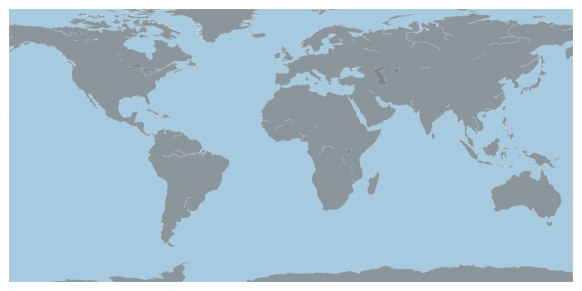
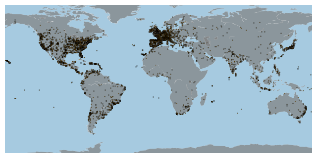
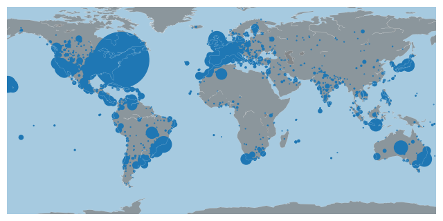
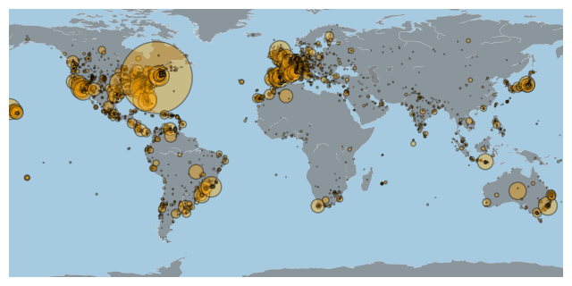

## Libraries

First, we need to load a few libraries:

- [matplotlib](http://python-graph-gallery.com/matplotlib/): for basic plotting
- [pandas](http://python-graph-gallery.com/pandas/): for data manipulation
- `mpl_toolkits` for the `Basemap` module (maps)

```python
from mpl_toolkits.basemap import Basemap
import matplotlib.pyplot as plt
import pandas as pd
```

## Dataset

Let's load a dataset with **geographical information** (latitude and longitude columns):

```python
data = pd.read_csv('https://raw.githubusercontent.com/holtzy/The-Python-Graph-Gallery/master/static/data/TweetSurfData.csv', sep=";")
data.head()
```

:::output
::output-html{src="./output-1.html"}
:::

## Background map

Let's start by building the **background map** of our bubble map thanks to the `basemap` library. The `basemap` library allows to load the boundaries of **any region of the world** without having to load a `shapefile` or a `geojson` file.

You can read more about this step in the [map section](https://www.python-graph-gallery/map) of the gallery.

```python
# Initialize the background map
plt.figure(figsize=(8, 10))
m=Basemap(llcrnrlon=-160, llcrnrlat=-75,urcrnrlon=160,urcrnrlat=80)

# Draw boundaries, continents and coastlins
m.drawmapboundary(fill_color='#A6CAE0', linewidth=0)
m.fillcontinents(color='grey', alpha=0.7, lake_color='grey')
m.drawcoastlines(linewidth=0.1, color="white")

# show
plt.show()
```

:::output

:::

## Add markers

```python
# Initialize the background map
plt.figure(figsize=(8, 10))
m=Basemap(llcrnrlon=-160, llcrnrlat=-75,urcrnrlon=160,urcrnrlat=80)

# Draw boundaries, continents and coastlins
m.drawmapboundary(fill_color='#A6CAE0', linewidth=0)
m.fillcontinents(color='grey', alpha=0.7, lake_color='grey')
m.drawcoastlines(linewidth=0.1, color="white")

# Add a point per position
m.scatter(
    data["homelon"],
    data["homelat"],
    alpha=0.4,
    s=1,
    c="orange",
    linewidth=1,
    edgecolor="black"
)

# show
plt.show()
```

:::output

:::

## Bubble size

It can be interesting to use the size of the bubble to represent a **3rd variable**. In this case, the size of the bubble is proportional to the `n` in the dataset.

You can control the **size of the bubble** by changing the `s` argument of the `scatter()` function.

```python
# Initialize the background map
plt.figure(figsize=(8, 10))
m=Basemap(llcrnrlon=-160, llcrnrlat=-75,urcrnrlon=160,urcrnrlat=80)

# Draw boundaries, continents and coastlins
m.drawmapboundary(fill_color='#A6CAE0', linewidth=0)
m.fillcontinents(color='grey', alpha=0.7, lake_color='grey')
m.drawcoastlines(linewidth=0.1, color="white")

# Add a point per position
m.scatter(
    data["homelon"],
    data["homelat"],
    s=data["n"]/10
)

# show
plt.show()
```

:::output

:::

## Custom bubble style

For better looking map, we can **customize the bubble** style with the following arguments:

- `alpha`: transparency of the bubble
- `edgecolor`: color of the bubble border
- `linewidth`: width of the bubble border
- `c`: color of the bubble

```python
# Initialize the background map
plt.figure(figsize=(8, 10))
m=Basemap(llcrnrlon=-160, llcrnrlat=-75,urcrnrlon=160,urcrnrlat=80)

# Draw boundaries, continents and coastlins
m.drawmapboundary(fill_color='#A6CAE0', linewidth=0)
m.fillcontinents(color='grey', alpha=0.7, lake_color='grey')
m.drawcoastlines(linewidth=0.1, color="white")

# Add a point per position
m.scatter(
    data["homelon"],
    data["homelat"],
    alpha=0.4,
    s=data["n"]/10,
    c="orange",
    linewidth=1,
    edgecolor="black"
)

# show
plt.show()
```

:::output

:::

## Going further

This post explains how to create and custom a [bubble map](https://www.python-graph-gallery.com/bubble-map) with Python.

If you want to go further, you can also create a [choropleth map](https://www.python-graph-gallery.com/choropleth-map) or a [connection map](https://www.python-graph-gallery.com/connection-map) with Python.
