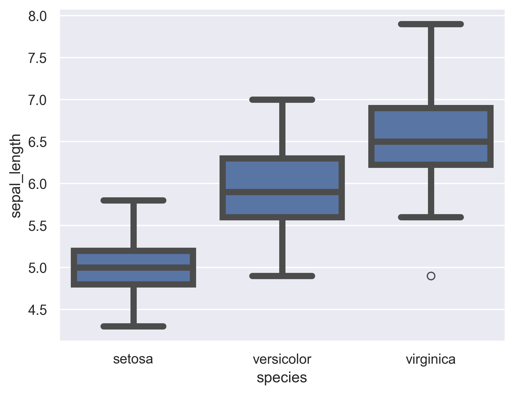
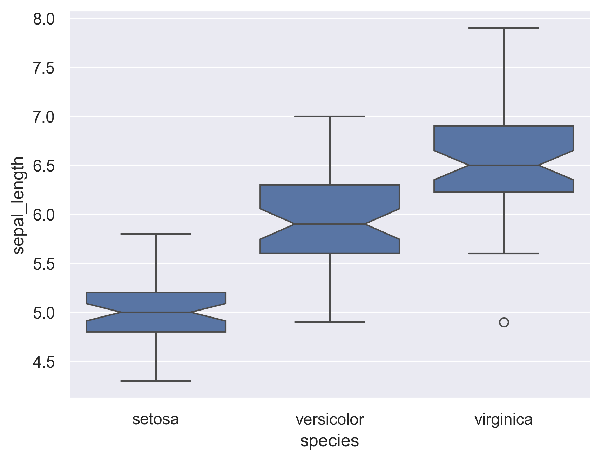
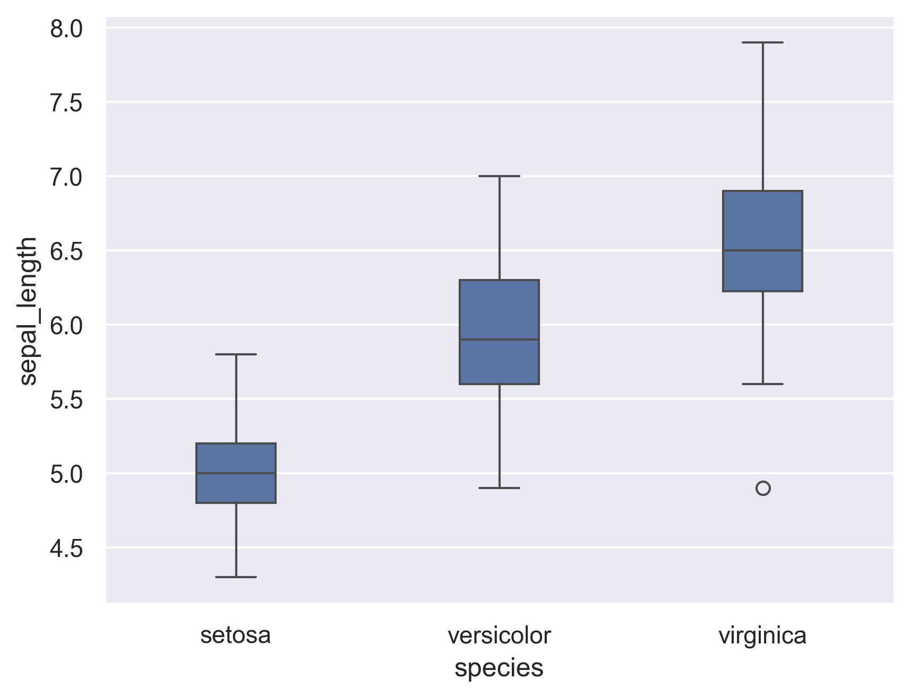

## Custom linewidth

Customizing your boxplot's linewidth is really straightforward and quickly done through the `linewidth` argument.

```python
# libraries & dataset
import seaborn as sns
import matplotlib.pyplot as plt
  
sns.set_theme(style="darkgrid")
df = sns.load_dataset('iris')

sns.boxplot(x=df["species"], y=df["sepal_length"], linewidth=5)
plt.show()
```

:::output

:::

## Add notch

```python
# libraries & dataset
import seaborn as sns
import matplotlib.pyplot as plt
  
sns.set_theme(style="darkgrid")
df = sns.load_dataset('iris')

sns.boxplot(x=df["species"], y=df["sepal_length"], notch=True)
plt.show()
```

:::output

:::

## Controlling box size

This can be an interesting modification in the case where you are facing with multiple categories to display in the same figure, given that space is limited.

```python
# libraries & dataset
import seaborn as sns
import matplotlib.pyplot as plt
  
sns.set_theme(style="darkgrid")
df = sns.load_dataset('iris')

sns.boxplot(x=df["species"], y=df["sepal_length"], width=0.3)
plt.show()
```

:::output

:::
