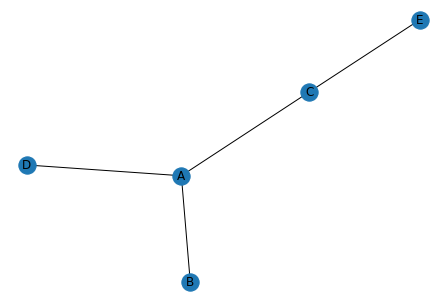

This example is probably the **most basic** [network chart](https://python-graph-gallery.com/network-chart/) you can draw.

A network chart is constituted by **nodes**. These nodes are interconnected by **edges**. So a basic format is a data frame where each line describes a connection.

Here we construct a data frame with 4 lines, describing the 4 connections of this plot! So if you have a csv file with your connections, load it and you are ready to visualise it!

Next step: customise the chart parameters!

```python
# libraries
import pandas as pd
import numpy as np
import networkx as nx
import matplotlib.pyplot as plt
 
# Build a dataframe with 4 connections
df = pd.DataFrame({ 'from':['A', 'B', 'C','A'], 'to':['D', 'A', 'E','C']})
 
# Build your graph
G=nx.from_pandas_edgelist(df, 'from', 'to')
 
# Plot it
nx.draw(G, with_labels=True)
plt.show()
```

:::output

:::
