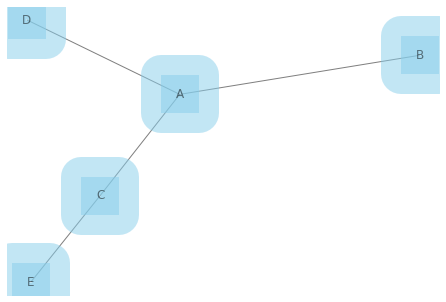
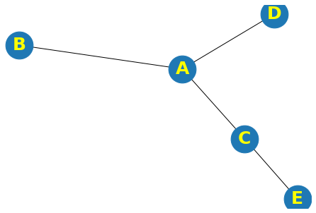
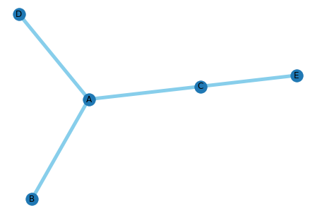
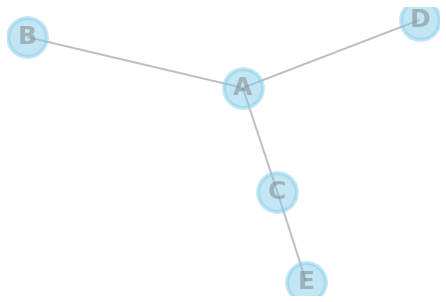

The customisations are separated in 3 main categories: **nodes**, **node labels** and **edges**:

## Nodes

The `draw()` function of networkx library is used to draw the graph G with matplotlib. You can make customization to the nodes by passing these parameters to the function: **node_size**, **node_color**, **node_shape**, **alpha**, **linewidths**.

```python
# libraries
import pandas as pd
import numpy as np
import networkx as nx
import matplotlib.pyplot as plt
 
# Build a dataframe with your connections
df = pd.DataFrame({ 'from':['A', 'B', 'C','A'], 'to':['D', 'A', 'E','C']})
 
# Build your graph
G=nx.from_pandas_edgelist(df, 'from', 'to')
 
# Graph with Custom nodes:
nx.draw(G, with_labels=True, node_size=1500, node_color="skyblue", node_shape="s", alpha=0.5, linewidths=40)
plt.show()
```

:::output

:::

## Labels

You can custom the labels of nodes by passing **font_size**, **font_color** and **font_weight** parameters to the function.

```python
# libraries
import pandas as pd
import numpy as np
import networkx as nx
import matplotlib.pyplot as plt
 
# Build a dataframe with your connections
df = pd.DataFrame({ 'from':['A', 'B', 'C','A'], 'to':['D', 'A', 'E','C']})
 
# Build your graph
G=nx.from_pandas_edgelist(df, 'from', 'to')
 
# Custom the labels:
nx.draw(G, with_labels=True, node_size=1500, font_size=25, font_color="yellow", font_weight="bold")
plt.show()
```

:::output

:::

## Edges

You can custom the edges by passing **width**, **edge_color** and **style** parameters to the function.

```python
# libraries
import pandas as pd
import numpy as np
import networkx as nx
import matplotlib.pyplot as plt
 
# Build a dataframe with your connections
df = pd.DataFrame({ 'from':['A', 'B', 'C','A'], 'to':['D', 'A', 'E','C']})
 
# Build your graph
G=nx.from_pandas_edgelist(df, 'from', 'to')
 
# Chart with Custom edges:
nx.draw(G, with_labels=True, width=5, edge_color="skyblue", style="solid")
```

:::output

:::

## All

We can create a fancy network chart using all parameters described above:

```python
# libraries
import pandas as pd
import numpy as np
import networkx as nx
import matplotlib.pyplot as plt
 
# Build a dataframe with your connections
df = pd.DataFrame({ 'from':['A', 'B', 'C','A'], 'to':['D', 'A', 'E','C']})
 
# Build your graph
G=nx.from_pandas_edgelist(df, 'from', 'to')
 
# All together we can do something fancy
nx.draw(G, with_labels=True, node_size=1500, node_color="skyblue", node_shape="o", alpha=0.5, linewidths=4, font_size=25, 
        font_color="grey", font_weight="bold", width=2, edge_color="grey")
```

:::output

:::
