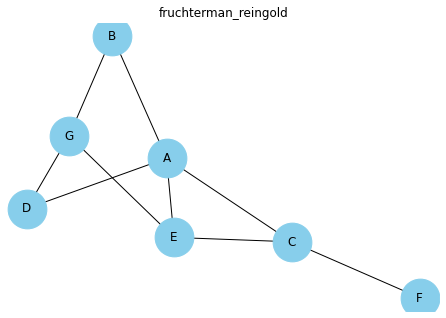
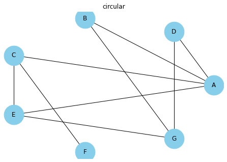
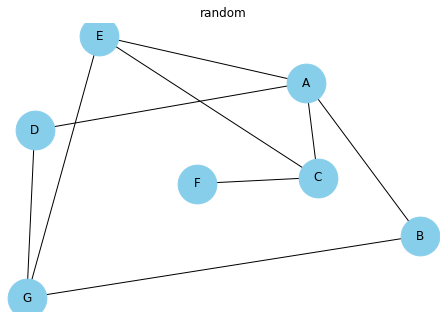
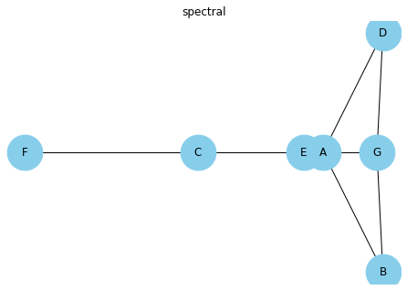
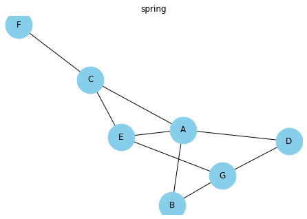

There is actually an algorithm that calculates the most **optimal position** of each node. Several algorithms have been developed and are proposed by NetworkX. This page illustrates this concept by taking the same small dataset and applying different layout algorithms on it. If you have no idea which one is the best for you, just let the function to use the default! (It will be the fruchterman Reingold solution). Read more about it with `help(nx.layout)`.

```python
# libraries
import pandas as pd
import numpy as np
import networkx as nx
import matplotlib.pyplot as plt
 
# Build a dataframe with your connections
df = pd.DataFrame({ 'from':['A', 'B', 'C','A','E','F','E','G','G','D','F'], 'to':['D', 'A', 'E','C','A','F','G','D','B','G','C']})
df
 
# Build your graph
G=nx.from_pandas_edgelist(df, 'from', 'to')
 
# Fruchterman Reingold
nx.draw(G, with_labels=True, node_size=1500, node_color="skyblue", pos=nx.fruchterman_reingold_layout(G))
plt.title("fruchterman_reingold")
plt.show()
 
# Circular
nx.draw(G, with_labels=True, node_size=1500, node_color="skyblue", pos=nx.circular_layout(G))
plt.title("circular")
plt.show()
 
# Random
nx.draw(G, with_labels=True, node_size=1500, node_color="skyblue", pos=nx.random_layout(G))
plt.title("random")
plt.show()
 
# Spectral
nx.draw(G, with_labels=True, node_size=1500, node_color="skyblue", pos=nx.spectral_layout(G))
plt.title("spectral")
plt.show()
 
# Spring
nx.draw(G, with_labels=True, node_size=1500, node_color="skyblue", pos=nx.spring_layout(G))
plt.title("spring")
plt.show()
```

:::output









:::
