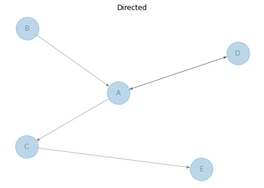
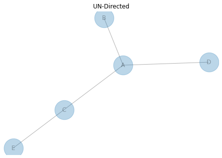

[Network charts](https://python-graph-gallery.com/network-chart/) can be split into 2 main categories: **directed** and **undirected** networks.  

If it is **directed**, there is a notion of **flow** between 2 nodes, thus leaving a place to go somewhere else. Like money goes from company A to company B. That’s why you can see (kind of) arrows on the left chart, it gives the direction. The flow goes from B to A for example.  

If it is **undirected**, there is **just a link** between 2 nodes, like mister A and mister B are friend.  

When you build your graph, you have to use the function that suits your need: `Graph()` is used for undirected (default), `DiGraph()` is used for directed graph.

```python
# libraries
import pandas as pd
import numpy as np
import networkx as nx
import matplotlib.pyplot as plt
 
# ------- DIRECTED
 
# Build a dataframe with your connections
# This time a pair can appear 2 times, in one side or in the other!
df = pd.DataFrame({ 'from':['D', 'A', 'B', 'C','A'], 'to':['A', 'D', 'A', 'E','C']})
 
# Build your graph. Note that we use the DiGraph function to create the graph!
G=nx.from_pandas_edgelist(df, 'from', 'to', create_using=nx.DiGraph() )
 
# Make the graph
nx.draw(G, with_labels=True, node_size=1500, alpha=0.3, arrows=True)
plt.title("Directed")
plt.show()
 
# ------- UNDIRECTED
 
# Build a dataframe with your connections
# This time a pair can appear 2 times, in one side or in the other!
df = pd.DataFrame({ 'from':['D', 'A', 'B', 'C','A'], 'to':['A', 'D', 'A', 'E','C']})
 
# Build your graph. Note that we use the Graph function to create the graph!
G=nx.from_pandas_edgelist(df, 'from', 'to', create_using=nx.Graph() )
 
# Make the graph
nx.draw(G, with_labels=True, node_size=1500, alpha=0.3, arrows=True)
plt.title("UN-Directed")
plt.show()
```

:::output



:::
