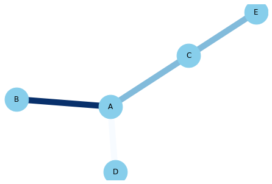
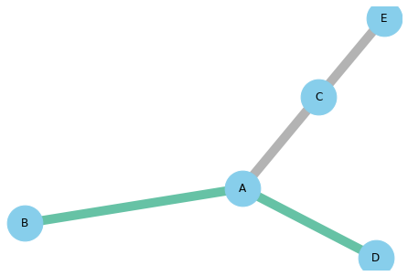

This time, we suppose that we have a feature for each **edge** of our network. For example, this feature can be the amount of money that this links represents (numerical value), or on which continent it happened (categorical value). We want the edge to be different according to this variable, and here is how to do it:

## Numerical

```python
# libraries
import pandas as pd
import numpy as np
import networkx as nx
import matplotlib.pyplot as plt
 
# Build a dataframe with your connections
df = pd.DataFrame({ 'from':['A', 'B', 'C','A'], 'to':['D', 'A', 'E','C'], 'value':[1, 10, 5, 5]})
 
# Build your graph
G=nx.from_pandas_edgelist(df, 'from', 'to', create_using=nx.Graph() )
 
# Custom the nodes:
nx.draw(G, with_labels=True, node_color='skyblue', node_size=1500, edge_color=df['value'], width=10.0, edge_cmap=plt.cm.Blues)
```

:::output

:::

## Categorical

```python
# libraries
import pandas as pd
import numpy as np
import networkx as nx
import matplotlib.pyplot as plt
 
# Build a dataframe with your connections
df = pd.DataFrame({ 'from':['A', 'B', 'C','A'], 'to':['D', 'A', 'E','C'], 'value':['typeA', 'typeA', 'typeB', 'typeB']})
 
# And I need to transform my categorical column in a numerical value typeA->1, typeB->2...
df['value']=pd.Categorical(df['value'])
df['value'].cat.codes
 
# Build your graph
G=nx.from_pandas_edgelist(df, 'from', 'to', create_using=nx.Graph() )
 
# Custom the nodes:
nx.draw(G, with_labels=True, node_color='skyblue', node_size=1500, edge_color=df['value'].cat.codes, width=10.0, edge_cmap=plt.cm.Set2)
```

:::output

:::
