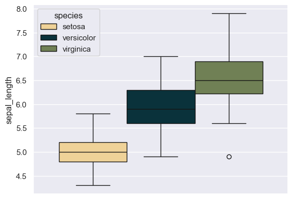
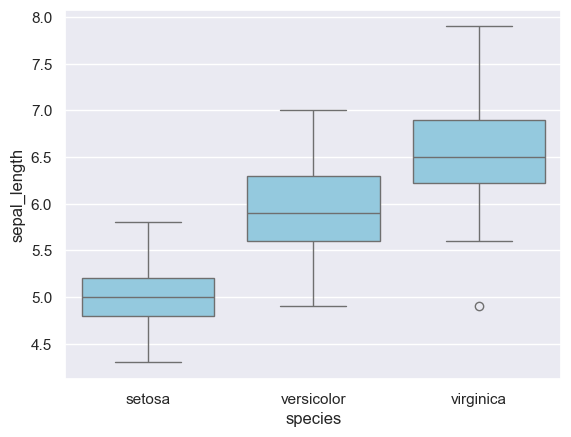
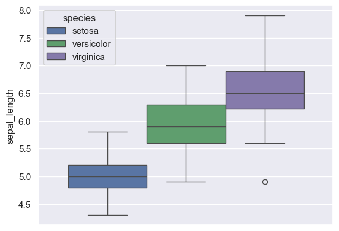
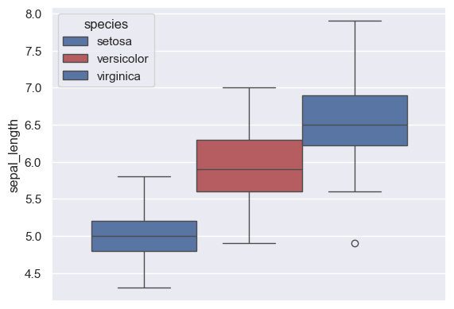
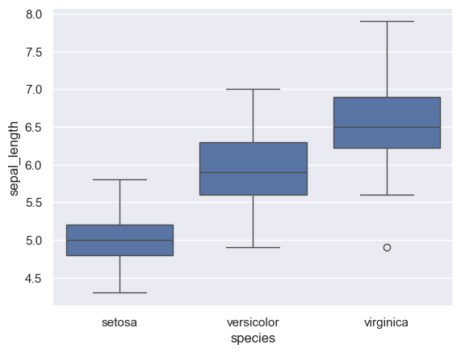

## Using a color palette

Using a palette can help discriminate between several groups and get a better sens of data. You may refer to [Seaborn documentation](https://seaborn.pydata.org/tutorial/color_palettes.html) for extensive information on this topic.

Our palette comes from the [PyPalettes library](/color-palette-finder).

```python
# libraries & dataset
import seaborn as sns
import matplotlib.pyplot as plt
from pypalettes import load_palette

sns.set_theme(style="darkgrid")
df = sns.load_dataset("iris")
palette = load_palette("Acadia", keep_first_n=3)

sns.boxplot(hue=df["species"], y=df["sepal_length"], palette=palette)
plt.show()
```

:::output

:::

## Applying a uniform color

Of course you can easily apply an uniform color to every boxes. Find a list of the numerous colors you can use here. The most common ones are  
b: blue  
g: green  
r: red  
c: cyan  
m: magenta  
y: yellow  
k: black  
w: white

```python
# libraries & dataset
import seaborn as sns
import matplotlib.pyplot as plt

sns.set_theme(style="darkgrid")
df = sns.load_dataset("iris")

sns.boxplot(x=df["species"], y=df["sepal_length"], color="skyblue")
plt.show()
```

:::output

:::

## Specifying a color for each distribution

Specifying colors 'by hand' is quickly performed by creating a dictionnary composed of 'category': 'color' pairs as key:value, such as we did in the following example with my_pal.

```python
# libraries & dataset
import seaborn as sns
import matplotlib.pyplot as plt

sns.set_theme(style="darkgrid")
df = sns.load_dataset("iris")

my_pal = {"versicolor": "g", "setosa": "b", "virginica": "m"}
sns.boxplot(hue=df["species"], y=df["sepal_length"], palette=my_pal)
plt.show()
```

:::output

:::

## Highliting a particular group

You may want to highlight one distribution among others, and this can be done again by creating a custom palette dictionnary, such as before.

```python
# libraries & dataset
import seaborn as sns
import matplotlib.pyplot as plt

sns.set_theme(style="darkgrid")
df = sns.load_dataset("iris")

my_pal = {
    species: "r" if species == "versicolor" else "b" for species in df.species.unique()
}
sns.boxplot(hue=df["species"], y=df["sepal_length"], palette=my_pal)
plt.show()
```

:::output

:::

## Adding transparency to your figure

I personally think that charts look better with transparency. I find out how to do it using [mwaskom's Github post](https://github.com/mwaskom/seaborn/issues/979).  
If you want to dig deeper on the matter, you can start with [matplotlib documentation on Artist objects](https://matplotlib.org/tutorials/intermediate/artists.html).

```python
# libraries & dataset
import seaborn as sns
import matplotlib.pyplot as plt

sns.set_theme(style="darkgrid")
df = sns.load_dataset("iris")

# usual boxplot, plotted on a matplotlib.axes object named ax
ax = sns.boxplot(x="species", y="sepal_length", data=df)

# adding transparency to colors
for patch in ax.artists:
    r, g, b, a = patch.get_facecolor()
    patch.set_facecolor((r, g, b, 0.3))

plt.show()
```

:::output

:::
