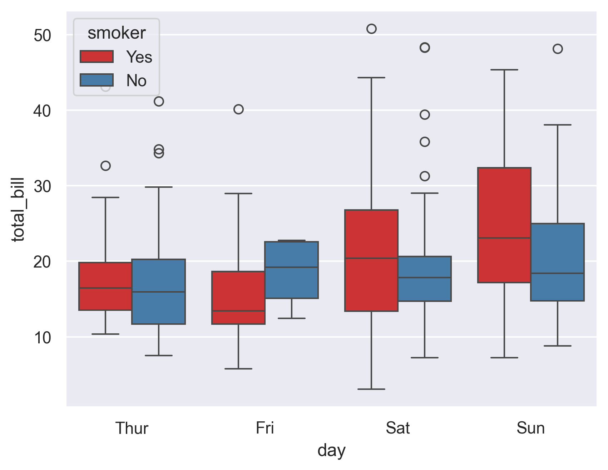
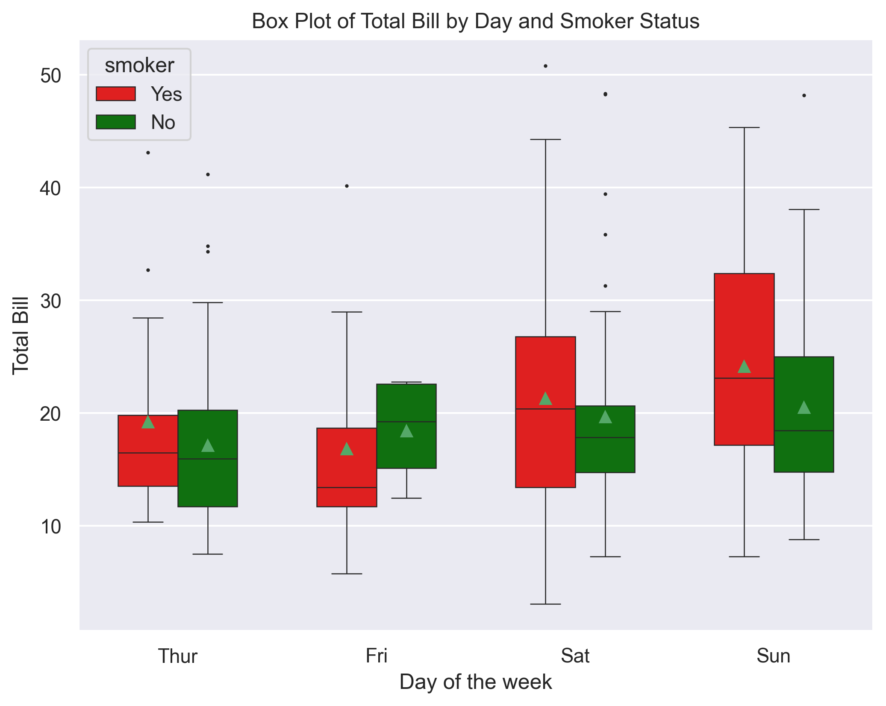

## Libraries & Dataset

First, you need to install the following libraries:

- [seaborn](https://python-graph-gallery.com/seaborn/) is used for creating the plot and load the dataset
- [matplotlib](https://python-graph-gallery.com/matplotlib/) is used for customization purposes

We'll use a dataset on customers in a bar that you can **easily load** with the code below.

If you've never worked with [seaborn](https://python-graph-gallery.com/seaborn/), remember to run `pip install seaborn` in your terminal/command prompt before.

```python
import seaborn as sns
import matplotlib.pyplot as plt
df = sns.load_dataset('tips')
```

## Simple boxplot with groups and subgroups

With [seaborn](https://python-graph-gallery.com/seaborn/), this chart is very easy to make. We start by adding a dark grid in the background thanks to the `set()` function and then we use the `boxplot()` function with the following arguments:

- `x`: the variable in the x-axis (qualitative, the **day of the week**)
- `y`: the variable in the y-axis (quantitative, the **total bill**)
- `hue`: the variable by which we want to separate our box plot (**smoker or not**), for each value in the other qualitative variable (**day of the week**)
- `data`: the dataset where our variables are stored (**df**)

Optionnal:

- `palette`: the set of color we want to use
- `width`: width of each boxplot

```python
# Add a dark grid
sns.set_theme(style="darkgrid")

# Create and display the plot
sns.boxplot(x="day",
            y="total_bill",
            hue="smoker",
            data=df,
            palette="Set1",
            width=0.8)
plt.show()
```

:::output

:::

## Customize boxplots with groups and subgroups

To make our previous graphics more aesthetic and customized, we'll add the following components:

- use a **custom palette**: we put in `red` customer who smokes and `green` if not
- add **axis label** and a **title**
- change the **width of the lines** around boxplots with `linewidth` argument
- add the **mean of each distribution** with `showmeans=True` argument
- change the **size of the outliers** with the `fliersize` argument

```python
# Customization
sns.set_theme(style="darkgrid")
plt.figure(figsize=(8, 6))

# Define a custom color palette
custom_palette = {"Yes": "red", "No": "green"}

# Create and display the plot
sns.boxplot(x="day",
            y="total_bill",
            hue="smoker",
            data=df,
            palette=custom_palette,  # Use the custom palette
            width=0.6,
            linewidth=0.6,
            showmeans=True,
            fliersize=1,
            )  

# Add a title
plt.title("Box Plot of Total Bill by Day and Smoker Status")

# Add labels to the axes
plt.xlabel("Day of the week")
plt.ylabel("Total Bill")

# Show the plot
plt.show()
```

:::output

:::

## Going further

This post explains how to create a grouped boxplot in [seaborn](https://python-graph-gallery.com/seaborn/).

For more examples of **how to create or customize** your boxplots, see the [boxplot section](https://python-graph-gallery.com/boxplot/). You may also be interested in how to [add individual observation in a boxplot](https://python-graph-gallery.com/39-hidden-data-under-boxplot/).
