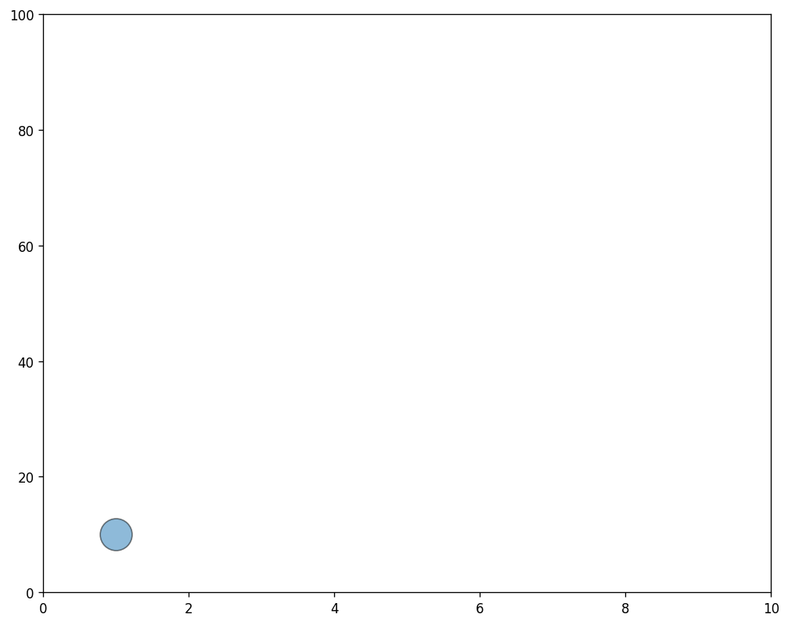

## 📍 Basic scatterplot

Let's start by building a very basic scatterplot. This is extensively described in the [scatterplot section](https://python-graph-gallery.com/scatter-plot/) of the gallery, so let's go straight to the point:

```python
# libraries
import matplotlib.pyplot as plt

fig, ax = plt.subplots(figsize=(10, 8), dpi=120)
ax.scatter(
   1, 10,
   s=600,
   alpha=0.5,
   edgecolors="black"
)
ax.set_xlim(0, 10)
ax.set_ylim(0, 100)
plt.show()
```

:::output

:::

## 🔁 Loop

This Python script creates an animated scatter plot and saves it as a GIF file. Here's a summary of what the code does:

1. **Import Libraries**:

   - `matplotlib.pyplot` is used for plotting.
   - `FuncAnimation` from `matplotlib.animation` is used to create animations.

2. **Set Up the Figure**:

   - A figure and subplot are created with a specified size and resolution.

3. **Define the Update Function**:

   - An `update` function is defined, which will be called for each frame of the animation.
   - The function clears the current plot, draws a scatter plot with changing x and y coordinates, sets the axis limits, and returns the figure and axes.

4. **Create the Animation**:

   - `FuncAnimation` is used to create the animation, calling the `update` function for a specified number of frames.

5. **Save the Animation**:
   - The animation is saved as a GIF file with a specified frame rate (frames per second).

In essence, this script generates an animated scatter plot where the point's position changes in each frame, and the resulting animation is saved as a GIF.

```python
# libraries
import matplotlib.pyplot as plt
from matplotlib.animation import FuncAnimation

# initiate figure
fig, ax = plt.subplots(figsize=(10, 8), dpi=120)

def update(frame):

    ax.clear()
    ax.scatter(
    1+frame, 10+frame*10,
        s=600, alpha=0.5,
        edgecolors="black"
    )
    ax.set_xlim(0, 10)
    ax.set_ylim(0, 100)
    return fig, ax

ani = FuncAnimation(fig, update, frames=range(10))
ani.save("../../static/animations/scatter.gif", fps=5)
```


## Going further

You might be interested in:

- animate the [gapminder dataset](/341-python-gapminder-animation) and how to smooth it
- creating an [advanced animation](/web-animated-line-chart-with-annotation) with text appearing through time
