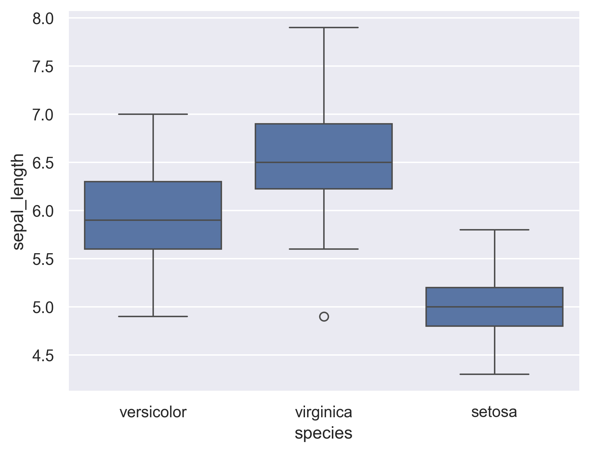
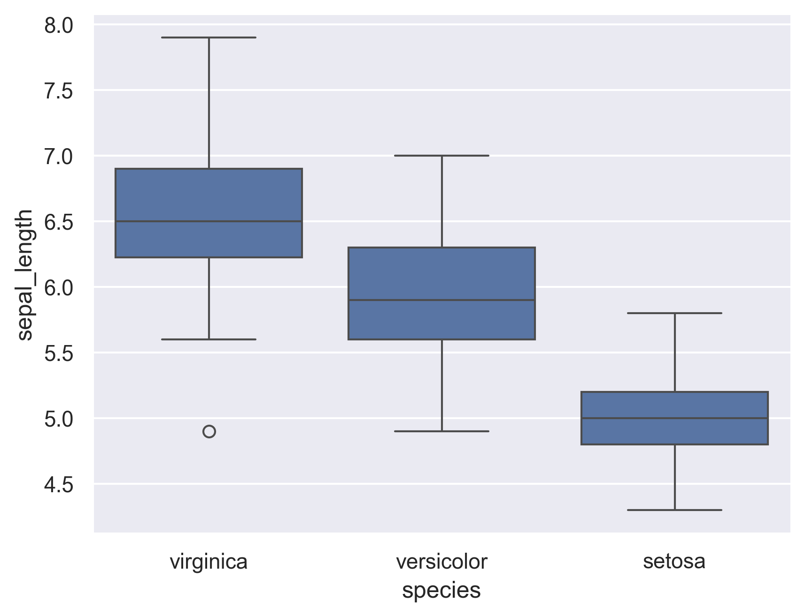

## Defining the order 'by hand'

You can choose to specify the order argument directly by setting its value to a predefined list, such as we did below.

```python
# libraries & dataset
import seaborn as sns
import matplotlib.pyplot as plt
sns.set_theme(style="darkgrid")
df = sns.load_dataset('iris')

sns.boxplot(x='species', y='sepal_length', data=df, order=["versicolor", "virginica", "setosa"])
plt.show()
```

:::output

:::

## By decreasing median

In the example above, we directly specified the order in which we expected our distributions to appear (based on groups name). Not knowing beforehand, we could have decided to dispay the distributions by decreasing median. This can be achieved again by specifying the `order` argument inside the boxplot() function.  
Using pandas groupby, median and slicing in reverse order (thanks to .iloc[::-1]), we are able to define a list of groups ordered by decreasing median, which is then used as a value for the `order` argument.

```python
# libraries & dataset
import seaborn as sns
import matplotlib.pyplot as plt
sns.set_theme(style="darkgrid")
df = sns.load_dataset('iris')
 
# Find the order
my_order = df.groupby(by=["species"])["sepal_length"].median().iloc[::-1].index
 
# Give it to the boxplot
sns.boxplot(x='species', y='sepal_length', data=df, order=my_order)
plt.show()
```

:::output

:::
