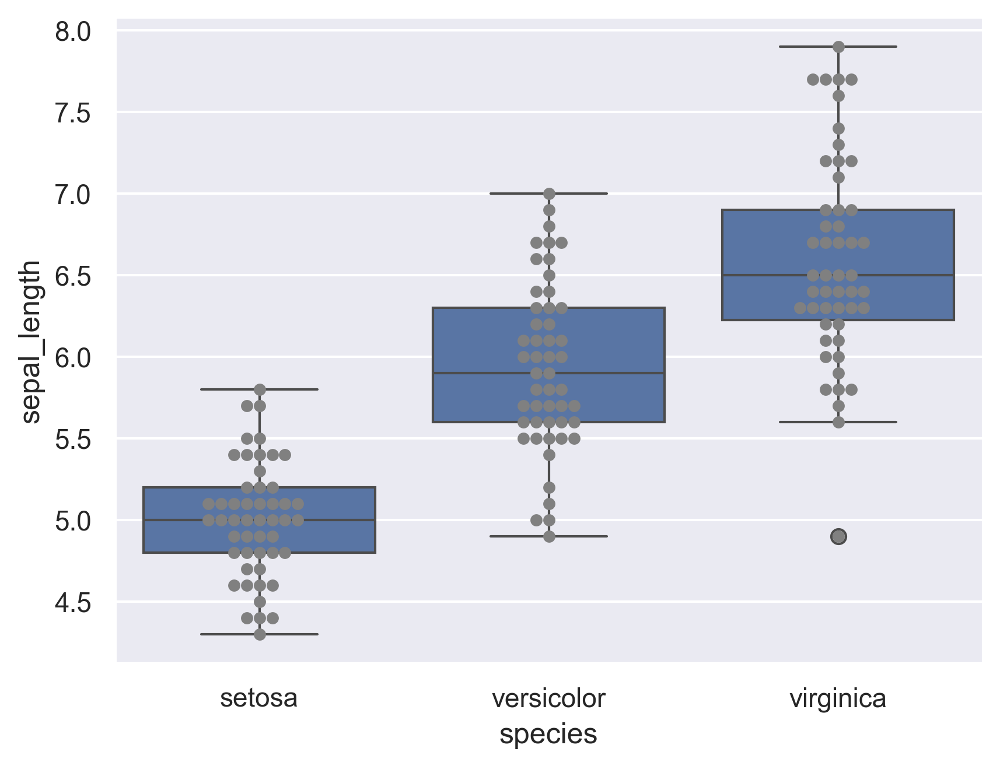

Seaborn boxplot() function does not include any argument to display points directly. To do so, we use a matplotlib.axes object in order to successively plot a seaborn boxplot() and a seaborn swarmplot(). The latter enables us to add points to the figure.  
Overall, such a figure is quite similar to a violinplots in terms of information.

```python
# libraries & dataset
import seaborn as sns
import matplotlib.pyplot as plt
sns.set_theme(style="darkgrid")
df = sns.load_dataset('iris')

# Usual boxplot
ax = sns.boxplot(x='species', y='sepal_length', data=df)
 
# Add jitter with the swarmplot function
ax = sns.swarmplot(x='species', y='sepal_length', data=df, color="grey")
plt.show()
```

:::output

:::
