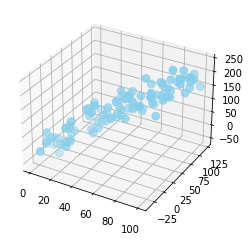

In order to create a 3d graph, you should set projection parameter with '3d' keyword.  Note that most of the customisations presented in the [Scatterplot section](https://python-graph-gallery.com/scatter-plot/) will work in 3D as well. The result can be a bit disappointing since each marker is represented as a dot, not as a sphere..

```python
# libraries
from mpl_toolkits.mplot3d import Axes3D
import matplotlib.pyplot as plt
import numpy as np
import pandas as pd
 
# Dataset
df=pd.DataFrame({'X': range(1,101), 'Y': np.random.randn(100)*15+range(1,101), 'Z': (np.random.randn(100)*15+range(1,101))*2 })
 
# plot
fig = plt.figure()
ax = fig.add_subplot(111, projection='3d')
ax.scatter(df['X'], df['Y'], df['Z'], c='skyblue', s=60)
plt.show()
```

:::output

:::
