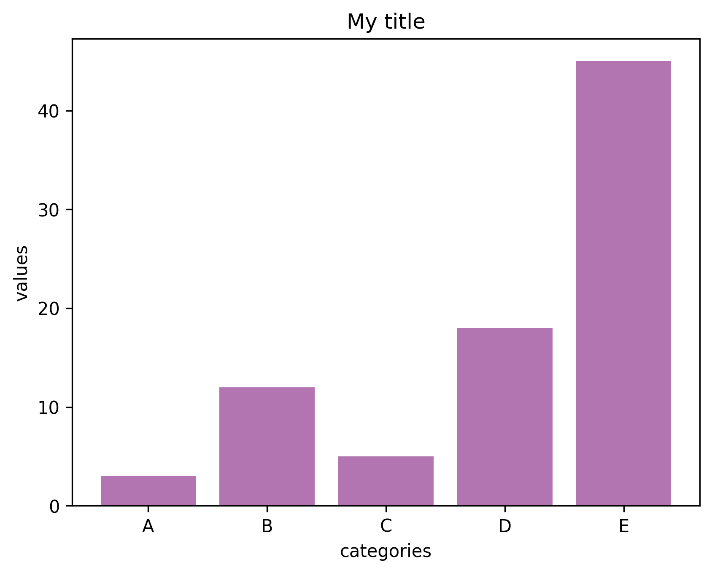

In the following example, **title**, **x label** and **y label** are added to the [barplot](http://python-graph-gallery.com/barplot/) using the `title()`, `xlabel()`, and `ylabel()` functions of the [matplotlib](http://python-graph-gallery.com/matplotlib/) library.

Those functions are applied to a barplot in the example, but the same method would work for other chart types.

```python
# libraries
import numpy as np
import matplotlib.pyplot as plt
 
# create dataset
height = [3, 12, 5, 18, 45]
bars = ('A', 'B', 'C', 'D', 'E')
x_pos = np.arange(len(bars))
 
# Create bars and choose color
plt.bar(x_pos, height, color = (0.5,0.1,0.5,0.6))
 
# Add title and axis names
plt.title('My title')
plt.xlabel('categories')
plt.ylabel('values')
 
# Create names on the x axis
plt.xticks(x_pos, bars)
 
# Show graph
plt.show()
```

:::output

:::

> Note: the [matplotlib section](https://python-graph-gallery.com/matplotlib/) provides a lot of tips and tricks on how to customize a matplotlib chart!
