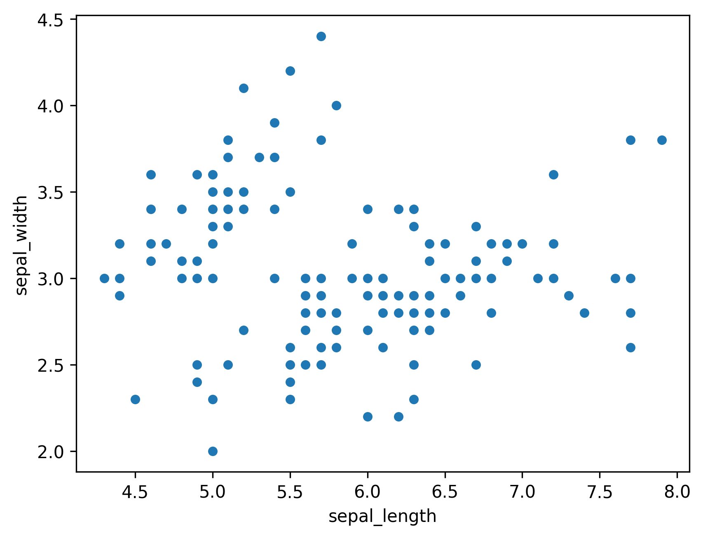
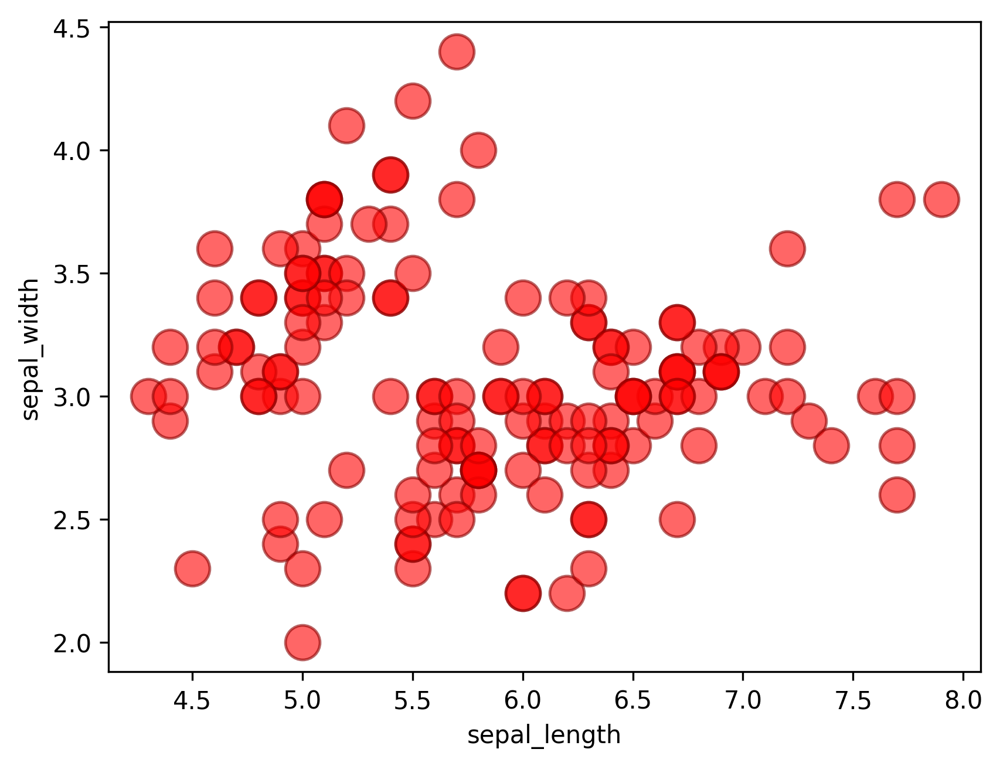

## Libraries

First, we need to load a few libraries:

- [seaborn](https://python-graph-gallery.com/seaborn/): for creating the scatterplot
- [matplotlib](https://python-graph-gallery.com/matplotlib/): for displaying the plot
- [pandas](https://python-graph-gallery.com/pandas/): for data manipulation

```python
import seaborn as sns
import matplotlib.pyplot as plt
import pandas as pd
```

## Dataset

Since [scatter plot](https://python-graph-gallery.com/scatter-plot/) are made for visualizing **relationships between two numerical variables**, we need a dataset that contains at least two numerical columns.

Here, we will use the `iris` dataset that we **load** directly from the gallery:

```python
path = 'https://raw.githubusercontent.com/holtzy/The-Python-Graph-Gallery/master/static/data/iris.csv'
df = pd.read_csv(path)
df.head()
```

:::output
::output-html{src="./output-1.html"}
:::

## Scatter plot

A [scatterplot](/scatter-plot) can be made using `scatterplot()` function of [seaborn](/seaborn) library. An example dataset from seaborn repository, iris dataset, is used in the example. The plot shows the relationship between sepal lenght and width of plants. In order to show the most basic utilization of this function, the following parameters should be provided:

- `x` : positions of points on the X axis
- `y` : positions of points on the Y axis

```python
sns.scatterplot(x=df["sepal_length"], y=df["sepal_width"])
plt.show()
```

:::output

:::

_Alternatively: you can use the following syntax:_

```python
sns.scatterplot(data=df, x="sepal_length", y="sepal_width")
plt.show()
```

:::output

:::

## Customize the scatter plot

The `scatterplot()` function accepts the following arguments (**among others**):

- `color`: of the points
- `edgecolor` : edge colour of the points
- `alpha` : transparency of points (**between 0 and 1**)
- `s`: dot size

You can find all the available colors [here](/python-colors).

```python
sns.scatterplot(
    x=df["sepal_length"],
    y=df["sepal_width"],
    color="red",
    edgecolor="darkred",
    alpha=0.6,
    s=200
)
plt.show()
```

:::output

:::

## Going further

This post explains how to create a [scatterplot](http://python-graph-gallery.com/scatter-plot/) with [seaborn](http://python-graph-gallery.com/seaborn/).

You might be interested in more advanced examples on

- [how to visualize linear regression](/42-custom-linear-regression-fit-seaborn)
- [how to color points according to a third variable](/43-use-categorical-variable-to-color-scatterplot-seaborn).
- [discover more marker customization](/41-control-marker-features).
