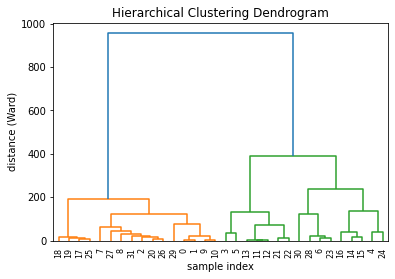

To draw a dendrogram, you first need to have a **numeric matrix**. Each line represents an **entity** (here a car). Each column is a **variable** that describes the cars. The objective is to **cluster** the entities to show who shares similarities with whom. The dendrogram will draw the similar entities closer to each other in the tree.

Let’s start by loading a dataset and the requested libraries:

```python
# Libraries
import pandas as pd
from matplotlib import pyplot as plt
from scipy.cluster.hierarchy import dendrogram, linkage
import numpy as np
 
# Import the mtcars dataset from the web + keep only numeric variables
url = 'https://raw.githubusercontent.com/holtzy/The-Python-Graph-Gallery/master/static/data/mtcars.csv'
df = pd.read_csv(url)
df = df.set_index('model')
df = df.reset_index(drop=True)
df.head()
```

:::output
::output-html{src="./output-1.html"}
:::

All right, now that we have our numeric matrix, we can calculate the **distance** between each car, and draw the **hierarchical clustering**. Distance calculation can be done by the `linkage()` function. I strongly advise you to visit the [next page](https://python-graph-gallery.com/401-customised-dendrogram/) for more details concerning this crucial step.

```python
# Calculate the distance between each sample
# You have to think about the metric you use (how to measure similarity) + about the method of clusterization you use (How to group cars)
Z = linkage(df, 'ward')
```

Last but not least, you can easily plot this object as a [dendrogram](https://python-graph-gallery.com/dendrogram/) using the `dendrogram()` function of scipy library. These parameters are passed to the function:
* `Z` : The linkage matrix
* `labels` : Labels to put under the leaf node
* `leaf_rotation` : Specifies the angle (in degrees) to rotate the leaf labels  


See [post #401](https://python-graph-gallery.com/401-customised-dendrogram/) for possible customisations to a dendrogram.

```python
# Plot title
plt.title('Hierarchical Clustering Dendrogram')

# Plot axis labels
plt.xlabel('sample index')
plt.ylabel('distance (Ward)')

# Make the dendrogram
dendrogram(Z, labels=df.index, leaf_rotation=90)

# Show the graph
plt.show()
```

:::output

:::
