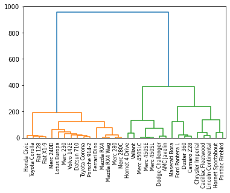
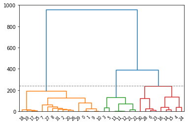
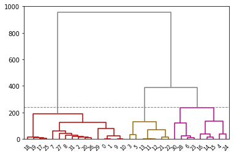
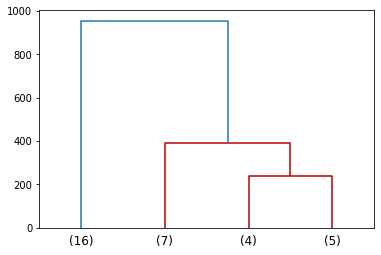
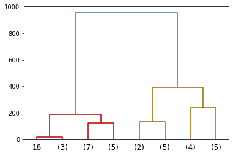
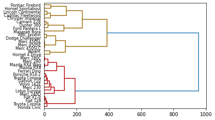
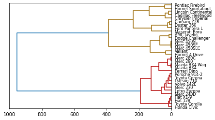

## Leaf Label

In the example below, leaf labels are indicated with the model names of cars, instead of the index numbers. In order to customize leaf labels, the `labels` parameter is passed with the column which has the desired labels. In the example below, the model names of cars are in the index column of the dataframe.

```python
# Libraries
import pandas as pd
from matplotlib import pyplot as plt
from scipy.cluster.hierarchy import dendrogram, linkage
import numpy as np
 
# Data set
url = 'https://raw.githubusercontent.com/holtzy/The-Python-Graph-Gallery/master/static/data/mtcars.csv'
df = pd.read_csv(url)
df = df.set_index('model')
 
# Calculate the distance between each sample
Z = linkage(df, 'ward')
 
# Plot with Custom leaves
dendrogram(Z, leaf_rotation=90, leaf_font_size=8, labels=df.index)

# Show the graph
plt.show()
```

:::output

:::

## Number of Clusters

You can give a threshold value to control the colors of clusters. In the following example, `color_threshold` value is 240. It means all the clusters below the value 240 are specified with different colors and the clusters above 240 are specified with a same color. In order to display the threshold value visually, you can add a horizontal line across the axis using the `axhline()` function.

```python
# Libraries
import pandas as pd
from matplotlib import pyplot as plt
from scipy.cluster.hierarchy import dendrogram, linkage
import numpy as np
 
# Data set
url = 'https://raw.githubusercontent.com/holtzy/The-Python-Graph-Gallery/master/static/data/mtcars.csv'
df = pd.read_csv(url)
df = df.set_index('model')
 
# Calculate the distance between each sample
Z = linkage(df, 'ward')
 
# Control number of clusters in the plot + add horizontal line.
dendrogram(Z, color_threshold=240)
plt.axhline(y=240, c='grey', lw=1, linestyle='dashed')

# Show the graph
plt.show()
```

:::output

:::

## Color

All links connecting nodes which are above the threshold are colored with the default matplotlib color. You can change the default color with passing `above_threshold_color` parameter to the function.

```python
# Libraries
import pandas as pd
from matplotlib import pyplot as plt
from scipy.cluster import hierarchy
import numpy as np
 
# Data set
url = 'https://raw.githubusercontent.com/holtzy/The-Python-Graph-Gallery/master/static/data/mtcars.csv'
df = pd.read_csv(url)
df = df.set_index('model')
 
# Calculate the distance between each sample
Z = hierarchy.linkage(df, 'ward')
 
# Set the colour of the cluster here:
hierarchy.set_link_color_palette(['#b30000','#996600', '#b30086'])
 
# Make the dendrogram and give the colour above threshold
hierarchy.dendrogram(Z, color_threshold=240, above_threshold_color='grey')
 
# Add horizontal line.
plt.axhline(y=240, c='grey', lw=1, linestyle='dashed')

# Show the graph
plt.show()
```

:::output

:::

## Truncate

You can use truncation to condense the dendrogram by passing `truncate_mode` parameter to the `dendrogram()` function. There are 2 modes:
* `lastp` : Plot p leafs at the bottom of the plot
* `level` : No more than p levels of the dendrogram tree are displayed

```python
# Libraries
import pandas as pd
from matplotlib import pyplot as plt
from scipy.cluster import hierarchy
import numpy as np
 
# Data set
url = 'https://raw.githubusercontent.com/holtzy/The-Python-Graph-Gallery/master/static/data/mtcars.csv'
df = pd.read_csv(url)
df = df.set_index('model')
 
# Calculate the distance between each sample
Z = hierarchy.linkage(df, 'ward')
 
# method 1: lastp
hierarchy.dendrogram(Z, truncate_mode = 'lastp', p=4 ) # -> you will have 4 leaf at the bottom of the plot
plt.show()
 
# method 2: level
hierarchy.dendrogram(Z, truncate_mode = 'level', p=2) # -> No more than ``p`` levels of the dendrogram tree are displayed.
plt.show()
```

:::output



:::

## Orientation

The direction to plot the dendrogram can be controlled with the `orientation` parameter of the `dendrogram()`function. The possible orientations are `top`, `bottom`, `left`, and `right`.

```python
# Libraries
import pandas as pd
from matplotlib import pyplot as plt
from scipy.cluster import hierarchy
import numpy as np
 
# Data set
url = 'https://raw.githubusercontent.com/holtzy/The-Python-Graph-Gallery/master/static/data/mtcars.csv'
df = pd.read_csv(url)
df = df.set_index('model')
 
# Calculate the distance between each sample
Z = hierarchy.linkage(df, 'ward')
 
# Orientation of the dendrogram
hierarchy.dendrogram(Z, orientation="right", labels=df.index)
plt.show()
# or
hierarchy.dendrogram(Z, orientation="left", labels=df.index)
plt.show()
```

:::output



:::
