## Default

You can build a dendrogram and heatmap by using the `clustermap()` function of seaborn library. The following example displays a default plot.

```python
# Libraries
import seaborn as sns
import pandas as pd
from matplotlib import pyplot as plt
 
# Data set
url = 'https://raw.githubusercontent.com/holtzy/The-Python-Graph-Gallery/master/static/data/mtcars.csv'
df = pd.read_csv(url)
df = df.set_index('model')
 
# Default plot
sns.clustermap(df)

# Show the graph
plt.show()
```

:::output
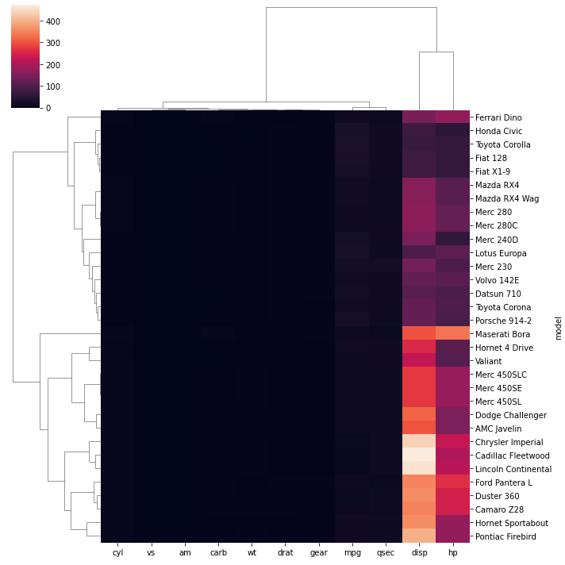
:::

## Normalize

It is possible to standardize or normalize the data you want to plot by passing the `standard_scale` or `z_score` aguments to the function:
* `standard_scale` : Either 0 (rows) or 1 (columns)
* `z_score` : Either 0 (rows) or 1 (columns)

```python
# Libraries
import seaborn as sns
import pandas as pd
from matplotlib import pyplot as plt
 
# Data set
url = 'https://raw.githubusercontent.com/holtzy/The-Python-Graph-Gallery/master/static/data/mtcars.csv'
df = pd.read_csv(url)
df = df.set_index('model')
 
# Standardize or Normalize every column in the figure
# Standardize:
sns.clustermap(df, standard_scale=1)
plt.show(
)
# Normalize
sns.clustermap(df, z_score=1)
plt.show()
```

:::output


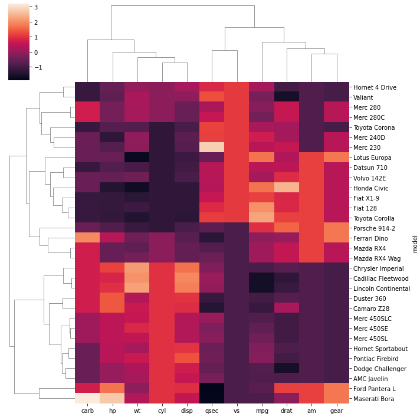
:::

## Distance Method

You can use different distance metrics for your data using the `metric` parameter. The most common methods are **correlation** and **euclidean** distance.

```python
# Libraries
import seaborn as sns
import pandas as pd
from matplotlib import pyplot as plt
 
# Data set
url = 'https://raw.githubusercontent.com/holtzy/The-Python-Graph-Gallery/master/static/data/mtcars.csv'
df = pd.read_csv(url)
df = df.set_index('model') 
 
# plot with correlation distance
sns.clustermap(df, metric="correlation", standard_scale=1)
plt.show()

# plot with euclidean distance
sns.clustermap(df, metric="euclidean", standard_scale=1)
plt.show()
```

:::output
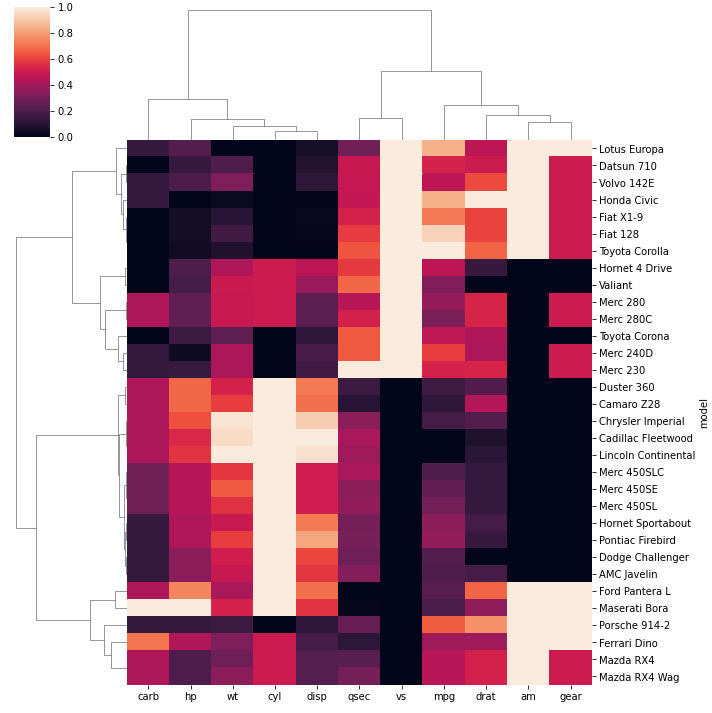

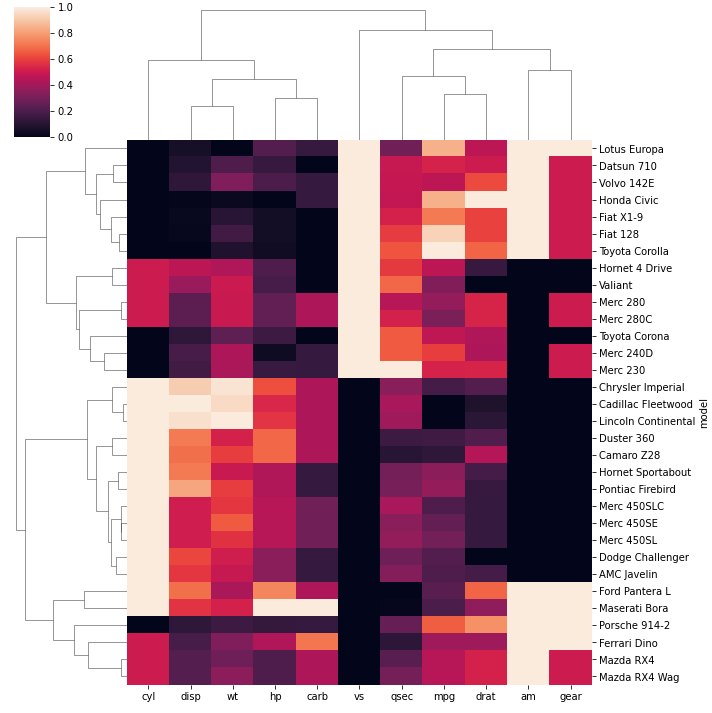
:::

## Cluster Method

Since we determined the distance calculation method, now we can set the linkage method to use for calculating clusters with the `method` parameter.

```python
# Libraries
import seaborn as sns
import pandas as pd
from matplotlib import pyplot as plt
 
# Data set
url = 'https://raw.githubusercontent.com/holtzy/The-Python-Graph-Gallery/master/static/data/mtcars.csv'
df = pd.read_csv(url)
df = df.set_index('model')
 
# linkage method to use for calculating clusters: single
sns.clustermap(df, metric="euclidean", standard_scale=1, method="single")
plt.show()

# linkage method to use for calculating clusters: ward
sns.clustermap(df, metric="euclidean", standard_scale=1, method="ward")
plt.show()
```

:::output
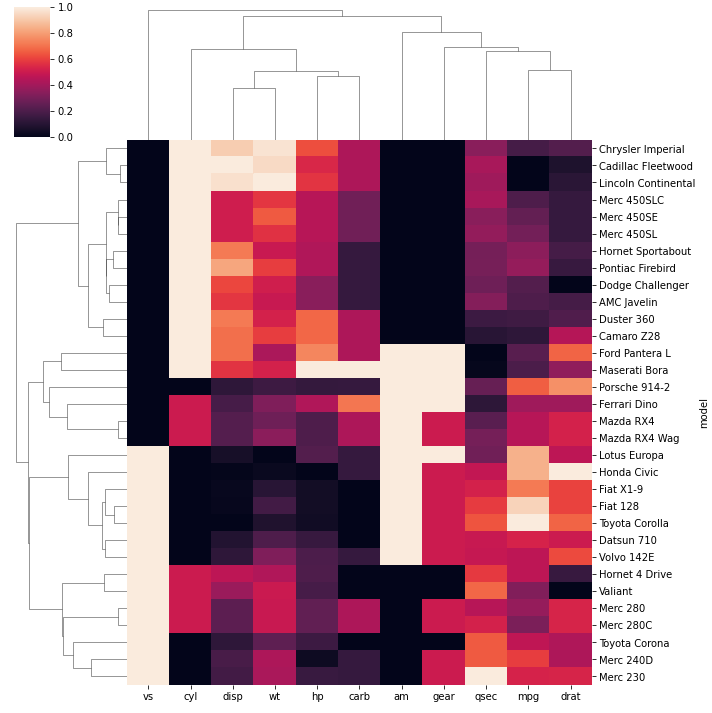

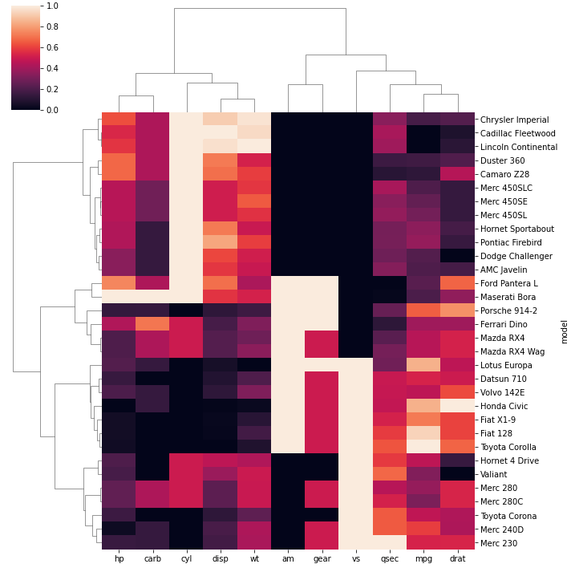
:::

## Color

The color palette can be passed to the `clustermap()` function with the `cmap` parameter.

```python
# Libraries
import seaborn as sns
import pandas as pd
from matplotlib import pyplot as plt
 
# Data set
url = 'https://raw.githubusercontent.com/holtzy/The-Python-Graph-Gallery/master/static/data/mtcars.csv'
df = pd.read_csv(url)
df = df.set_index('model')
 
# Change color palette
sns.clustermap(df, metric="euclidean", standard_scale=1, method="ward", cmap="mako")
plt.show()
sns.clustermap(df, metric="euclidean", standard_scale=1, method="ward", cmap="viridis")
plt.show()
sns.clustermap(df, metric="euclidean", standard_scale=1, method="ward", cmap="Blues")
plt.show()
```

:::output
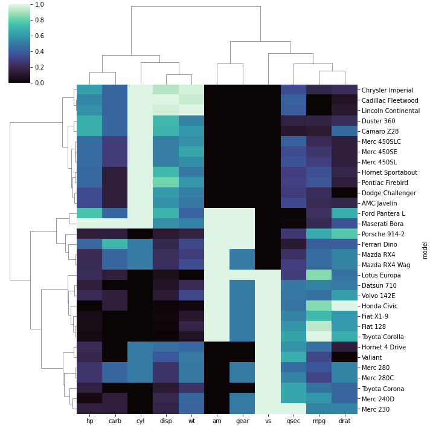

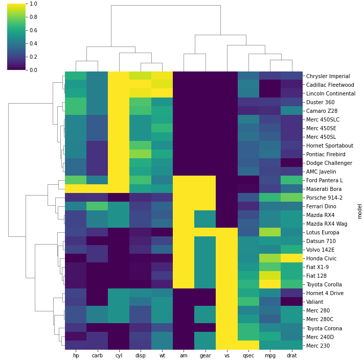

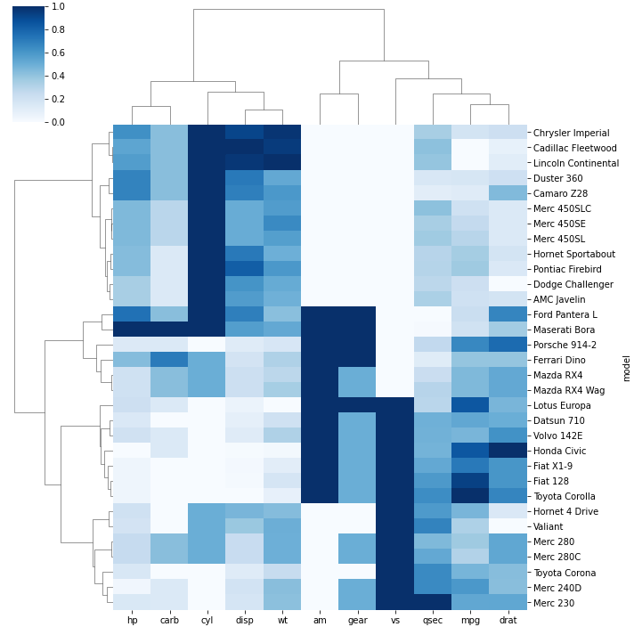
:::

## Outliers

In order to ignore an outlier in a heatmap, you can use `robust` parameter:
* `robust` : If True, the colormap range is computed with robust quantiles instead of the extreme values

```python
# Libraries
import seaborn as sns
import pandas as pd
from matplotlib import pyplot as plt
 
# Data set
url = 'https://raw.githubusercontent.com/holtzy/The-Python-Graph-Gallery/master/static/data/mtcars.csv'
df = pd.read_csv(url)
df = df.set_index('model')
 
# Let's create an outlier in the dataset:
df.loc[15:16,'drat'] = 1000

# use the outlier detection
sns.clustermap(df, robust=True)
plt.show()
 
# do not use it
sns.clustermap(df, robust=False)
plt.show()
```

:::output
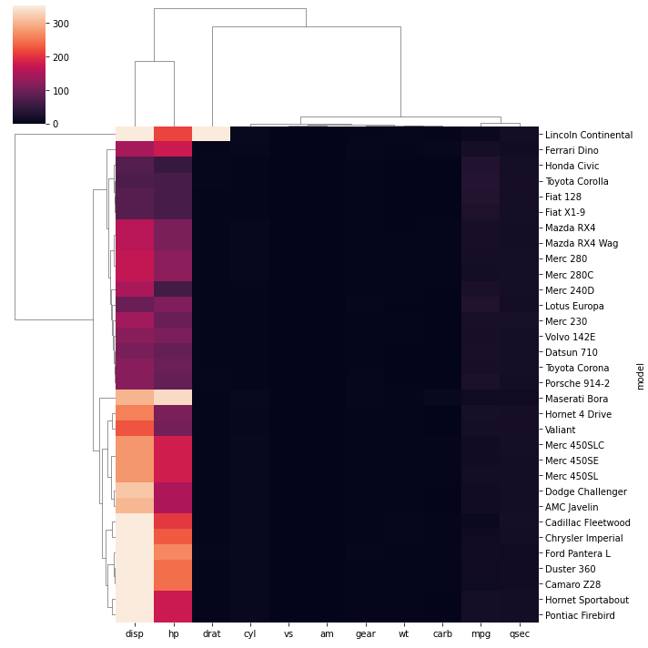

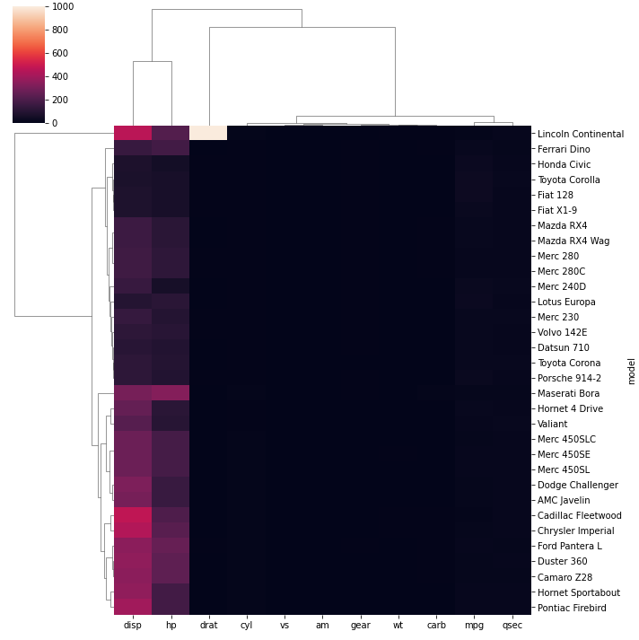
:::
