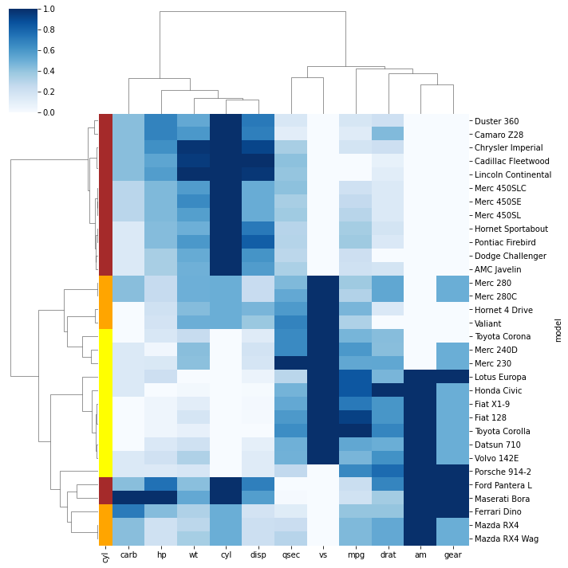

In the example, mtcars dataset that shows the features of cars through numerical variables is used. While clustering cars, a color sheme is added to the left part of the plot. The 3 colours represent the 3 possible values of the ‘cyl’ column. By using this feature, you can evaluate whether samples within a group are clustered together.

```python
# Libraries
import seaborn as sns
import pandas as pd
from matplotlib import pyplot as plt
 
# Data set
url = 'https://raw.githubusercontent.com/holtzy/The-Python-Graph-Gallery/master/static/data/mtcars.csv'
df = pd.read_csv(url)
df = df.set_index('model')
 
# Prepare a vector of color mapped to the 'cyl' column
my_palette = dict(zip(df.cyl.unique(), ["orange","yellow","brown"]))
row_colors = df.cyl.map(my_palette)
 
# plot
sns.clustermap(df, metric="correlation", method="single", cmap="Blues", standard_scale=1, row_colors=row_colors)
plt.show()
```

:::output

:::
