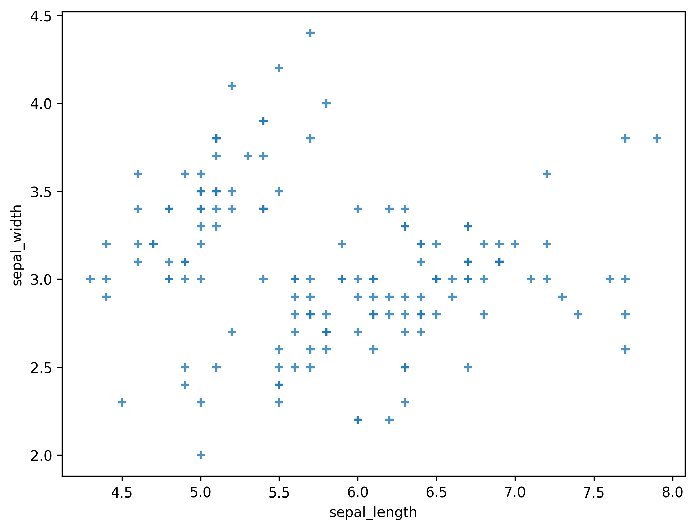
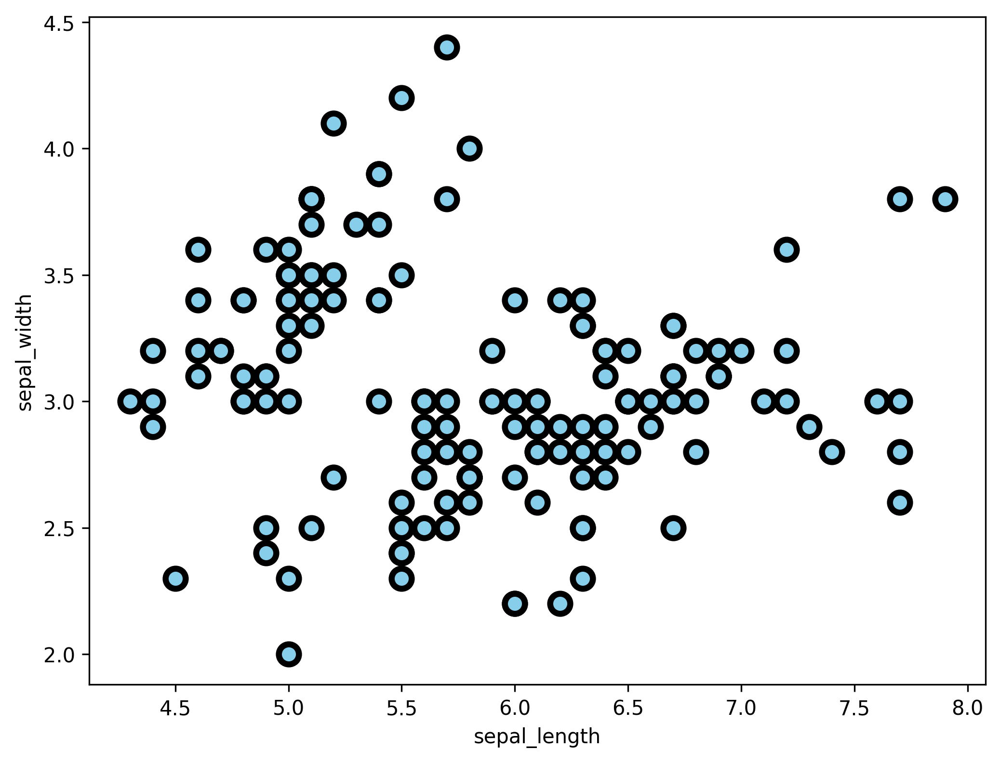

## Libraries

First, we need to load a few libraries:

- [seaborn](https://python-graph-gallery.com/seaborn/): for creating the scatterplot
- [matplotlib](https://python-graph-gallery.com/matplotlib/): for displaying the plot
- [pandas](https://python-graph-gallery.com/pandas/): for data manipulation

```python
import pandas as pd
import matplotlib.pyplot as plt
import seaborn as sns

plt.rcParams["figure.dpi"] = 300
```

## Dataset

Since [scatter plot](https://python-graph-gallery.com/scatter-plot/) are made for visualizing **relationships between two numerical variables**, we need a dataset that contains at least two numerical columns.

Here, we will use the `iris` dataset that we **load** directly from the gallery:

```python
path = 'https://raw.githubusercontent.com/holtzy/The-Python-Graph-Gallery/master/static/data/iris.csv'
df = pd.read_csv(path)
df.head()
```

:::output
::output-html{src="./output-1.html"}
:::

## Control Marker Shape

In order to **change the shape** of the marker, you need to provide:

- `marker`: the shape of the marker

There are actually lots of **different shapes available**. Here are a few examples:

- `'o'`: circle
- `'s'`: square
- `'+'`: plus
- `'x'`: cross
- `'D'`: diamond
- `'h'`: hexagon
- `'p'`: pentagon
- `'v'`: triangle_down
- `'^'`: triangle_up
- `'<'`: triangle_left
- `'>'`: triangle_right
- all numbers from `1` to `4`
- and many more...

You can find them by running the following code:

```
from matplotlib import markers
print(markers.MarkerStyle.markers.keys())
```

```python
fig, ax = plt.subplots(figsize=(8, 6))
sns.regplot(
    x=df["sepal_length"],
    y=df["sepal_width"],
    marker="+",
    fit_reg=False,
    ax=ax
)

plt.show()
```

:::output

:::

## Changing Color, Transparency and Size of Markers

You can also change the **other features** of markers in a plot thanks to `scatter_kws`.

This argument accepts a dictionary of argument names and their values. These values will be **exclusively used to style the dots**. For example, `scatter_kws={"color" : "red", "alpha" : 1.5}` will render the line red and with an opacity of 0.3.

- `color` : color of the markers
- `alpha` : opacity of the markers
- `s` : size of the markers

```python
fig, ax = plt.subplots(figsize=(8, 6))
sns.scatterplot(
    x=df["sepal_length"],
    y=df["sepal_width"],
    color="skyblue",
    alpha=1,
    s=100,
    edgecolor="black",
    lw=3,
    ax=ax
)
plt.show()
```

:::output

:::

## Going further

This post explains how to customize the **appearance of the markers** in a [scatter plot](https://python-graph-gallery.com/scatter-plot/) with [seaborn](http://python-graph-gallery.com/seaborn/).

You might be interested in

- [how to visualize linear regression](/42-custom-linear-regression-fit-seaborn)
- how to create a [bubble plot](https://python-graph-gallery.com/bubble-plot/), a kind of scatter plot where the size of the marker is **proportional to a third variable**
- how to [colors dots according to a variable](https://python-graph-gallery.com/43-use-categorical-variable-to-color-scatterplot-seaborn/).
