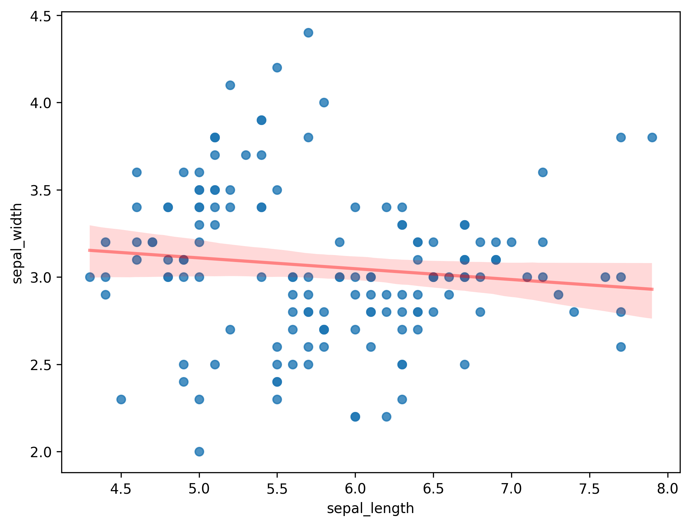
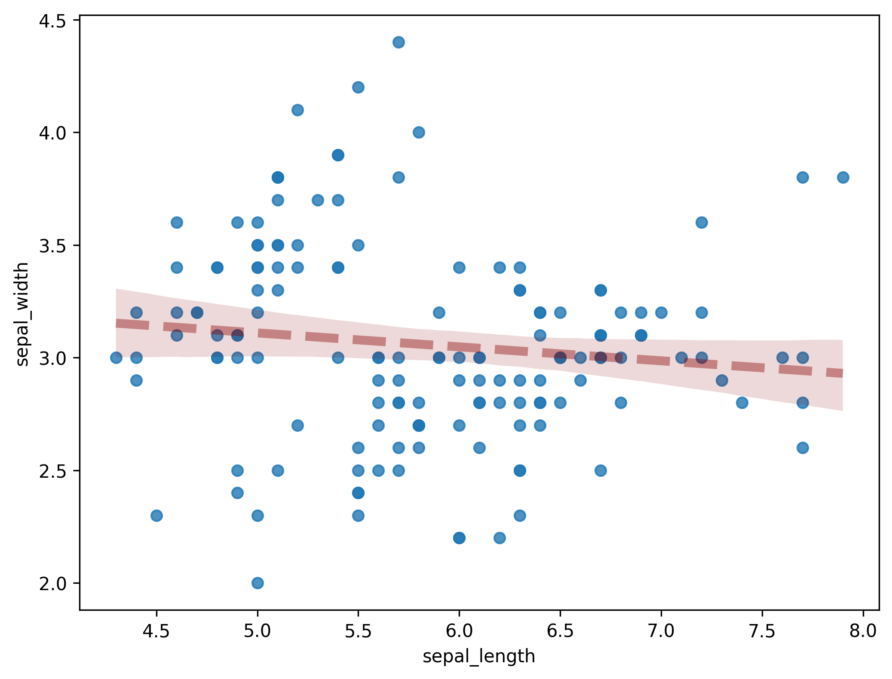

## Libraries

First, we need to load a few libraries:

- [seaborn](https://python-graph-gallery.com/seaborn/): for creating the scatterplot
- [matplotlib](https://python-graph-gallery.com/matplotlib/): for displaying the plot
- [pandas](https://python-graph-gallery.com/pandas/): for data manipulation

```python
import pandas as pd
import matplotlib.pyplot as plt
import seaborn as sns
```

## Dataset

Since [scatter plot](https://python-graph-gallery.com/scatter-plot/) are made for visualizing **relationships between two numerical variables**, we need a dataset that contains at least two numerical columns.

Here, we will use the `iris` dataset that we **load** directly from the gallery:

```python
path = 'https://raw.githubusercontent.com/holtzy/The-Python-Graph-Gallery/master/static/data/iris.csv'
df = pd.read_csv(path)
df.head()
```

:::output
::output-html{src="./output-1.html"}
:::

## Color and width

You can custom the appearance of the **regression fit** in a scatterplot built with [seaborn](http://python-graph-gallery.com/seaborn/) thanks to the `line_kws` argument.

This argument accepts a dictionary of argument names and their values. These values will be **exclusively used to style the line**. For example, `line_kws={"color" : "red", "linewidth" : 1.5}` will render the line red and with a width of 1.5.

```python
fig, ax = plt.subplots(figsize=(8, 6))
sns.regplot(
    x=df["sepal_length"],
    y=df["sepal_width"],
    line_kws={"color": "red", "linewidth": 1.5},
    ax=ax
)
plt.show()
```

:::output

:::

## Opacity

You can also custom the **opacity** of the line with the `alpha` value:

```python
fig, ax = plt.subplots(figsize=(8, 6))
sns.regplot(
    x=df["sepal_length"],
    y=df["sepal_width"],
    line_kws={
        "color": "r",
        "alpha": 0.4
    },
    ax=ax
)
plt.show()
```

:::output

:::

## Line width and style

You can also custom the **line width** and **style** with the `linewidth` and `linestyle` values:

```python
fig, ax = plt.subplots(figsize=(8, 6))
sns.regplot(
    x=df["sepal_length"],
    y=df["sepal_width"],
    line_kws={
        "color": "darkred",
        "alpha": 0.4,
        "lw": 5,
        "ls": "--"
    },
    ax=ax
)
plt.show()
```

:::output

:::

## Going further

This post explains how to customize the **appearance of a regression fit** in a [scatter plot](/scatter-plot) with [seaborn](/seaborn).

You might be interested in more advanced examples on:

- [combine regression fit with facetting](/47-faceted-scatter-plot-with-seaborn)
- [how to better visualize linear regression](/556-visualize-linear-regression)
- [how to color points according to a third variable](/43-use-categorical-variable-to-color-scatterplot-seaborn).
- [discover more marker customization](/41-control-marker-features).
