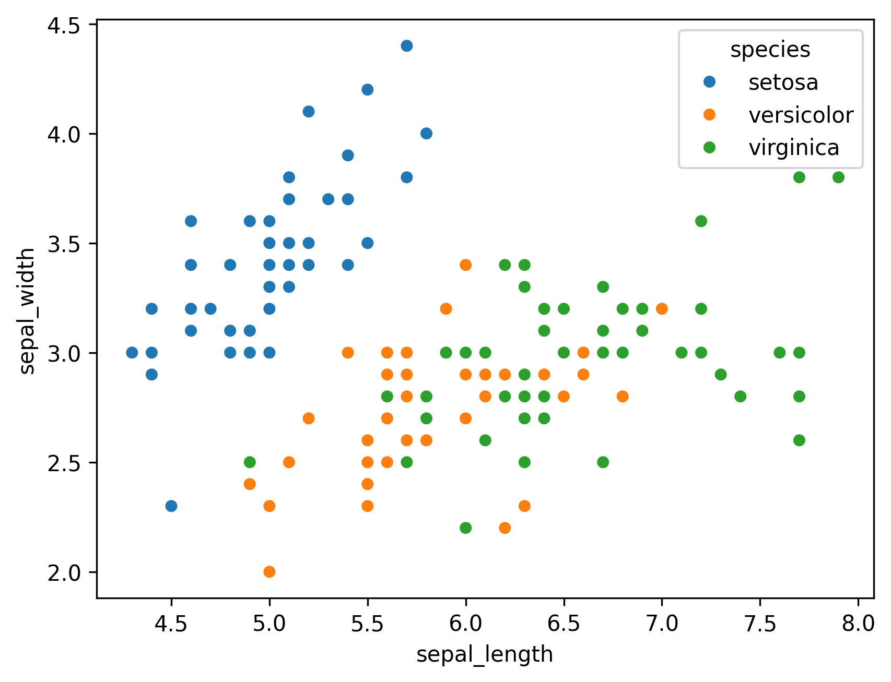
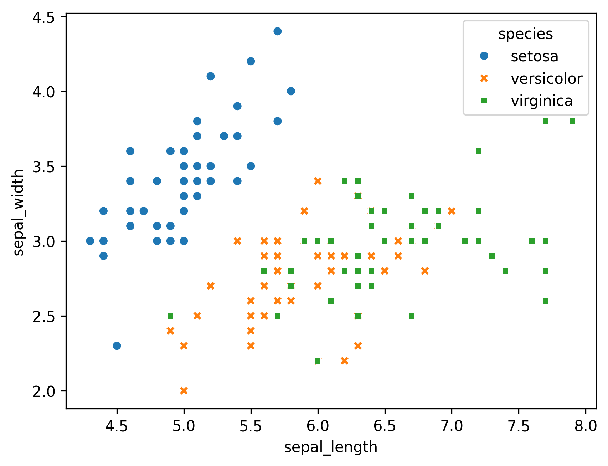
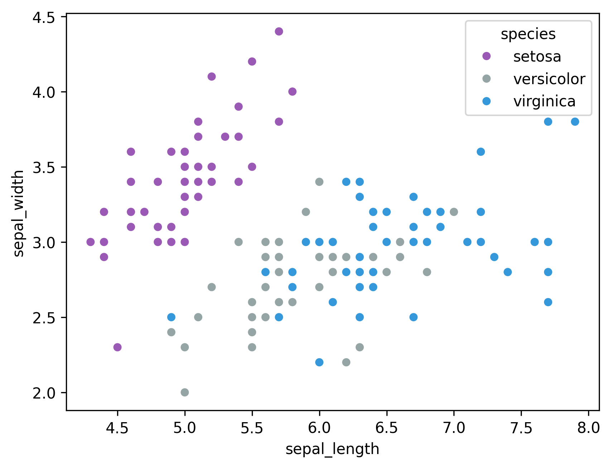

Using [seaborn](http://python-graph-gallery.com/40-basic-scatterplot-seaborn/) library, you can plot a basic scatterplot with the ability to use color encoding for different subsets of data. In the following examples, the iris dataset from seaborn repository is used. Using `hue` argument, it is possible to define groups in your data by different colors or shapes.

## Map a color per group

This example uses `scatterplot()` function of [seaborn](/seaborn) library. In order to define **each species with different colors**, species column of the dataset given in `hue` argument. The list of arguments needed for the function is:

- `x` : name of the column in `data` containing the points for the X axis
- `y` : name of the column in `data` containing the points for the Y axis
- `data` : dataset
- `hue` : variables that define subsets of the data

```python
# library & dataset
import seaborn as sns
import matplotlib.pyplot as plt
plt.rcParams["figure.dpi"] = 300
df = sns.load_dataset('iris')
 
# Use the 'hue' argument to provide a factor variable
sns.scatterplot(
   x="sepal_length",
   y="sepal_width",
   data=df,
   hue='species',
)

plt.show()
```

:::output

:::

## Map a marker per group

It is also possible to define categories with different forms of marker. Simply add the name of the column you want to map, in the same way as for `hue`.

```python
# library & dataset
import seaborn as sns
import matplotlib.pyplot as plt
df = sns.load_dataset('iris')
 
# Plot with specified markers for each species
sns.scatterplot(
    x="sepal_length",
    y="sepal_width",
    data=df,
    hue='species',
    style='species',
)

plt.show()
```

:::output

:::

## Control color of each group

Another alternative to **specify a color palette** for dataset groups in a [seaborn](/seaborn) scatterplot is creating a dictionary mapping hue levels to matplotlib colors.

```python
# library & dataset
import seaborn as sns
import matplotlib.pyplot as plt
df = sns.load_dataset('iris')
 
# Provide a dictionary to the palette argument
sns.scatterplot(
   x="sepal_length",
   y="sepal_width",
   data=df,
   hue='species',
   palette=dict(setosa="#9b59b6", virginica="#3498db", versicolor="#95a5a6"))
 
plt.show()
```

:::output

:::

## Going further

This post explains how to customize the **appearance of the markers** in a [scatter plot](https://python-graph-gallery.com/scatter-plot/) with [seaborn](http://python-graph-gallery.com/seaborn/).

You might be interested in

- [how to visualize linear regression](/42-custom-linear-regression-fit-seaborn)
- how to create a [bubble plot](/bubble-plot), a kind of scatter plot where the size of the marker is **proportional to a third variable**
- how to [add annotations next to each dot](/46-add-text-annotation-on-scatterplot).
