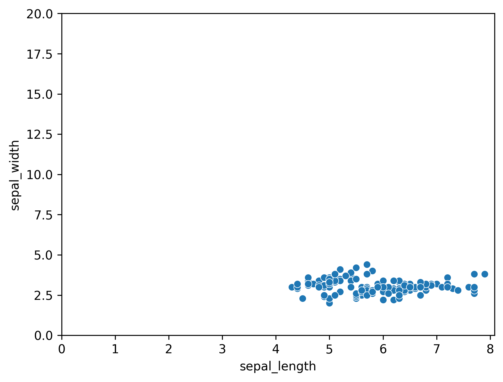

## Basic Scatterplot with Defined Axis Limits

You can control the limits of X and Y axis of your plots using [matplotlib](http://python-graph-gallery.com/matplotlib/) function `plt.xlim()` and `plt.ylim()`. In this example, `lmplot()` function of [seaborn](http://python-graph-gallery.com/40-basic-scatterplot-seaborn/) is used to plot a [basic scatterplot](http://python-graph-gallery.com/40-basic-scatterplot-seaborn/) with iris dataset. There are 2 arguments in these functions;

- `plt.xlim()` : (left, right)
- `plt.ylim()` : (buttom, top)

```python
# library & dataset
import seaborn as sns
import matplotlib.pyplot as plt
df = sns.load_dataset('iris')
 
# basic scatterplot
sns.scatterplot(
   x="sepal_length",
   y="sepal_width",
   data=df
)
 
# control x and y limits
plt.ylim(0, 20)
plt.xlim(0, None)
 
plt.show()
```

:::output

:::

## Going further

This post explains how to customize the **appearance of the markers** in a [scatter plot](https://python-graph-gallery.com/scatter-plot/) with [seaborn](http://python-graph-gallery.com/seaborn/).

You might be interested in

- [how to visualize linear regression](/42-custom-linear-regression-fit-seaborn)
- how to create a [bubble plot](https://python-graph-gallery.com/bubble-plot/), a kind of scatter plot where the size of the marker is **proportional to a third variable**
- how to [colors dots according to a variable](https://python-graph-gallery.com/43-use-categorical-variable-to-color-scatterplot-seaborn/).
