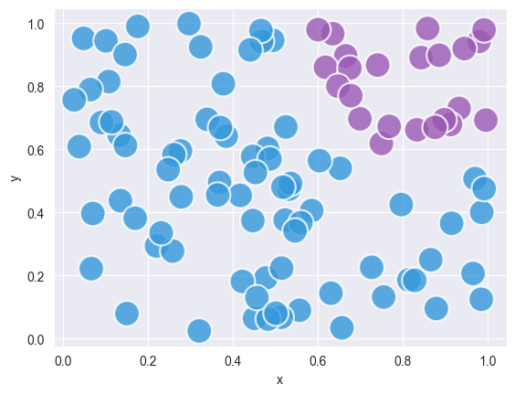
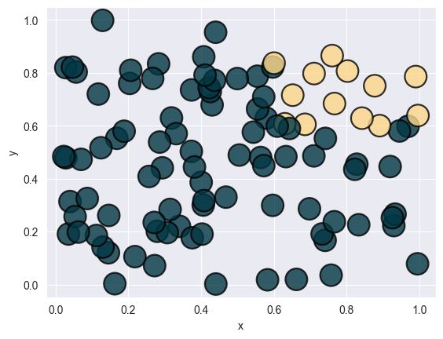

## Select Dots to Color

Previous posts on [controlling marker features](/41-control-marker-features) and [mapping categorical values to colors](/43-use-categorical-variable-to-color-scatterplot-seaborn) covered setting marker colors globally or by category.

Here, we'll demonstrate how to **control each marker's color individually**. This example uses a dataset with random points. To manage the colors, we add a column specifying the color for each marker (data point).

```python
# libraries
import pandas as pd
import numpy as np
import matplotlib.pylab as plt
import seaborn as sns

colors = ["#9b59b6", "#3498db"]

# Create data frame with randomly selected x and y positions
df = pd.DataFrame(np.random.random((100, 2)), columns=["x", "y"])

# Add a column: the color depends on x and y values, but you can use any function you want
is_selected_dot = (df["x"] > 0.6) & (df["y"] > 0.6)
df["color"] = np.where(is_selected_dot, colors[0], colors[1])

# plot
sns.set_style("darkgrid")
sns.scatterplot(
    data=df,
    x="x",
    y="y",
    color=df["color"],
    s=400,
    alpha=0.8,
)

plt.show()
```

:::output

:::

## Access more colors with pypalettes

You can easily way more palette colors with [pypalettes](/color-palette-finder). In this case we use the `load_cmap()` function with the "Acadia" palette, and keep the first 2 colors of it.

If you haven't already, install this library with `pip install pypalettes`

```python
# libraries
import pandas as pd
import numpy as np
import matplotlib.pylab as plt
import seaborn as sns
from pypalettes import load_palette

colors = load_palette("Acadia", keep_first_n=2)

# Create data frame with randomly selected x and y positions
df = pd.DataFrame(np.random.random((100, 2)), columns=["x", "y"])

# Add a column: the color depends on x and y values, but you can use any function you want
is_selected_dot = (df["x"] > 0.6) & (df["y"] > 0.6)
df["color"] = np.where(is_selected_dot, colors[0], colors[1])

# plot
sns.set_style("darkgrid")
sns.scatterplot(
    data=df,
    x="x",
    y="y",
    color=df["color"],
    edgecolor="black",
    s=400,
    alpha=0.8,
)

plt.show()
```

:::output

:::

## Going further

This post explains how to customize the **appearance of the markers** in a [scatter plot](https://python-graph-gallery.com/scatter-plot/) with [seaborn](http://python-graph-gallery.com/seaborn/).

You might be interested in

- [how to visualize linear regression](/42-custom-linear-regression-fit-seaborn)
- how to create a [bubble plot](https://python-graph-gallery.com/bubble-plot/), a kind of scatter plot where the size of the marker is **proportional to a third variable**
- how to [colors dots according to a variable](https://python-graph-gallery.com/43-use-categorical-variable-to-color-scatterplot-seaborn/).
