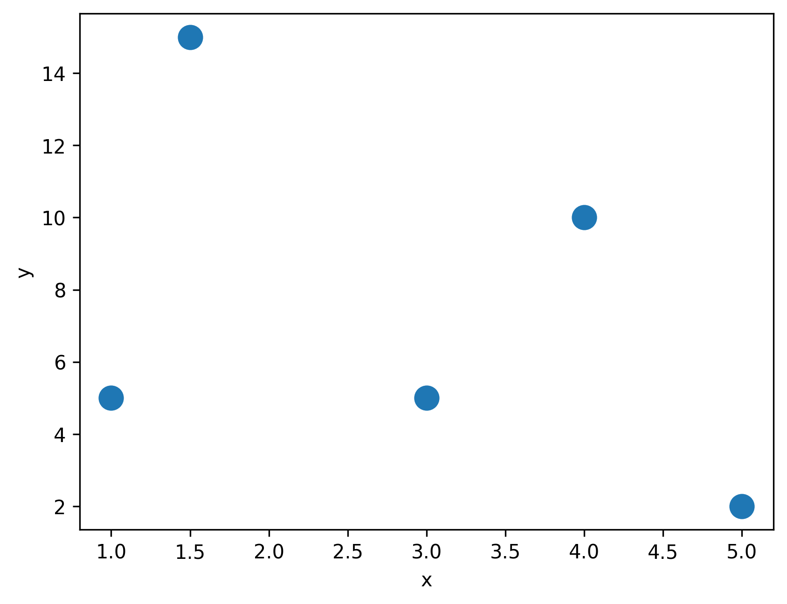
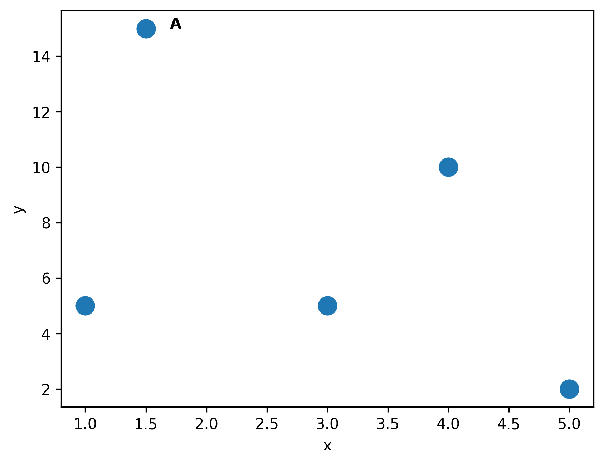
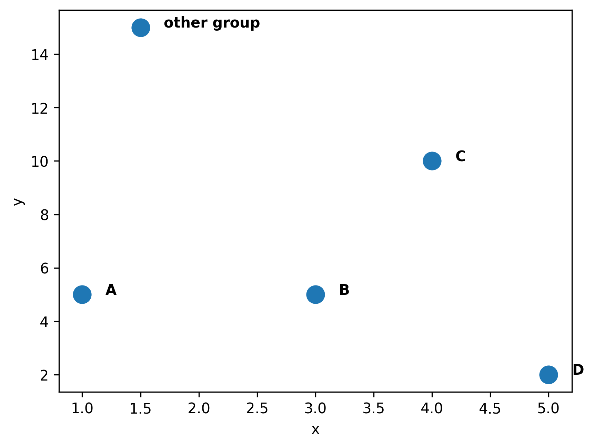

## Basic scatterplot

You can create a [basic scatterplot](http://python-graph-gallery.com/40-basic-scatterplot-seaborn/) using `regplot()` function of [seaborn](http://python-graph-gallery.com/seaborn/) library. The following parameters should be provided:

- `data` : dataset
- `x` : positions of points on the X axis
- `y` : positions of points on the Y axis
- `fit_reg` : if True, show the linear regression fit line
- `marker` : marker shape
- `color` : the color of markers

```python
import pandas as pd
import numpy as np
import matplotlib.pylab as plt
import seaborn as sns
 
# Create dataframe
df = pd.DataFrame({
'x': [1, 1.5, 3, 4, 5],
'y': [5, 15, 5, 10, 2],
'group': ['A','other group','B','C','D']
})
 
sns.scatterplot(data=df, x="x", y="y", s=200)

plt.show()
```

:::output

:::

## Add one annotation

Once you have created the dataset and plotted the scatterplot with the previous code, you can use `text()` function of matplotlib to add annotation. The following parameters should be provided:

- `x` : the position to place the text in x axis
- `y` : the position to place the text in y axis
- `s`: the text

You can also specify the additional parameters such as `horizontalalignment`, `size`, `color`, `weight` to design your text.

```python
import pandas as pd
import numpy as np
import matplotlib.pylab as plt
import seaborn as sns
 
# Create dataframe
df = pd.DataFrame({
'x': [1, 1.5, 3, 4, 5],
'y': [5, 15, 5, 10, 2],
'group': ['A','other group','B','C','D']
})
 
sns.scatterplot(data=df, x="x", y="y", s=200)
plt.text(x=1.7, y=15, s="A", weight="bold")

plt.show()
```

:::output

:::

## Use a loop to annotate each marker

If you want to annotate every markers, it is practical to use a loop as follow:

```python
import pandas as pd
import numpy as np
import matplotlib.pylab as plt
import seaborn as sns
 
# Create dataframe
df = pd.DataFrame({
'x': [1, 1.5, 3, 4, 5],
'y': [5, 15, 5, 10, 2],
'group': ['A','other group','B','C','D']
})
 
sns.scatterplot(data=df, x="x", y="y", s=200)

# add annotations one by one with a loop
for line in range(0,df.shape[0]):
     plt.text(
          df["x"][line]+0.2,
          df["y"][line],
          df["group"][line],
          ha='left',
          weight='bold'
     )

plt.show()
```

:::output

:::

## Going further

This post explains how to customize the **appearance of the markers** in a [scatter plot](/scatter-plot) with [seaborn](/seaborn).

You might be interested in:

- [customize annotation in matplotlib](/matplotlib#Annotation)
- how to create a [bubble plot](/bubble-plot), a kind of scatter plot where the size of the marker is **proportional to a third variable**
- how to [colors dots according to a variable](/43-use-categorical-variable-to-color-scatterplot-seaborn).
