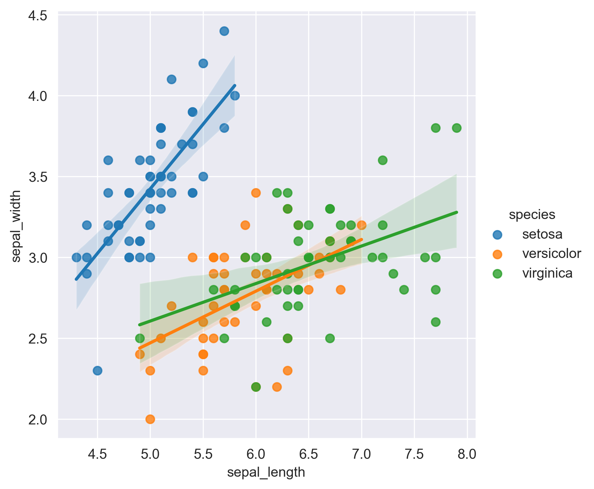
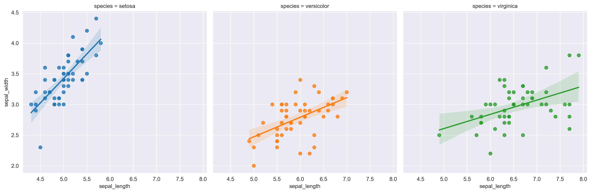
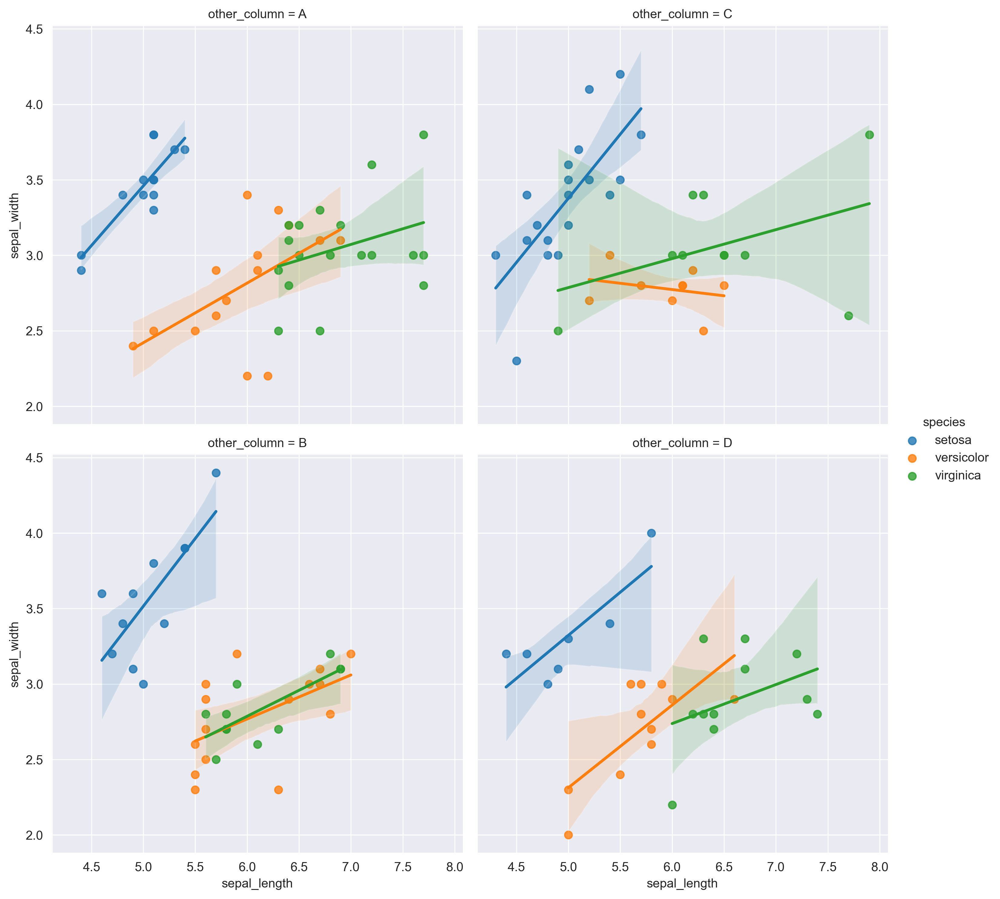

## Libraries

First, we need to load a few libraries:

- [seaborn](https://python-graph-gallery.com/seaborn/): for creating the scatterplot
- [matplotlib](https://python-graph-gallery.com/matplotlib/): for displaying the plot
- [pandas](https://python-graph-gallery.com/pandas/): for data manipulation

```python
import pandas as pd
import matplotlib.pyplot as plt
import seaborn as sns

sns.set_style("darkgrid")
```

## Dataset

Since [scatter plot](https://python-graph-gallery.com/scatter-plot/) are made for visualizing **relationships between two numerical variables**, we need a dataset that contains at least two numerical columns.

Here, we will use the `iris` dataset that we **load** directly from the gallery:

```python
path = 'https://raw.githubusercontent.com/holtzy/The-Python-Graph-Gallery/master/static/data/iris.csv'
df = pd.read_csv(path)
df.head()
```

:::output
::output-html{src="./output-1.html"}
:::

## Simple splitting with a categorical variable

The `lmplot()` function requires the following 4 arguments to create a faceted scatterplot:

- `x` : column of the variable for the **x** axis
- `y`: column of the variable for the **y** axis
- `hue`: column of the variable for the **facet**.
- `data` : **data frame** with all columns

```python
sns.lmplot(
    x="sepal_length",
    y="sepal_width",
    data=df,
    hue="species",
)
plt.show()
```

:::output

:::

## Multiple subplots

You can also use the `col` argument and assign it the same value as the `hue` to create **subplots** instead of a single one:

```python
sns.lmplot(
    x="sepal_length",
    y="sepal_width",
    data=df,
    hue="species",
    col="species"
)
plt.show()
```

:::output

:::

## Split with a 4th column

You can also custom the **line width** and **style** with the `linewidth` and `linestyle` values:

```python
import numpy as np
df["other_column"] = np.random.choice(['A', 'B', 'C', 'D'], size=len(df))

sns.lmplot(
    x="sepal_length",
    y="sepal_width",
    data=df,
    hue="species",
    col="other_column",
    col_wrap=2 # maximum of 2 columns
)
plt.show()
```

:::output

:::

## Going further

This post explains how to customize the **appearance of a regression fit** in a [scatter plot](/scatter-plot) with [seaborn](/seaborn).

You might be interested in more advanced examples on:

- [how to better visualize linear regression](/556-visualize-linear-regression/)
- [how to color points according to a third variable](/43-use-categorical-variable-to-color-scatterplot-seaborn/).
- [discover more marker customization](/41-control-marker-features).
