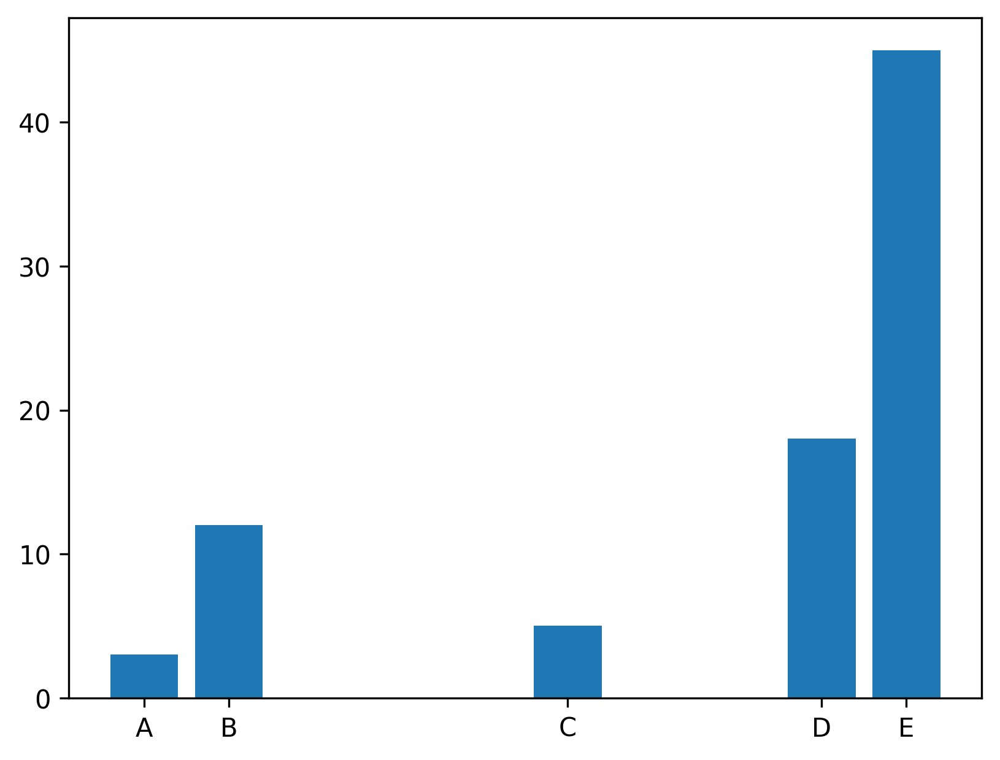
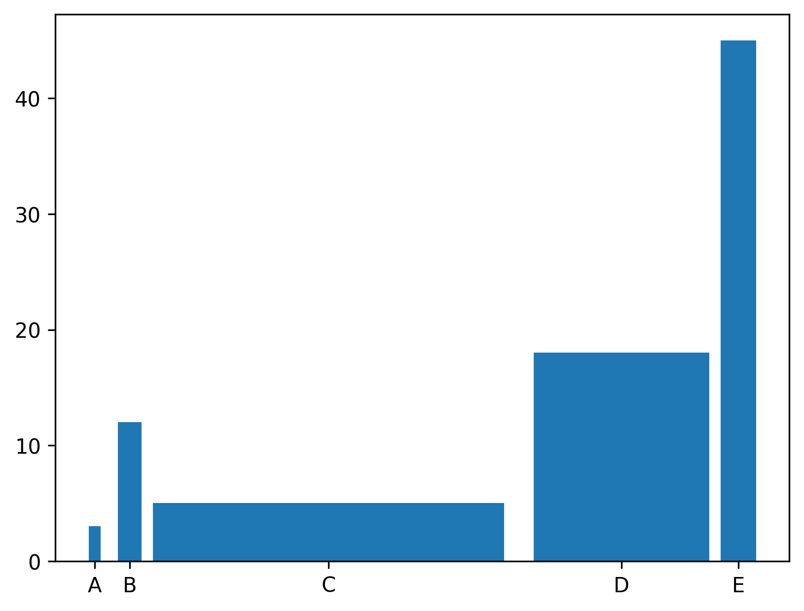

## Control Space

In order to control the space between bars, you can specify the positions of bars in the x axis. This way, you will be able to control the spaces.

```python
# library
import matplotlib.pyplot as plt
 
# create dataset
height = [3, 12, 5, 18, 45]
bars = ('A', 'B', 'C', 'D', 'E')
 
# Choose the position of each barplots on the x-axis (space=1,4,3,1)
x_pos = [0,1,5,8,9]
 
# Create bars
plt.bar(x_pos, height)
 
# Create names on the x-axis
plt.xticks(x_pos, bars)
 
# Show graphic
plt.show()
```

:::output

:::

## Control Width

The width of the bars can be controlled by `width` argument of the `bar()` function.

```python
# library
import matplotlib.pyplot as plt
 
# create dataset
height = [3, 12, 5, 18, 45]
bars = ('A', 'B', 'C', 'D', 'E')

# Choose the width of each bar and their positions
width = [0.1,0.2,3,1.5,0.3]
x_pos = [0,0.3,2,4.5,5.5]
 
# Make the plot
plt.bar(x_pos, height, width=width)

# Create names on the x-axis
plt.xticks(x_pos, bars)
 
# Show graphic
plt.show()
```

:::output

:::
