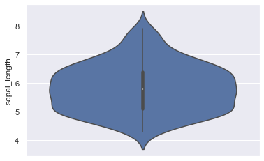
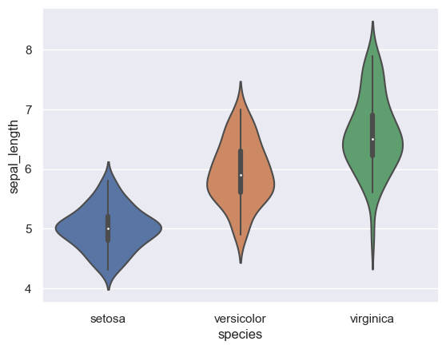
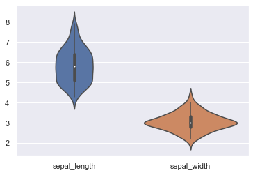

## One numerical variable only

If you have only one numerical variable, you probably better have to make an [histogram](http://python-graph-gallery.com/histogram/) or a [density plot](http://python-graph-gallery.com/density-plot/). But you can still use the violinplot function to describe the distribution of this variable, as follows:

```python
# libraries & dataset
import seaborn as sns
import matplotlib.pyplot as plt

sns.set_theme(style="darkgrid")
df = sns.load_dataset('iris')

# Make boxplot for one group only
sns.violinplot(y=df["sepal_length"])
plt.show()
```

:::output

:::

## One variable and several groups

Usually, [violinplots](http://python-graph-gallery.com/violin-plot/) are used in cases similar to [boxplots](http://python-graph-gallery.com/boxplot/): when you have one numerical variable and several groups. It allows to **compare distributions** from one group to another.

One usually works with two columns, one giving the value of the variable, the other one the group:

```python
# libraries & dataset
import seaborn as sns
import matplotlib.pyplot as plt

sns.set_theme(style="darkgrid")
df = sns.load_dataset('iris')

# plot
sns.violinplot(x=df["species"], y=df["sepal_length"])
plt.show()
```

:::output

:::

## Several variables

[Violinplots](http://python-graph-gallery.com/violin-plot/) are also useful to compare several variables. In the iris dataset, we can compare the first 2 numerical variables:

```python
# libraries & dataset
import seaborn as sns
import matplotlib.pyplot as plt

sns.set_theme(style="darkgrid")
df = sns.load_dataset('iris')

# plot
sns.violinplot(data=df.iloc[:, 0:2])
plt.show()
```

:::output

:::

## Going further

This post explains how to build a [violinplot](/violin-plot) with [seaborn](/seaborn).

You might be interested in how to create a [violin plot with boxplots on top of it](/web-ggbetweenstats-with-matplotlib) and how to [add a beeswarm plot](/502-violinplot-and-swarmplot).
