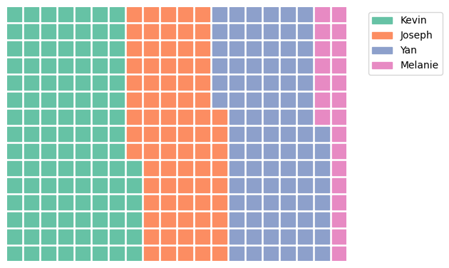
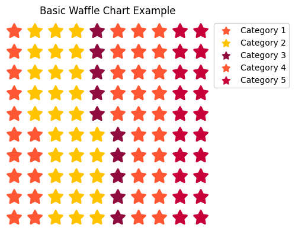
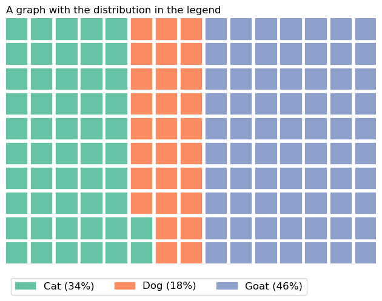

## The PyWaffle library

A waffle chart is a visual representation of data where individual squares are used to depict the proportion or distribution of categorical variables, with the total number of squares forming a grid-like pattern resembling a waffle. It has the same goal than a [treemap](https://python-graph-gallery.com/treemap/) or a pie chart.


This post relies on the [PyWaffle library](https://github.com/gyli/PyWaffle), that is definitely the best way to create a waffle chart with Python.

The very first thing to do is to install the library:

`pip install pywaffle`

We can now import the necessary libraries:

```python
import matplotlib.pyplot as plt
from pywaffle import Waffle
```

## The data

Let's create a dummy dataset for our first waffle chart. Your data can be a list of integers, a dictionary with labels as keys and integers as values or a pandas dataframe.

```python
# create simple dummy data
data = {'Kevin': 10, 'Joseph': 7, 'Yan': 8, 'Melanie': 2}
```

## First waffle chart

The waffle chart can now be created using the `Waffle` class and the `figure` method. With the `rows` and `columns` arguments you can specify the number of rows and columns you want your waffle to have. By default, the number of squares in the grid adapts to your number of rows/columns.

```python
plt.figure(
    FigureClass=Waffle,
    rows=15,
    columns=20,
    values=data,
    legend={'loc': 'upper left', 'bbox_to_anchor': (1.05, 1)},
)
plt.show()
```

:::output

:::

## Basic customizations

- colors: the `colors` argument changes the color of the grids and must be a list of colors of the same lenght than your number of categories 
- icons: the `icons` argument changes the shape of the grids and can be a list of icons

```python
# Data for the waffle chart
data = {'Category 1': 15,
        'Category 2': 30,
        'Category 3': 10,
        'Category 4': 25,
        'Category 5': 20}

# Total number of icons in the waffle chart
total_icons = sum(data.values())

# Create a waffle chart
fig = plt.figure(
    FigureClass=Waffle,
    rows=10,  # Adjust rows to change the height of the waffle chart
    values=data,
    icons='star',  # You can use different icons like 'circle', 'diamond', 'square', 'hexagon', etc.
    colors=["#FF5733", "#FFC300", "#900C3F", "#FF5733", "#C70039"], # Replace with your colors
    legend={'loc': 'upper left', 'bbox_to_anchor': (1, 1)},
    icon_legend=True,
    figsize=(8, 4),  # Adjust figsize to change the width of the waffle chart
    font_size = 18   # Size of the grids
)

# Add a title
plt.title("Basic Waffle Chart Example")

# Display the chart
plt.show()
```

:::output

:::

## Add the repartition of each category

You might want to display the real repartition of the categories. To do this, you need to calculate the proportions in each category and add them to the legend.

```python
# Dummy data
data = {'Cat': 30, 'Dog': 16, 'Goat': 40}

# Repartition 
repartition = [f"{k} ({int(v / sum(data.values()) * 100)}%)" for k, v in data.items()]

# Make the chart
fig = plt.figure(
    FigureClass=Waffle,
    rows=10,
    columns=15,
    values=data,
    title={
        'label': 'A graph with the distribution in the legend',
        'loc': 'left',
        'fontdict': {
            'fontsize': 12
        }
    },
    labels=repartition,
    legend={
        'loc': 'lower left',
        'bbox_to_anchor': (0, -0.15), # position of the legend
        'ncol': len(data), # number of columns in the legend
        'fontsize': 12 #size of the legend
    }
)
```

:::output

:::
