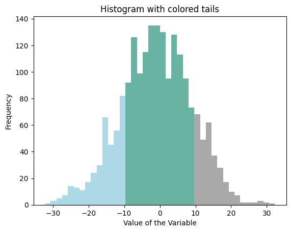

## Libraries

The following example is based on 2 libraries: 

- [matplotlib](http://python-graph-gallery.com/matplotlib/) is used for its `bar()` function and to customize the final chart.
- `numpy` is used to create a dummy dataset and to __create bins__ from it.

You can load those libraries as follow once they've been installed:

```python
# Import libraries
import numpy as np
import matplotlib.pyplot as plt
```

## Dataset

Let's use the `random.normal()` function of `numpy` to create a set of numeric values that follow a normal distribution. This function expects 3 arguments: 

- `loc`: the mean (or center) of the distribution
- `scale`: the standard deviation of the distribution
- `size`: the number of random numbers you want to generate

```python
# Generate some random data (replace with your data)
my_variable = np.random.normal(0, 10, 2000)
```

Now, let's bin a draw the histogram from this dataset.

## Binning the dataset

We now need to create __bins__ from this dataset. Each bin will become a __bar__ of the histogram.

`np.histogram` is a `NumPy` function used to do exactly this. It takes an array of data and a specified number of bins as input and returns two arrays: the __bin edges__ and the __counts of data points__ that fall into each bin, allowing for easy visualization of data distribution.

Let's see it in action:

```python
# Compute the histogram of `my_variable` with 40 bins and get the bin edges
my_hist, bin_edges = np.histogram(my_variable, bins=40)
```

## Set the color of each bins

We use a `for` loop that iterates over all our bins and assigns them a color according to their edges. The tails are defined using the `lower_bound` and `upper_bound` thresholds. 

Don't forget to modify them according to your use-case.

```python
# Define color thresholds
lower_bound = -10
upper_bound = 10

# Define colors for tails and center
lower_tail_color = "lightblue"
hist_center_color = "#69B3A2"
upper_tail_color = "darkgray"
    
# Init the list containing the color of each bin.
colors = []

for bin_edge in bin_edges:
    
    # Light blue: Assign a color to the bin if its edge is less than 'lower_bound'
    if bin_edge < lower_bound:
        colors.append(lower_tail_color)
    
    # Dark gray: Assign a color to the bin if its edge is greater than or equal to 'upper_bound'
    elif bin_edge >= upper_bound:
        colors.append(upper_tail_color)  
    
    # Purple: Assign a color to the bin if its edge is between -10 and 10
    else:
        colors.append(hist_center_color)
```

## Histogram with colored tails

Finally!

Everything is now ready to build the histogram.

The `bar()` function of matplotlib does most of the work. You can check the barplot section of the gallery to understand more of it works. What's important here is to note that our list of colors (`colors`) that we made in the previous section is used for the `color` argument.

It is also interesting to note that this example does not use the `hist` function of matplotlib. Indeed, using the `bar` function is more convenient for fine grain control of bars.

```python
# Create a bar plot with specified colors and bin edges
plt.bar(
    bin_edges[:-1], 
    my_hist, 
    width=np.diff(bin_edges), 
    color=colors, 
    edgecolor='none'
) 

# graph customization
plt.title('Histogram with colored tails')  # Set the title of the plot
plt.xlabel('Value of the Variable')  # Set the label for the x-axis
plt.ylabel('Frequency')  # Set the label for the y-axis
plt.show()  # Display the plot
```

:::output

:::

## Going further
This post explained how to create a histogram with colored tails using [matplotlib](https://python-graph-gallery.com/matplotlib/). 

For more examples of how to customize your histogram, check the [histogram section](https://python-graph-gallery.com/histogram/). You might be interested in how to make a histogram with [seaborn](https://python-graph-gallery.com/20-basic-histogram-seaborn/) for a better looking chart or even how to show several distribution with a [mirror histogram](https://python-graph-gallery.com/density-mirror/).
