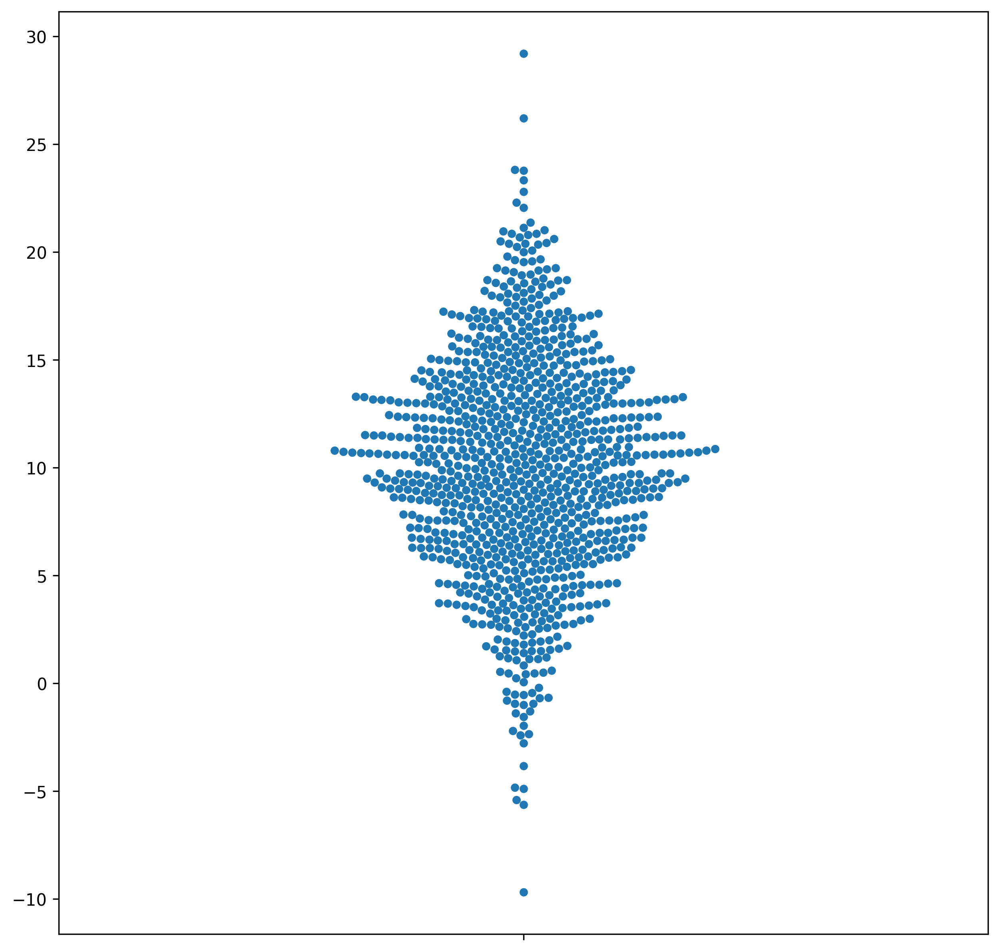
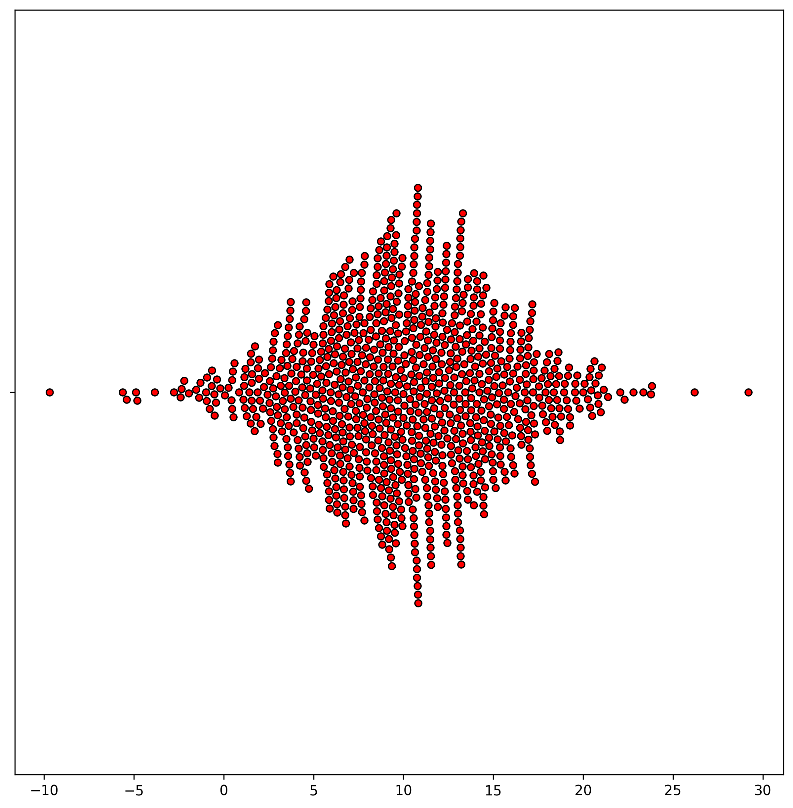
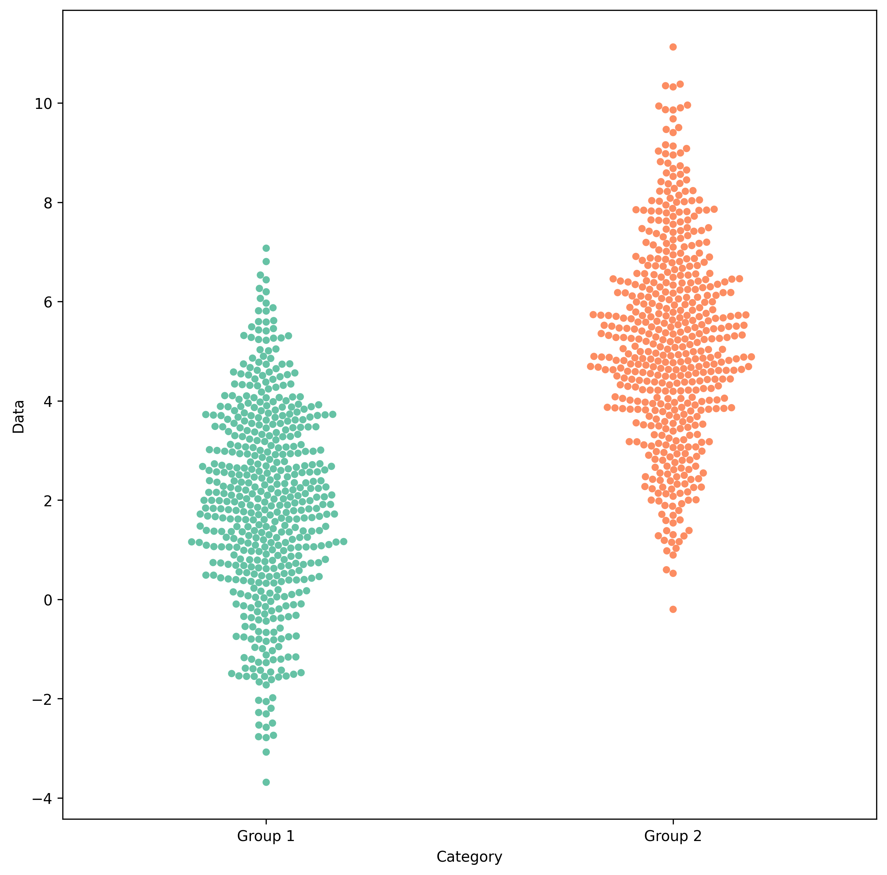
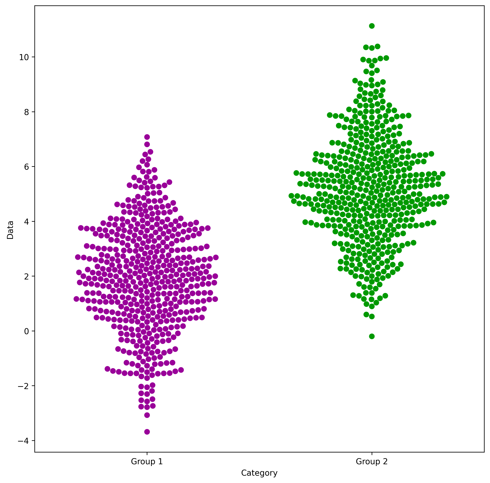

## Beeswarm definition

Imagine you want to know how your friends' height is distributed.

To do this, you can use a **swarm plot**, which is a visual way of seeing individual data points (in this case, the height of your friends) and how they are **distributed**.

Circles are slightly **shifted** to avoid **overlaps**. It ends up in a neat organic shape that is visually attracting and avoids to hide information. It allows you to quickly understand the **extent** and **distribution** of data without losing any information.

You can read more about beeswarm in the [dedicated section](https://python-graph-gallery.com/beeswarm/) of the gallery.

## Libraries

First, you need to install the following librairies:

- [seaborn](https://python-graph-gallery.com/seaborn/) is used for creating the chart witht the `swarmplot()` function
- [matplotlib](https://python-graph-gallery.com/matplotlib/) is used for plot customization purposes
- `numpy` is used to generate some data

Don't forget to install seaborn if you haven't already done so with the `pip install seaborn` command.

```python
# Libraries
import seaborn as sns
import matplotlib.pyplot as plt
import numpy as np

plt.rcParams["figure.dpi"] = 300
```

## Dataset

Since beeswarm plots are meant to represent continuous variables, let's generate a sample of 100 randomly distributed observations using numpy and its `random.normal()` function. Our sample is generated with a **mean** of 10 and a **standard deviation** of 5.

```python
my_variable = np.random.normal(loc=10, scale=5, size=1000)
```

## Basic beeswarm plot

The following code displays a simple bee swarm graphic, with a title and an axis name, thanks to the `swarmplot()` function.

Note that circles are displayed vertically since the numeric vector is passed to the `y` axis.

That's it! A first beeswarm plot made with the default parameters.

```python
fig, ax = plt.subplots(figsize=(10, 10))

sns.swarmplot(y=my_variable, ax=ax)

plt.show()
```

:::output

:::

## Color and orientation

### Modify the colors

The following code uses the `color`, `edgecolor` and `linewidth` arguments to modify the style of points.

- `color` defines the point color
- `edgecolor` defines the color of the edge color
- `linewidth` defines the the edge size. The edgecolor will not appear if you don't explicit the latter argument since its default value is 0.

### Use another orientation

If you want to show your variable distribution on a given axis, you just have to put `x=my_variable` for the x-axis or `y=my_variable` for the y-axis. It's that simple, allowing to switch from a horizontal to a vertical beeswarm chart.

```python
fig, ax = plt.subplots(figsize=(10, 10))

sns.swarmplot(
    x=my_variable,
    ax=ax,
    color="red",  # Point color
    edgecolor="black",  # Edge color
    linewidth=0.9,  # Edge size
)
plt.show()
```

:::output

:::

## Beeswarm with multiple groups

### Dataset

First, we need to create data with 2 groups. To do this, we take the following steps:

- Define the sample size per group. Given that we have two groups, there will be 100 people in each, for a total of 200.
- Create the data for each group (here, we give them a different mean with `loc=0` VS `loc=2`, in order to have sufficiently different groups)
- Create the list containing the group name for each observation

```python
sample_size = 500  # Define the size of the random data samples.

data_group1 = np.random.normal(
    loc=2, scale=2, size=sample_size
)  # Generate data points for 'Group 1'
data_group2 = np.random.normal(
    loc=5, scale=2, size=sample_size
)  # Generate data points for 'Group 2'
data_combined = np.concatenate(
    [data_group1, data_group2]
)  # Concatenate the data to create a combined dataset

category_feature = ["Group 1"] * sample_size + [
    "Group 2"
] * sample_size  # List that indicates the category for each data point
```

### Plot

This time, both the `x` and `y` attributes must be provided. Also, it is common to use a categorical color sheme to color groups thanks to the `palette` argument to color groups.

```python
fig, ax = plt.subplots(figsize=(10, 10))

sns.swarmplot(
    x=category_feature,  # Group labels
    ax=ax,
    y=data_combined,  # Numeric variable
    palette="Set2",  # Color set used
    hue=category_feature,  # Add a legend
)

plt.xlabel("Category")
plt.ylabel("Data")
plt.show()
```

:::output

:::

## Customize palette

Thanks to the [pypalettes library](/color-palette-finder), it's super easy to use a large number of palette in your seaborn/matplotlib charts. You can find your dream palette in the [color palette finder](/color-palette-finder), and use the `load_cmap()` function with the name of the palette you want. Here is an example with the `classic` palette:

```python
from pypalettes import load_palette

fig, ax = plt.subplots(figsize=(10, 10))

# load a palette
palette = load_palette("classic")

sns.swarmplot(
    x=category_feature,  # Group labels
    ax=ax,
    y=data_combined,  # Numeric variable
    palette=palette,  # Color set used
    hue=category_feature,  # Add a legend
    size=7,
)

plt.xlabel("Category")
plt.ylabel("Data")
plt.show()
```

:::output

:::

## Going further

That's it for a quick **introduction** to beeswarm plot with seaborn.

Please check the [beeswarm section](https://python-graph-gallery.com/beeswarm/) of the gallery to see many more examples with higher levels of **customization**.
