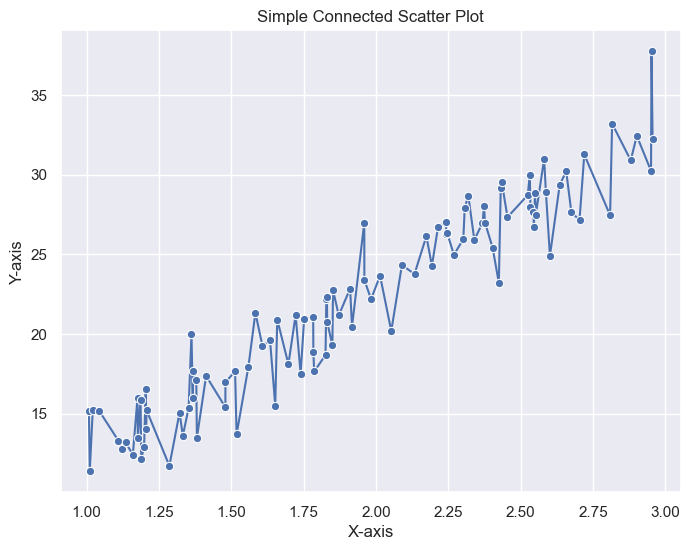
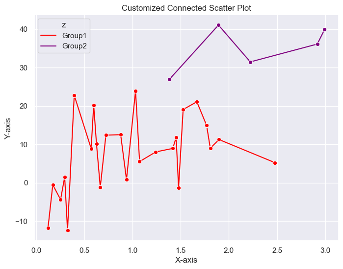
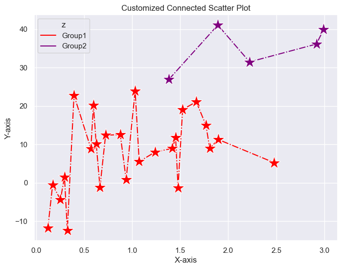
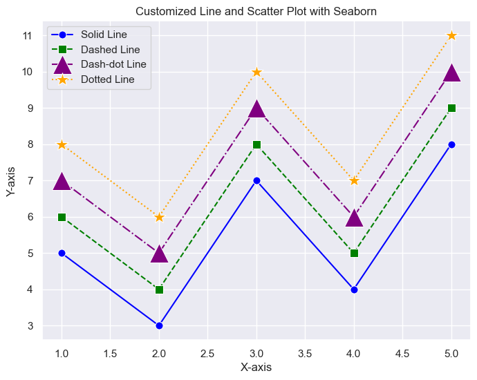

## About scatter plots

### Simple scatter plot

A `simple scatter plot` is a graphical representation that displays **individual data points as dots on a two-dimensional plane**. Each dot represents a single observation or data point, and its position on the plot corresponds to the values of two variables. 

### Connected scatter plot

A `connected scatter plot`, also known as a line plot with markers, is similar to a simple scatter plot but with the addition of **lines connecting the data points in the order they appear**. This type of plot is often used to visualize the temporal or sequential relationships between two variables.

## Libraries

First, you need to install the following librairies:
- [seaborn](https://python-graph-gallery.com/seaborn/) is used for creating the chart witht the `lineplot()` function
- [matplotlib](https://python-graph-gallery.com/matplotlib/) is used for plot customization purposes
- `numpy` is used to generate some data
- `pandas` is used to store the data generated with numpy

Don't forget to install seaborn if you haven't already done so with the `pip install seaborn` command.

```python
# Use the darkgrid theme for seaborn
import seaborn as sns
sns.set_theme(style="darkgrid")

import matplotlib.pyplot as plt
import numpy as np
import pandas as pd
```

## Dataset

For scatter plot, we need **2 numeric variables**. We randomly generate these variables thanks to numpy's `random.uniform()` and `random.normal()` function that, respectively, generate uniformly and normally distributed data.

```python
# Generate random numeric values, where y is a function of x
x = np.random.uniform(3,1,100)
y = x * 10 + np.random.normal(3,2,100)

data = {'x': x,
        'y': y,
        }
df = pd.DataFrame(data)
```

## Basic connected scatter plot

The following code displays a **simple connected scatter plot**, with a title and an axis name, thanks to the `lineplot()` function from [Seaborn](https://python-graph-gallery.com/seaborn/).

```python
plt.figure(figsize=(8, 6)) # Width and Height of the chart
sns.lineplot(x='x',
             y='y',
             data=df,
             marker='o', # Style used to mark the join between 2 points
            )
plt.xlabel('X-axis') # x-axis name
plt.ylabel('Y-axis') # y-axis name
plt.title('Simple Connected Scatter Plot') # Add a title
plt.show() # Display the graph
```

:::output

:::

## Customization features

### Display multiple lines on the same graph

To our previous dataset, we add a **3rd variable** which will be categorical, named `z`. It will be used to separate our observations according to their label in this variable. In practice, just add `hue='z'` (or the **name of the variable** you want to use to divide the rows) when using the `lineplot` function. 
 
### Specify your own colors

You can use the `palette` parameter to specify **your own colors** for lines. If you want a specific color for each group, I recommend **using a dictionary** with *label as key* and *color as value* (which is what we do in the following example). But it's also possible to **make a list of colors** (however, it must be the same length as the number of distinct labels in `z`).

```python
# Generate random numeric values, where y is a function of x
x = np.random.uniform(3,0.1,30)
y = x * 10 + np.random.normal(3,10,30)
z = ['Group1' if i < 25 else 'Group2' for i in y] # Categorical variable

data = {'x': x,
        'y': y,
        'z': z,
        }
df = pd.DataFrame(data)
```

```python
plt.figure(figsize=(8, 6)) # Width and Height of the chart
sns.lineplot(x='x',
             y='y',
             hue='z', # Create 2 line plots according to labels in 'z'
             data=df,
             marker='o', # Style used to mark the join between 2 points
             palette={'Group1':'red',
                      'Group2':'purple'}, # Colors of the lines
            )
plt.xlabel('X-axis') # x-axis name
plt.ylabel('Y-axis') # y-axis name
plt.title('Customized Connected Scatter Plot') # Add a title
plt.show() # Display the graph
```

:::output

:::

## Customize lines and markers

You can also customize markers and lines, thanks to several arguments.
- `marker`: the style of the marker (**must be** in the following list: `o`, `s`, `d`, `^`, `v`, `<`, `>`, `p`, `*`, `+`, `x`, `h`)
- `markersize`: marker size
- `linestyle`: the style of the line (**must be** in the following list: `-`, `--`, `-.`, `:`, `None`)

```python
plt.figure(figsize=(8, 6)) # Width and Height of the chart
sns.lineplot(x='x',
             y='y',
             hue='z', # Create 2 line plots according to labels in 'z'
             data=df,
             marker='*', # Style used to mark the join between 2 points
             markersize=20, # Size of the marker
             palette={'Group1':'red',
                      'Group2':'purple'}, # Colors of the lines,
             linestyle='-.', # Style used for the lines
            )
plt.xlabel('X-axis') # x-axis name
plt.ylabel('Y-axis') # y-axis name
plt.title('Customized Connected Scatter Plot') # Add a title
plt.show() # Display the graph
```

:::output

:::

## A complete example that covers all the previous concepts

To give you some ideas for customization, here's a **complete example of a connected scatter plot** using the same concepts as above.

```python
# Sample data
x = [1, 2, 3, 4, 5]
y = [5, 3, 7, 4, 8]

# Set Seaborn style
plt.figure(figsize=(8, 6))

# Solid line with circle markers
sns.lineplot(x=x, y=y, linestyle='-', marker='o', markersize=8, label='Solid Line', color='blue') 

# Dashed line with square markers
sns.lineplot(x=x, y=[i + 1 for i in y], linestyle='--', marker='s', markersize=8, label='Dashed Line', color='green') 

# Dash-dot line with triangle up markers
sns.lineplot(x=x, y=[i + 2 for i in y], linestyle='-.', marker='^', markersize=20, label='Dash-dot Line', color='purple') 

# Dotted line with asterisk markers
sns.lineplot(x=x, y=[i + 3 for i in y], linestyle=':', marker='*', markersize=15, label='Dotted Line', color='orange') 

plt.title('Customized Line and Scatter Plot with Seaborn') # Add a title
plt.xlabel('X-axis') # x-axis name
plt.ylabel('Y-axis') # x-axis name
plt.legend(loc='upper left') # Add a legend
plt.show() # Display the graph
```

:::output

:::

## Going further

This post explained how to create a [connected scatter plot](https://python-graph-gallery.com/connected-scatter-plot/) with different customization features using Python and its [Seaborn](https://python-graph-gallery.com/seaborn/) library.

For more examples of **how to create or customize** your scatter plots with Python, check the [scatter plot section](https://python-graph-gallery.com/scatter-plot/). You might be interested in how to make a [scatter plot with a linear regression](https://python-graph-gallery.com/scatterplot-with-regression-fit-in-matplotlib/) on it.
