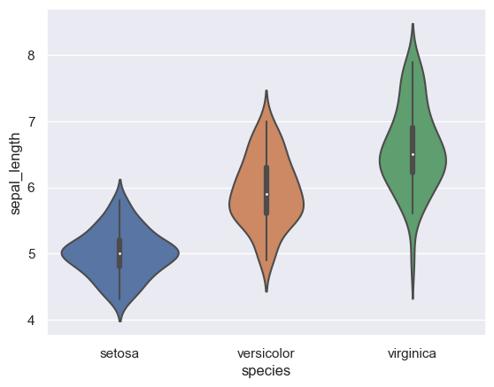
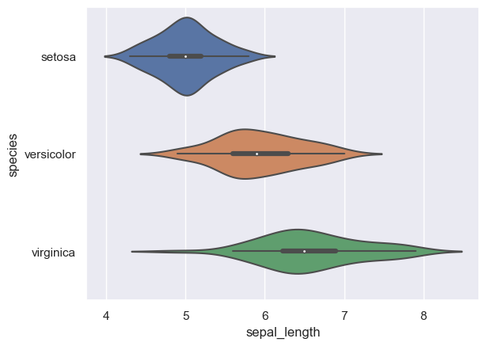

## Libraries

First, you need to install the following librairies:
- [seaborn](https://python-graph-gallery.com/seaborn/) is used for creating the chart
- [matplotlib](https://python-graph-gallery.com/matplotlib/) is used for customization

```python
import seaborn as sns
import matplotlib.pyplot as plt
```

## Dataset

The dataset we will use is the **iris dataset**, which we can easily download with [seaborn](https://python-graph-gallery.com/seaborn/):

```python
df = sns.load_dataset('iris')
```

## Violin plot

Fortunately, it's a very **light syntax** to create a [violin plot](https://python-graph-gallery.com/violin-plot/) with seaborn thanks to the `violinplot()` function:

```python
  
sns.set_theme(style="darkgrid")
 
# Just switch x and y
sns.violinplot(x=df["species"], y=df["sepal_length"])
plt.show()
```

:::output

:::

## Flipped violin plot

**Flipping this graph** is actually quite simple, as all you have to do is **exchange** the arguments `x` and `y`.

```python
  
sns.set_theme(style="darkgrid")
 
# Just switch x and y
sns.violinplot(y=df["species"], x=df["sepal_length"])
plt.show()
```

:::output

:::

## Going further

This post explains how to create a horizontal violin plot with [seaborn](https://python-graph-gallery.com/seaborn/).

For more examples of **how to create or customize** your violin plots, check the [violin plot section](https://python-graph-gallery.com/violin-plot/). You may also be interested in how to [customize a violin plot](https://python-graph-gallery.com/52-custom-seaborn-violinplot/).
