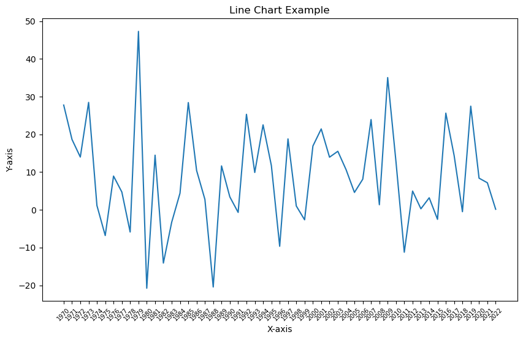
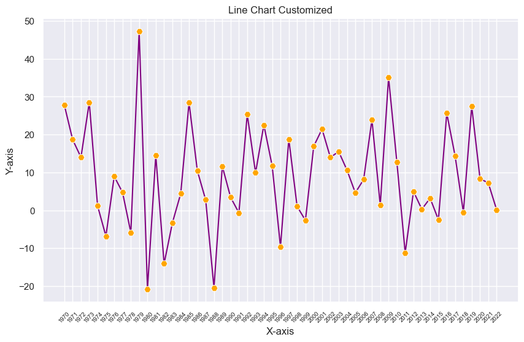
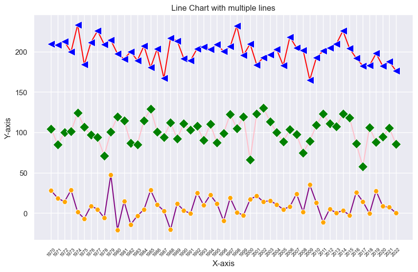

## About line chart

A [line chart](https://python-graph-gallery.com/line-chart/) is a type of visual representation that uses a series of points connected by lines to show how data changes over time. It's like connecting the dots on a graph to reveal **trends and patterns**. [Line charts](https://python-graph-gallery.com/line-chart/) are useful for tracking things that happen over a period, such as temperature changes, stock prices, or your savings in a piggy bank. They help us **quickly see** if something goes up, down, or stays steady as time passes, making it easier to understand **how things are changing** and make informed decisions.

## Libraries

First, you need to install the following librairies:
- [seaborn](https://python-graph-gallery.com/seaborn/) is used for creating the chart witht the `lineplot()` function
- [matplotlib](https://python-graph-gallery.com/matplotlib/) is used for plot customization purposes
- `numpy` is used to generate some data
- `pandas` is used to put the data into a dataframe

Don't forget to install seaborn if you haven't already done so with the `pip install seaborn` command.

```python
# Libraries
import seaborn as sns
import matplotlib.pyplot as plt
import numpy as np
import pandas as pd
```

## Dataset

[Line chart](https://python-graph-gallery.com/line-chart/) are generally used to represent **variations over time**, but they don't have to be. For example, you can look at [connected scatter plots](https://python-graph-gallery.com/connected-scatter-plot/). 

In our case, however, we need to generate dates. To do this, we will simply use a `for` loop and generate annual data, *from 1970 to 2022*. 

Then we generate random values using `np.random.normal()` function from `numpy` (We're doing this **three times** because we'll be displaying several variables in a single graph at the end).

```python
# Init an empty list that will stores the dates
dates = []

# Iterates over our range and add the value to the list
for date in range(1970,2023):
    dates.append(str(date))
    
# Generate random values with different mean and standard deviation
sample_size = 2023-1970
variable1 = np.random.normal(10, 15, sample_size)
variable2 = np.random.normal(100, 15, sample_size)
variable3 = np.random.normal(200, 15, sample_size)

df = pd.DataFrame({'date': dates,
                   'value1': variable1,
                   'value2': variable2,
                   'value3': variable3,})
```

## Basic line chart

The following code displays a simple [line chart](https://python-graph-gallery.com/line-chart/), with a title and an axis name, thanks to the `lineplot()` function from [seaborn](https://python-graph-gallery.com/seaborn/).

```python
# Set figure size
plt.figure(figsize=(10, 6))  

# Create line chart
sns.lineplot(x=df['date'],
             y=df['value1'])  

plt.title("Line Chart Example") # Title
plt.xlabel("X-axis") # x-axis name
plt.ylabel("Y-axis") # y-axis name

# Rotate x-axis labels to 45 degrees and reduce labels size
plt.xticks(rotation=45, fontsize=7)

# Display the plot
plt.show()
```

:::output

:::

## Add marker and change color

### Marker

You can use a variety of **markers** for your [line chart](https://python-graph-gallery.com/line-chart/).
They must belong to one of the following categories: `o`, `s`, `D`, `^`, `v`, `<`, `>`, `p`, `P`, `*`, `X`, `H`, `h`, `+`. 

### Change the color

If you want to **change the color of your line**, you just have to put `color='your_color'` when calling the `lineplot()` function. And if you want a different color for your markers, you add `markerfacecolor='your_other_color'`.

```python
# Add a grid in the background
sns.set_theme(style="darkgrid")  

# Set figure size
plt.figure(figsize=(10, 6))  

# Create line chart
sns.lineplot(x=df['date'],
             y=df['value1'],
             marker='H', # Type of marker
             markersize=8, # Size of the marker
             markerfacecolor='orange', # Color of the marker
             color='purple', # Color of the line (and marker)
            )  

plt.title("Line Chart Customized") # Title
plt.xlabel("X-axis") # x-axis name
plt.ylabel("Y-axis") # y-axis name

# Rotate x-axis labels to 45 degrees and reduce labels size
plt.xticks(rotation=45, fontsize=7)

# Display the plot
plt.show()
```

:::output

:::

## Line chart with multiple variables

It's quite common to want to have **several lines in a single graph**. In practice, all you need to do is write the `lineplot()` code several times.

```python
# Add a grid in the background
sns.set_theme(style="darkgrid")  

# Set figure size
plt.figure(figsize=(10, 6))  

# Create line chart
sns.lineplot(x=df['date'],
             y=df['value1'],
             marker='H', # Type of marker
             markersize=8, # Size of the marker
             markerfacecolor='orange', # Color of the marker
             color='purple', # Color of the line (and marker)
            )  

# Create line chart
sns.lineplot(x=df['date'],
             y=df['value2'],
             marker='D', # Type of marker
             markersize=10, # Size of the marker
             markerfacecolor='green', # Color of the marker
             color='pink', # Color of the line (and marker)
            ) 

# Create line chart
sns.lineplot(x=df['date'],
             y=df['value3'],
             marker='<', # Type of marker
             markersize=12, # Size of the marker
             markerfacecolor='blue', # Color of the marker
             color='red', # Color of the line (and marker)
            ) 

plt.title("Line Chart with multiple lines") # Title
plt.xlabel("X-axis") # x-axis name
plt.ylabel("Y-axis") # y-axis name

# Rotate x-axis labels to 45 degrees and reduce labels size
plt.xticks(rotation=45, fontsize=7)

# Display the plot
plt.show()
```

:::output

:::

## Going further

This article explains how to create a basic line chart with [seaborn](https://python-graph-gallery.com/seaborn/) with various customization features, such as changing color, overall style or display multiple lines. 

For more examples of **how to create or customize** your line charts with Python, see the [line chart section](https://python-graph-gallery.com/line-chart/). You may also be interested in creating an [area chart](https://python-graph-gallery.com/area-plot/).
